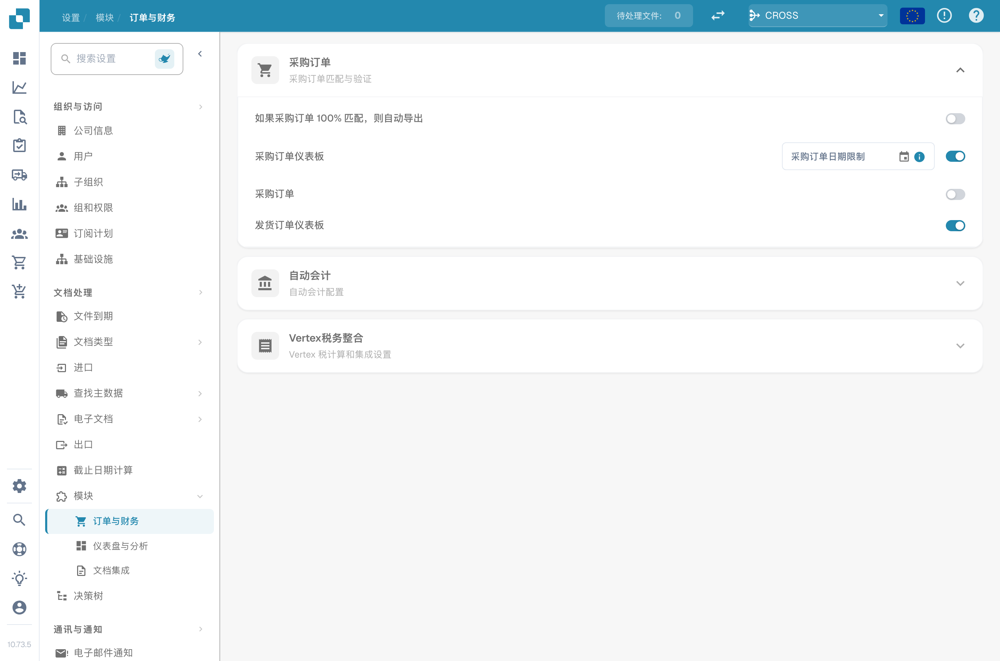

# 熟悉新版布局

本页可帮助你快速了解当前的 DocBits 布局——在哪里查找内容、导航如何运作，以及如何使用新的帮助功能。如果某个屏幕看起来和你记忆中的不同，或者你一时找不到某项设置，可以参考本页。

## 侧边栏

主侧边栏会列出你有权限使用的所有 DocBits 区域。你可以通过以下两种方式控制侧边栏：

* **迷你模式** — 点击侧边栏顶部的切换按钮，将其折叠为仅显示图标。将鼠标悬停在任意图标上即可查看标签。侧边栏会记住你上次选择的展开或折叠状态。
* **自定义** — 展开的侧边栏底部有一个 **Customize** 入口。你可以用它调整菜单顺序、隐藏不常用的入口，或固定最常打开的入口。

有关调整顺序、隐藏和固定入口的完整说明，请参阅[可自定义侧边栏](../../end-user-and-partner-section/end-user-section/customizable-sidebar.md)。

## 设置现在位于何处

“设置”菜单按用途分组，而不是按数据模型分组。如果你记得某项设置但找不到，可以尝试查看以下对应分组：

| 要查找的内容… | 打开“设置”→ |
|---|---|
| 公司名称、徽标、时区、应用颜色 | 公司与用户 → 公司信息 |
| 用户、组、权限 | 公司与用户 → 组、用户和权限 |
| API 密钥、ERP 连接、导出配置 | 集成 |
| 文档类型、字段、脚本、EDI、模型训练 | 文档类型 |
| OCR 设置、决策树、值列表、规则管理器 | 文档处理 |
| 访问审计、分析、全文索引、事件日志 | 日志与搜索 |
| 供应商门户、Watchdog | 设置 |

每个分组内的页面按使用频率排列，最常用的页面位于顶部附近。

## 较长的设置页面 — 锚点导航

包含多个区块的设置页面（例如“全局设置”或“文档类型”配置）会在页面标题区域显示锚点链接列表。点击锚点即可跳转到对应区块。滚动时，URL 会随之更新，因此可以复制或收藏指向特定区块的链接。

## 工作时查找文档 — 帮助图标

现在，大多数设置页面、对话框和工具界面的标题区域都会显示一个小小的 **?** 图标。

<figure><figcaption>
帮助图标会在新标签页中打开对应的文档页面。
</figcaption></figure>

点击该图标会在新标签页中打开 `docs.docbits.com` 上对应的页面，无需在文档中搜索合适的页面。该图标会根据你选择的界面语言打开相应的本地化文档；如果尚未发布该语言的文档，则会回退到英文版。

## 登录

登录屏幕、密码重置和 SSO 入口（Microsoft 365、Google、Infor OS）与 DocBits 的其他页面采用相同的布局。错误会直接显示在触发错误的字段下方；密码重置和帮助链接位于表单底部。操作流程与之前相同，只有布局发生了变化。

## 如果发现内容似乎缺失

如果某个页面或设置似乎已移动，而你找不到它：

1. 使用 <kbd>Cmd</kbd>/<kbd>Ctrl</kbd>+<kbd>K</kbd> 打开[全局快速搜索](../../end-user-and-partner-section/end-user-section/global-quick-search.md)，然后输入功能名称——快速搜索会索引应用中的所有页面。
2. 打开 `/sitemap` 上的[站点地图](../../end-user-and-partner-section/end-user-section/sitemap.md)，查看完整且可筛选的目录。
3. 使用最接近的屏幕上的帮助图标，跳转到相关文档。
