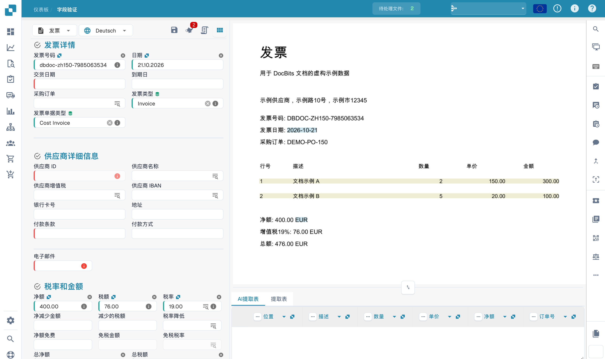
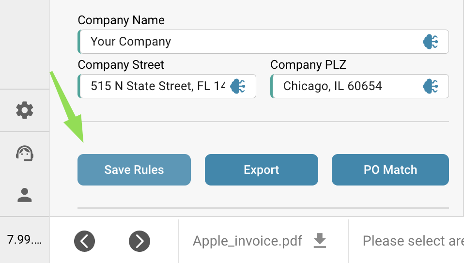

# 训练表头字段

上传文档后，您将进入验证界面。\
部分字段可能已自动填充，这要归功于 DocBits 的群体智能。不过，其他字段可能仍为空。这通常表示该文档类型尚未完成训练，因此 DocBits 还不知道应从哪里提取这些信息。

您可以手动标出正确的数据，帮助 DocBits 学习识别这些字段。 \
**请注意：**如果某个字段仍为空，也可能只是因为上传的文档中没有相关信息。

<figure><figcaption>
训练页眉字段前的虚构发票验证视图。
</figcaption></figure>

### 训练字段：

1. 点击要训练的字段。
2. 然后执行以下任一操作：
   * 在文档中对相关数据**双击**，或
   * 使用光标在数据周围**绘制选框**。

<figure><figcaption>
选择发票编号作为训练起点。
</figcaption></figure>

对所有必需字段重复此操作。\
填充完所有必要字段后，**点击“Save Rules”（保存规则）**以保存训练结果。这样，DocBits 就能学会如何在今后类似的文档中查找每项信息。

<figure><figcaption></figcaption></figure>

保存后，您的文档即可导出；下次 DocBits 将自动提取已训练的字段。

保存预期训练后，测试同一供应商的其他文档。能否导出还取决于验证结果和已配置的工作流。
