# 高级设置

在某些文档中，表格结构可能很复杂，例如跨越多行、包含分组信息或包含不必要的额外行。训练模式中的_高级设置_可以让您针对这些情况微调表格提取，从而提高准确性和一致性。

要访问这些设置，请启用**训练模式**，然后点击顶部操作栏中的**设置**齿轮图标：

<figure>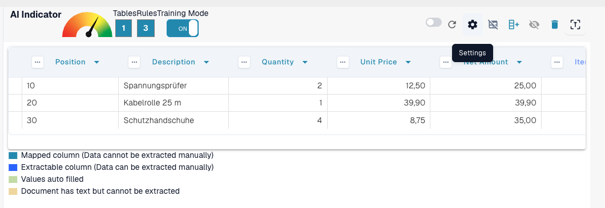<figcaption>
训练模式操作栏中的设置齿轮图标可打开高级设置。
</figcaption></figure>

### 表头行数

**使用此设置可定义表格表头包含多少行。**

有些表格的表头跨越多行。例如，此表格的表头跨越两行：

<figure>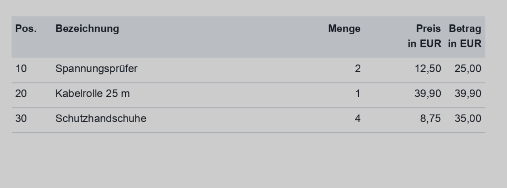<figcaption>
表头跨越两行的表格。
</figcaption></figure>

将**表头行数**设置为相应的值：

<figure>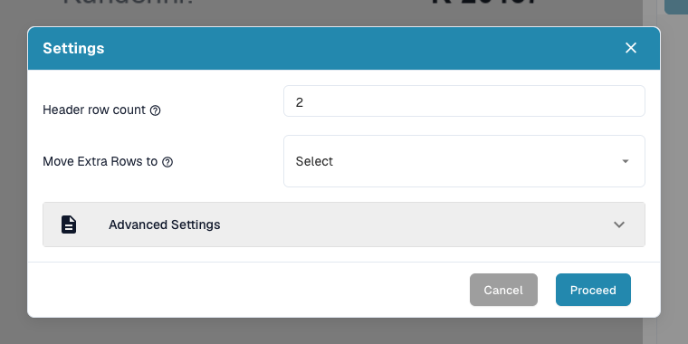<figcaption>
设置对话框中的表头行数设为 2。
</figcaption></figure>

#### 为什么这很重要？

如果不设置此项，DocBits 可能会将第二行识别为数据，而非表头的一部分，从而导致提取错误：

**之前：**

<figure>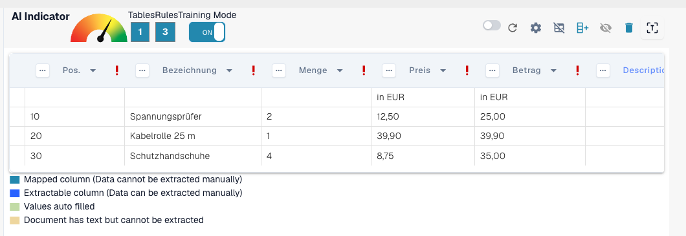<figcaption>
之前：第二行表头被识别为数据。
</figcaption></figure>

之后：

<figure>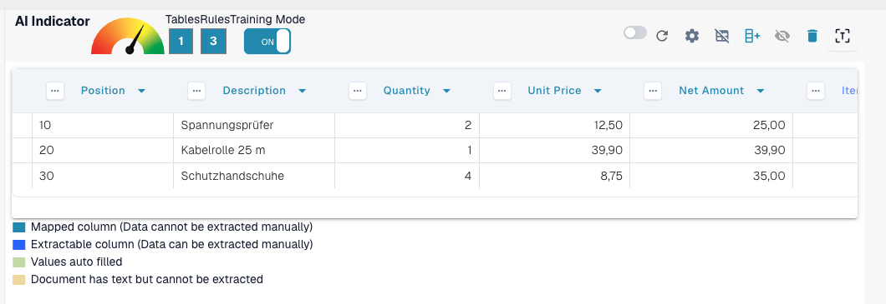<figcaption>
之后：表头行和数据行已正确区分。
</figcaption></figure>

### 将额外行移至回收站

**使用此设置可舍弃不需要的多行条目，例如溢出的描述。**

此示例中的描述延伸到了多行，但只有第一行是相关内容：

<figure>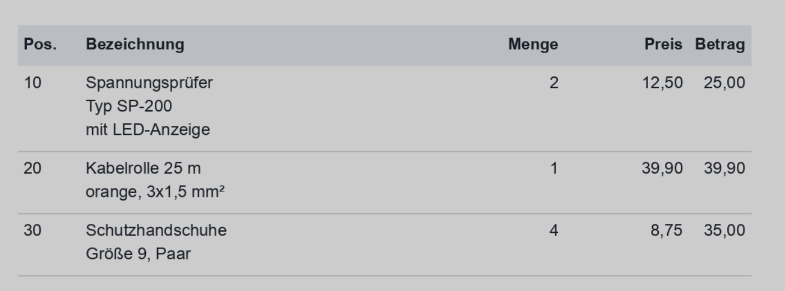<figcaption>
描述延伸到了多行，其中只有第一行是相关内容。
</figcaption></figure>

启用**将额外行移至回收站**以移除溢出的内容：

<figure><figcaption>
已启用将额外行移至回收站。
</figcaption></figure>

**映射后的结果：**

<figure><figcaption>
映射后的结果：仅保留相关行。
</figcaption></figure>

### 最小分组行数

**当需要将多行归到一个主行下时使用此设置（例如，包含多个子行的行项目）。**

在此示例中，六行中只有三行是相关内容。两个关键列已映射（例如 Position、Description），其他列则作为自定义字段处理。

首先，设置**表头行数**和**最小分组行数**：

<figure>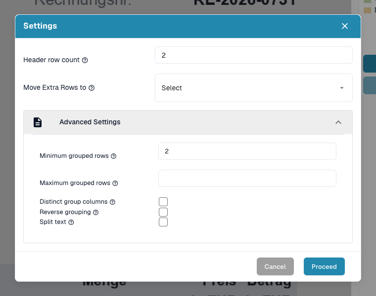<figcaption>
在设置对话框中设置表头行数和最小分组行数。
</figcaption></figure>

同时启用**将额外行移至回收站**，以清理不相关的数据：

<figure>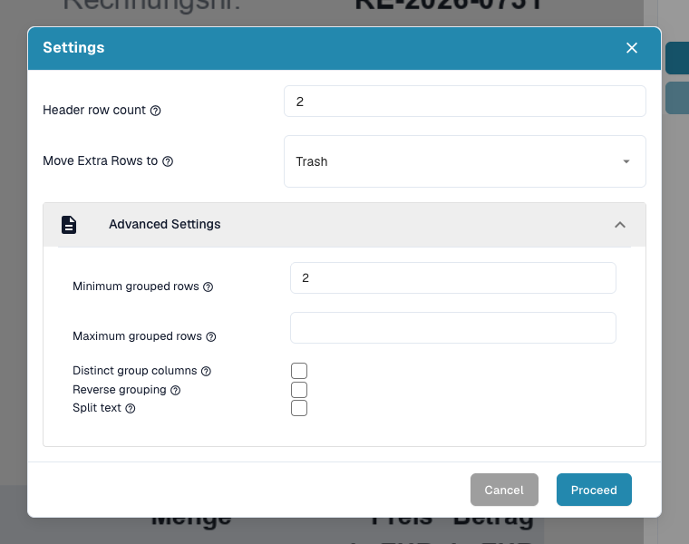<figcaption>
此外还启用了将额外行移至回收站。
</figcaption></figure>

然后定义分组键列，例如_Position_：

<figure>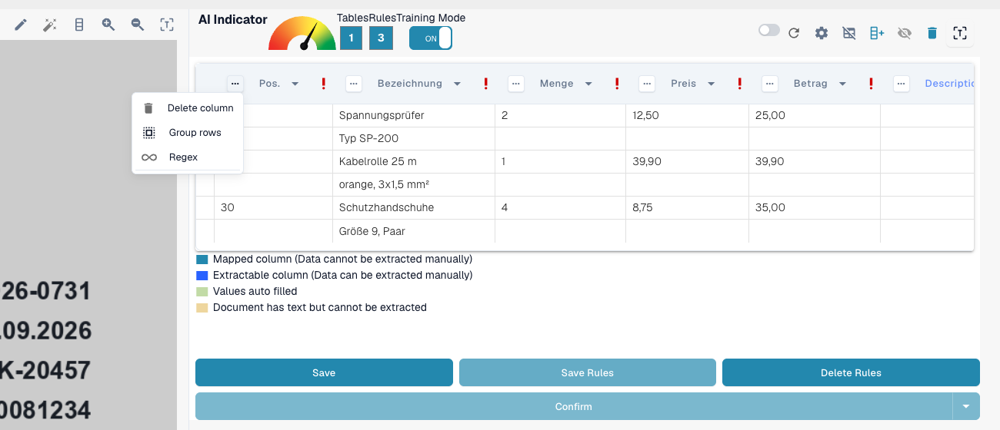<figcaption>
在分组键列（Position）的列菜单中选择 Group rows。
</figcaption></figure>

**结果：**

<figure><figcaption>
结果：六个实际行被分组成三个行项目。
</figcaption></figure>

### 反向分组

**当分组行出现在应被其分组的行&#x20;**_**之后**_**&#x20;时使用此设置。**

如果应与其他数据分组的行出现在分组键_上方_，请启用此选项：

<figure>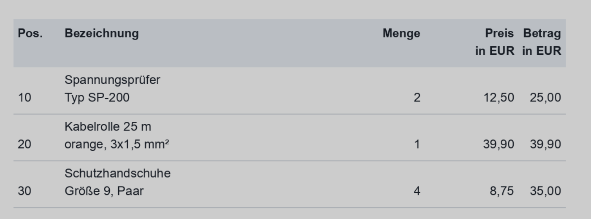<figcaption>
分组行出现在应被其分组的行之后。
</figcaption></figure>

启用**反向分组**，按主列（例如 Net amount）分组，并根据需要使用**将额外行移至回收站**：

<figure>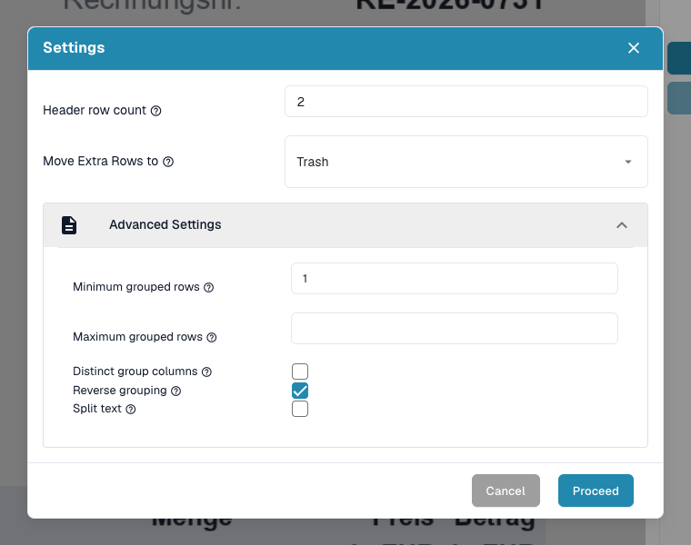<figcaption>
已启用反向分组，同时启用了将额外行移至回收站。
</figcaption></figure>

**最终结果：**\\

<figure>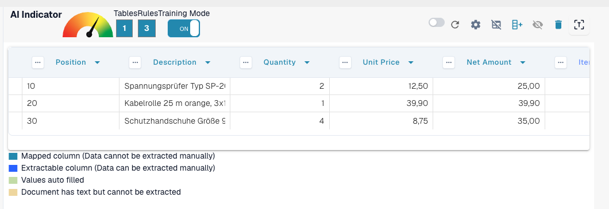<figcaption>
启用反向分组后的最终结果。
</figcaption></figure>

### 总结

使用_高级设置_可教会 DocBits 如何准确处理更复杂或不一致的表格结构。这些设置通过处理以下情况来提高提取精度：

* 多行表头
* 多行描述
* 分组行项目
* 分组数据顺序相反

在训练期间启用这些选项，可确保 DocBits 记住正确的布局，以用于同一供应商的后续文档。
