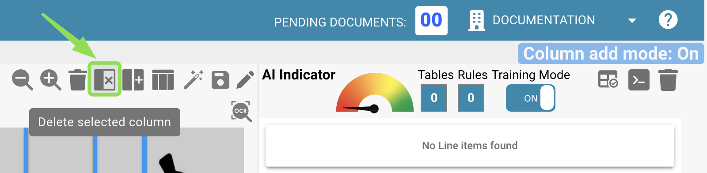
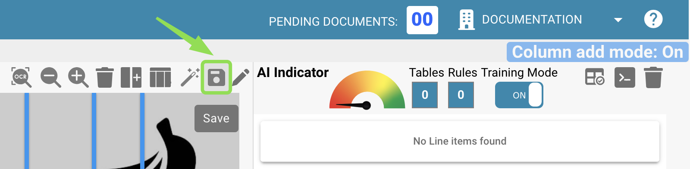

# 定义表格和列

本指南介绍如何在 DocBits 中手动定义表格和列，以提取行项目。当自动检测无法完整识别表格结构，或者需要添加自定义字段时，这项功能尤其有用。

### 1. 打开表格提取视图

在 DocBits 中打开文档，然后点击 **“Table Training”** 按钮，进入表格提取视图。

<figure><figcaption></figcaption></figure>

### 2. 激活训练模式

要手动定义或修改表格和列，请点击 **“TRAINING MODE”**。

<figure><figcaption></figcaption></figure>

### 3. 定义表格区域

进入训练模式后，您可以定义文档中的表格位置。您有两种选择：

#### 选项 1：使用自动检测

点击 **“Auto-Detect Tables”** 按钮，让 DocBits 尝试自动识别表格区域。

<figure><figcaption></figcaption></figure>

如果检测成功，系统会自动显示表格轮廓。随后，您可以继续定义列。

#### 选项 2：手动定义表格

如果自动检测失败或结果不准确，您可以手动定义表格：

1. 点击 **“Edit”** 按钮，启用表格选择模式。
2. 在左侧的文档视图中，围绕表格区域绘制一个矩形。

<figure><figcaption></figcaption></figure>

### 4. 添加和定义列

定义表格后，您可以通过以下按钮手动定义列：\

<figure><figcaption></figcaption></figure>

在文档上通过拖放来定义列并调整列顺序。对其他页面上的表格重复此操作。如果每页上的表格相同，您也可以使用以下按钮，将同一组列应用到文档中定义的所有表格。此功能会将您定义的列复制到其他所有页面：

<figure><figcaption></figcaption></figure>

对于内容密集或结构复杂的文档，可以使用**缩放**功能更准确地定义列。例如，当信息排列得很紧密，导致列难以定义时：

<figure><figcaption></figcaption></figure>

如果误定义了列，可以点击该列将其选中，然后通过以下按钮删除：

<figure><figcaption></figcaption></figure>

<mark style="color:red;">**注意**</mark>：只有在选中列后才会显示该按钮。

完成文档中所有表格和列的定义后，点击“Save”按钮以启用更改并从文档中提取数据：

<figure><figcaption></figcaption></figure>

系统会提取所有已定义区域的数据，并在右侧显示：

<figure><figcaption></figcaption></figure>

### 6. 保存并提取

定义完所有表格和列后，点击 **“Save Rules”**。

* 这会告知 DocBits 如何查找此特定供应商的表格数据。
* 下次上传同一供应商的文档时，DocBits 会使用已保存的规则自动提取表格。

<mark style="color:red;">**注意**</mark>：此训练针对特定供应商，不适用于其他供应商的文档。
