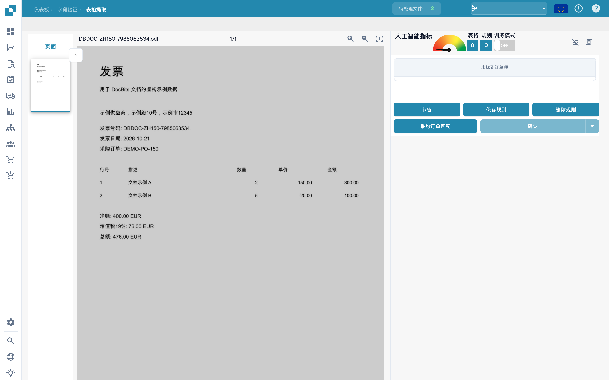
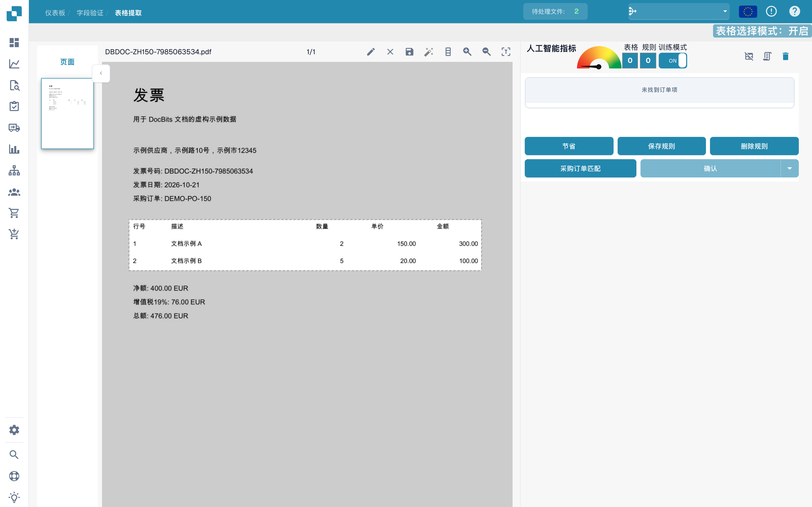
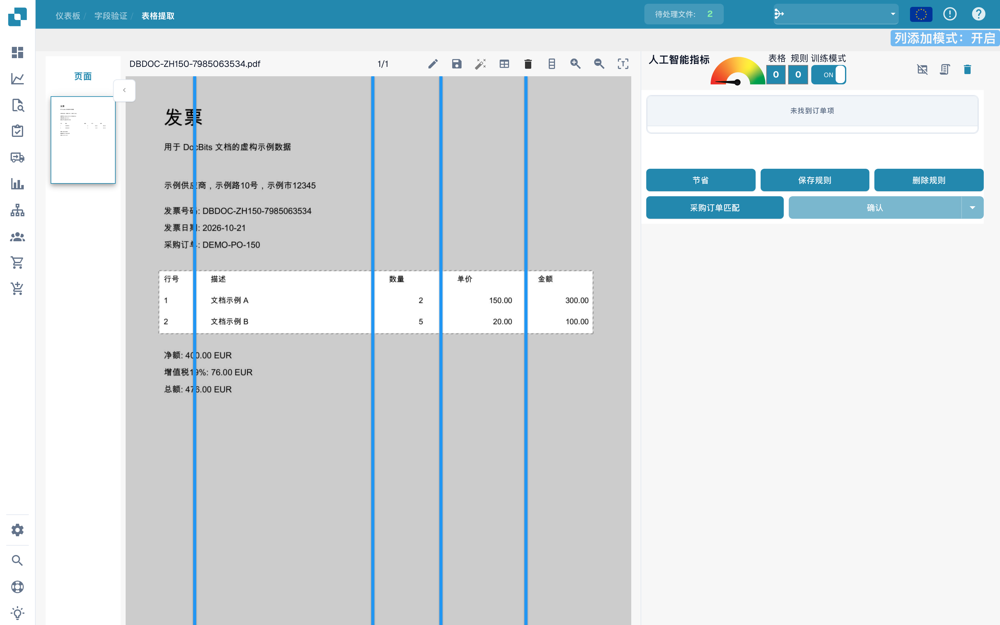
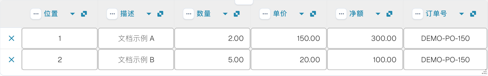

# 定义表格和列

如果表格未被完整识别，可通过表格训练指定区域和列。以下使用虚构发票和未保存的训练草稿。

## 打开训练

在字段验证中打开文档，然后进入表格提取。

<figure><figcaption>
定义表格和列的界面。 “节省”按钮实际表示保存；本例只标记未保存的训练区域和列分隔线。
</figcaption></figure>

启用训练模式，显示区域选择和列工具。

<figure><figcaption>
训练模式已开启的表格训练界面。 “节省”按钮实际表示保存；本例只标记未保存的训练区域和列分隔线。
</figcaption></figure>

工具栏也提供自动检测。请将检测结果与文档比较；图片只显示可用工具，并不证明已完成自动检测。

<figure><figcaption>
包括自动检测在内的表格训练工具。 “节省”按钮实际表示保存；本例只标记未保存的训练区域和列分隔线。
</figcaption></figure>

## 指定区域和列

用铅笔工具画出包含表头和明细行的矩形。将下方合计排除在区域之外。

<figure><figcaption>
虚构发票明细行上的表格区域，尚未保存。 “节省”按钮实际表示保存；本例只标记未保存的训练区域和列分隔线。
</figcaption></figure>

选择列工具，在实际列之间放置垂直分隔线。

<figure><figcaption>
带有垂直列分隔线的表格区域。 “节省”按钮实际表示保存；本例只标记未保存的训练区域和列分隔线。
</figcaption></figure>

检查行号、描述、数量、单价和金额。

<figure><figcaption>
虚构发票各列之间的分隔线。 “节省”按钮实际表示保存；本例只标记未保存的训练区域和列分隔线。
</figcaption></figure>

保存文档或规则前，检查整个区域和所有分隔线。

<figure><figcaption>
未保存的训练草稿中的区域和分隔线。 “节省”按钮实际表示保存；本例只标记未保存的训练区域和列分隔线。
</figcaption></figure>

## 检查提取结果

将提取的行与发票比较。下一张图片展示验证界面中已经自动提取的行，并非上方训练草稿的提取结果。

<figure><figcaption>
验证界面中自动提取的虚构发票明细行。
</figcaption></figure>

保存预期训练后，测试同一供应商的其他文档。一张发票不能证明所有布局都能可靠提取。
