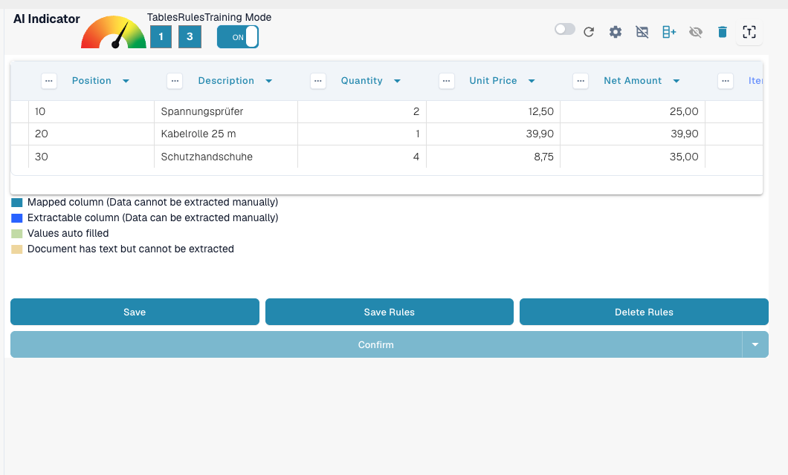
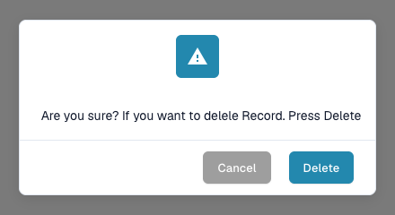

# 保存和删除规则

完成表格的训练或更正后，保存规则非常重要，这样 DocBits 才能将其自动应用于来自同一供应商的后续文档。

### 保存规则

定义所有列并完成更正后：

1. 点击顶部的 **SAVE RULES** 按钮。
2. 规则计数器会显示已保存的提取规则数量。

这样，DocBits 下次遇到类似文档时，就会自动使用经过训练的布局。

<figure><figcaption>
Save Rules 用于保存规则；计数器会显示现有规则的数量。
</figcaption></figure>

### 删除规则

如果已保存的规则配置不正确，或者文档布局发生了重大变化，可以使用 **DELETE RULES** 按钮删除规则。

<mark style="color:red;">**警告**</mark>：删除规则会影响来自同一供应商且布局相同的所有文档。您需要**从头重新训练表格提取**。

<figure><figcaption>
删除规则前必须确认。
</figcaption></figure>
