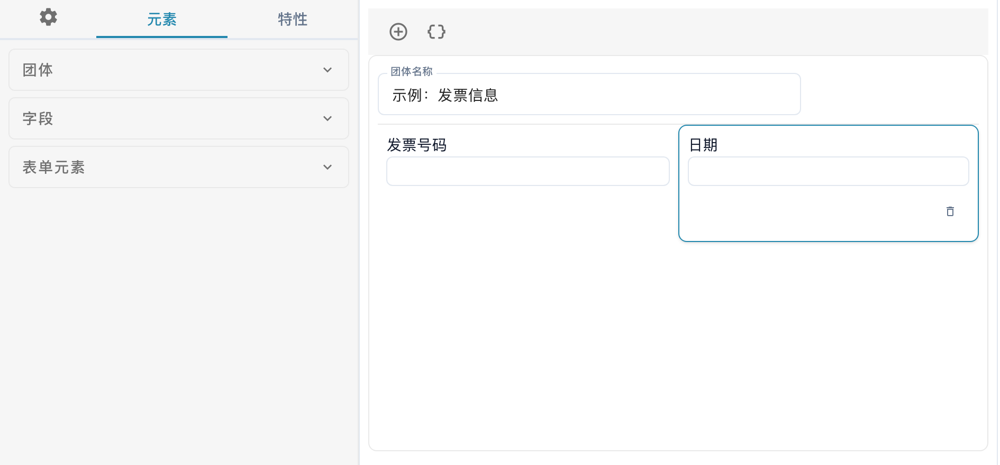
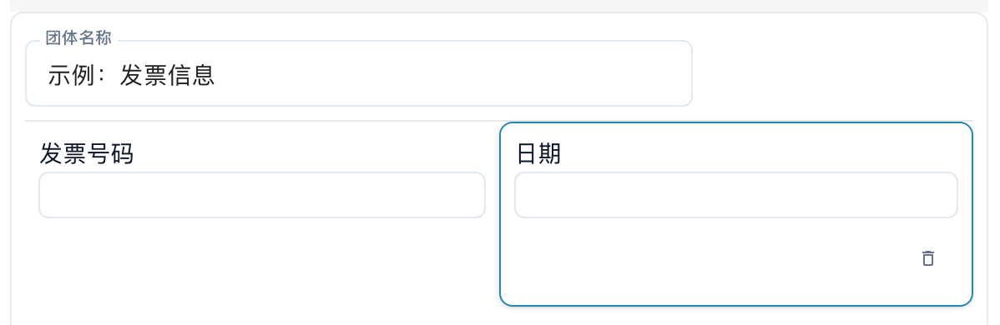
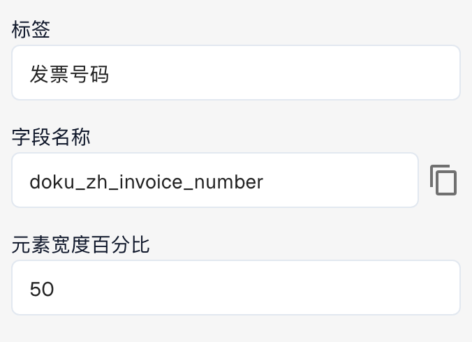

# 布局构建器

使用布局构建器来排列用户在验证或审批文档时看到的字段和控件。每个布局都与文档类型、来源和布局类型相关联。保存更改前，请先确认当前打开的布局。

## 打开布局

1. 打开 **设置 → 文档类型**。
2. 为所需的文档类型或子类型打开布局构建器。如果无法使用该编辑器，可能需要管理员先为您的组织启用相应模块。
3. 检查操作栏中选择的 **起源**，以及旁边显示的编辑器类型。

<figure><figcaption>
布局构建器局部视图：左侧为团体、字段和表单元素区域，中间为简化的发票布局示例。
</figcaption></figure>

切换 **起源** 时，DocBits 可能会为该来源创建独立的布局。因此，编辑前请先确认所选起源。

## 认识编辑器的各个区域

左侧可切换 **元素**、**特性**，以及齿轮图标所代表的常规设置。

* **元素** 选项卡包含 **团体**、**字段** 和 **表单元素** 三个区域，分别用于分组、文档字段和其他表单控件。展开相应区域，即可查看可用条目。
* 中间的布局区域显示当前布局中的分组和字段。分组用于组织相关字段。
* 右侧是示例文档区域，可显示文档供您对照，并可放大或缩小。

从左侧相应区域将条目拖到布局区域，即可添加分组、字段或表单元素。

<figure><figcaption>
示例分组中的发票号码和日期字段。在此示例中，两个字段各占分组宽度的 50%。
</figcaption></figure>

可复用的文档字段在[文档类型](README.md)中配置。编辑器中可用的字段取决于所选文档类型和您的配置。

## 更改元素特性

在布局区域选择一个分组或字段，然后打开左侧的 **特性**。可用选项取决于选中的元素，例如显示名称、技术字段名称、宽度和行为。

<figure><figcaption>
所选字段的特性：标签、技术字段名称，以及以百分比设置的元素宽度。
</figcaption></figure>

对于预定义字段，显示名称和技术字段名称可能无法编辑。根据元素类型，您还可以设置只读状态、可见性、Tab 键切换顺序、值列表，以及在值发生变化时执行工作流或脚本。分组和字段的可用选项并不相同。

调整属性后，请在布局区域检查效果。宽度以百分比设置；分组及其中的字段可以采用不同的宽度。更多详情请参阅[配置字段属性](../../settings/global-settings/document-types/layout-manager/configuring-field-properties.md)。

## 模板与 JSON

除了保存布局，操作栏还提供自动生成模板、将默认布局应用到各来源布局、使用默认模板和编辑 JSON 等功能。具体可用功能取决于当前打开的编辑器。

生成或应用模板可能会替换您自行排列的布局。因此，请先确认文档类型、来源和现有布局。**编辑 JSON** 用于高级配置，仅在了解模板格式时使用。在 JSON 对话框中，也可以复制布局配置。

## 检查并保存

排列好分组和字段后，在布局区域检查效果。确认无误后，使用操作栏中的 **保存**。有关特定来源的布局，请参阅[来源布局](origin-layouts.md)。


配图采用简化的发票布局示例。字段名称和可用选项取决于您的配置。

