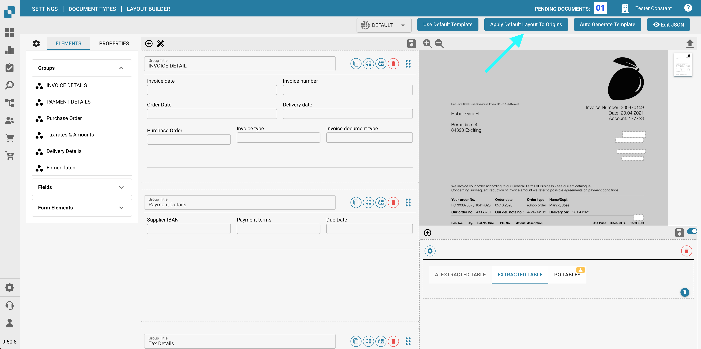
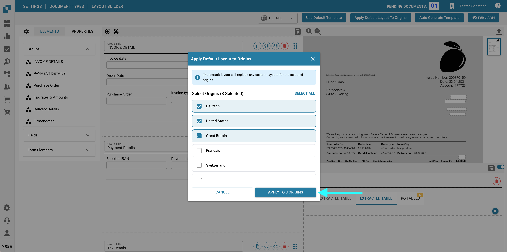

# 原属地布局


DocBits 原属地设置说明：日期和数字格式的国家标准


DocBits 擅长根据文档的地理来源调整文档布局，同时根据用户的浏览器设置统一货币格式等元素。下面介绍如何使用 Layout Builder（布局构建器）为美国和德国等不同来源自定义布局。

<figure><figcaption></figcaption></figure>

## **了解基于原属地的自定义**

* 货币和格式统一：无论原始文档使用何种货币或格式，DocBits 都会在服务器上按照用户的浏览器设置，将这些元素转换为统一的 ISO 格式。
* 地理布局自定义：系统支持根据文档的地理来源自定义文档布局。这意味着您可以为来自不同国家/地区的文档定义特定字段和格式。

## **示例：美国与德国的布局**

* 美国布局：对于美国发票，您可以添加城市税字段，以符合美国常见的税制结构。
* 德国布局：相比之下，德国发票布局可能不包含城市税字段，因为这不是德国的标准收费项目。

## **使用 Layout Builder（布局构建器）**

* 选择原属地布局：在 Layout Builder（布局构建器）中，选择与文档来源相对应的基础布局。
* 自定义字段：通过添加或移除字段来调整布局。例如，在美国布局中添加“City Tax”（城市税）。
* 应用并测试：完成自定义后，将布局应用于文档并进行测试，确保准确无误。

<figure><figcaption></figcaption></figure>

## **有效自定义的提示**

* 了解地区差异：熟悉不同地区在税务和格式方面的细微差异。
* 定期更新：定期更新布局，以反映地区法规的变化。
* 用户反馈：利用不同地区用户的反馈，进一步完善布局。

## 将默认布局应用于多个原属地

如果要将默认布局应用于多个原属地，请点击 **Apply Default To Origins**。

<figure><figcaption></figcaption></figure>

此时会出现一个弹出窗口，您可以选择要应用默认布局的原属地。您可以使用 **Select All**（全选）或 **Unselect All**（取消全选）快速管理所选项。弹出窗口会显示当前选中的原属地数量。

<figure><figcaption></figcaption></figure>

完成选择后，点击 **Apply to Origins**。成功消息会确认原属地已更新。
