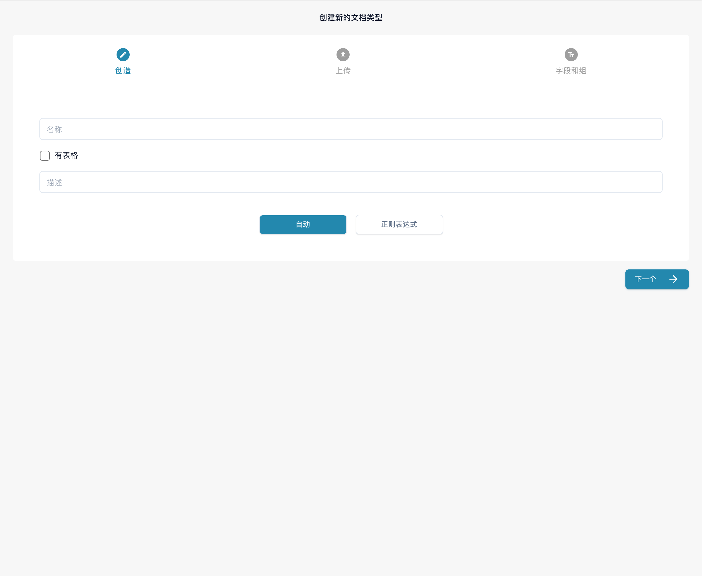

# 正则表达式管理器

DocBits 的此功能可作为模型分类的替代方案，让您为文档类型编写可搜索的正则表达式，用于分类及其他用途。

文档类型：Regex Manager 允许您编写正则表达式，随后系统会在文档中搜索该表达式。如果找到与某个已定义文档类型的正则表达式匹配的内容，系统就会将该文档分类为相应的文档类型。例如，您可以编写一个用于查找“Gutschrift”的正则表达式。如果 DocBits 在文档中找到这个词，就会将该文档分类为贷项通知单。

文档内容：正则表达式可以匹配指定词语或模式。“Factura”可以出现在多个国家的西班牙语文档中，不能仅凭这个词可靠地确定来源国家。若需要按国家分类，请使用文档中的国家信息、地址或已配置的主数据，并用不同来源的样本验证规则。

## **访问 Regex Manager**

要在 DocBits 中找到此功能，请导航至 设置 → 文档类型。在 自定义文档类型 下，点击“新建”。输入文档类型名称，可选地添加描述；如果文档包含表格，请勾选“有表格”。然后选择“正则表达式”而不是“自动”，并点击“下一个”。

<figure><figcaption>
中文文档类型创建表单，提供“自动”和“正则表达式”两种方式。表单为空，未选择“下一个”创建类型。
</figcaption></figure>

## **添加和移除正则表达式**

“正则表达式”步骤会显示已有的正则表达式模型，每个模型都列出来源和模式，并提供用于创建新正则表达式模型的“添加”按钮。使用每行末尾的操作菜单来管理对应条目。点击“下一个”继续配置“字段和组”。

<!-- Obsolete illustration retired: Retire obsolete English configured-pattern list. Current native create form remains above; keep full regex procedure and do not create a document type or pattern merely for an illustration. -->
