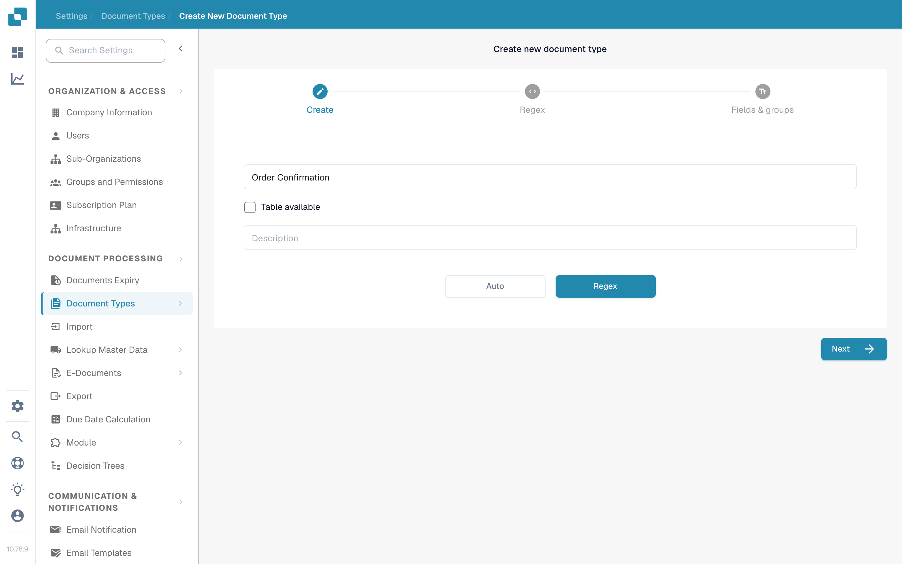
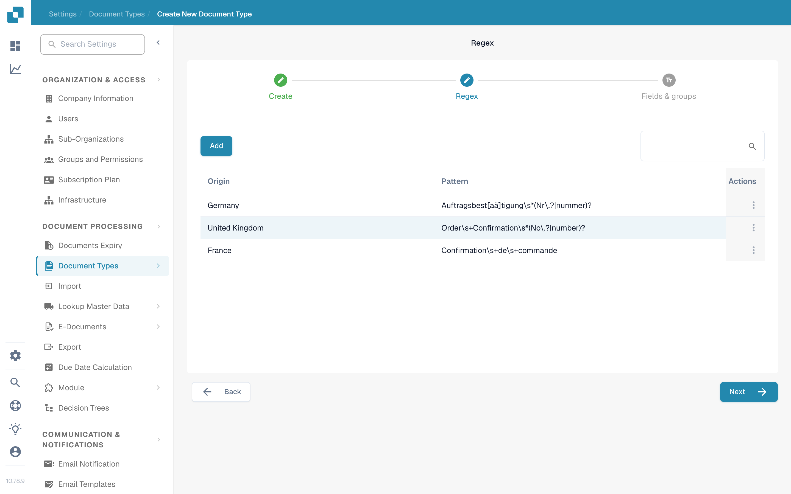

# Regex Manager

DocBits 的此功能可作为模型分类的替代方案，让您为文档类型编写可搜索的正则表达式，用于分类及其他用途。

文档类型：Regex Manager 允许您编写正则表达式，随后系统会在文档中搜索该表达式。如果找到与某个已定义文档类型的正则表达式匹配的内容，系统就会将该文档分类为相应的文档类型。例如，您可以编写一个用于查找“Gutschrift”的正则表达式。如果 DocBits 在文档中找到这个词，就会将该文档分类为贷项通知单。

文档来源：通过正则表达式，DocBits 可以识别文档的来源国家。例如，如果西班牙文档的正则表达式包含“Factura”一词，DocBits 搜索文档并找到该词后，就会识别该文档来自西班牙，并据此进行分类。

## **访问 Regex Manager**

要在 DocBits 中找到此功能，请导航至 Settings → Document Types。在 Custom Document Types 下，点击 New。输入文档类型名称，可选地添加描述；如果文档包含表格，请勾选“Table available”。然后选择“Regex”而不是“Auto”，并点击“Next”。

<figure><figcaption>
选择“Regex”，以使用正则表达式对新的文档类型进行分类。
</figcaption></figure>

## **添加和移除正则表达式**

“Regex”步骤会显示已有的正则表达式模型，每个模型都列出来源和模式，并提供用于创建新正则表达式模型的“Add”按钮。使用每行末尾的操作菜单来管理对应条目。点击“Next”继续配置“Fields & groups”。

<figure><figcaption>
已有的正则表达式模型及其来源和模式。点击“Add”可创建新模型。
</figcaption></figure>
