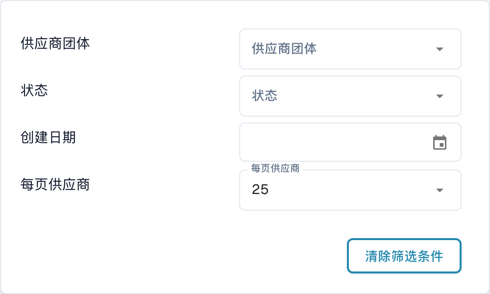
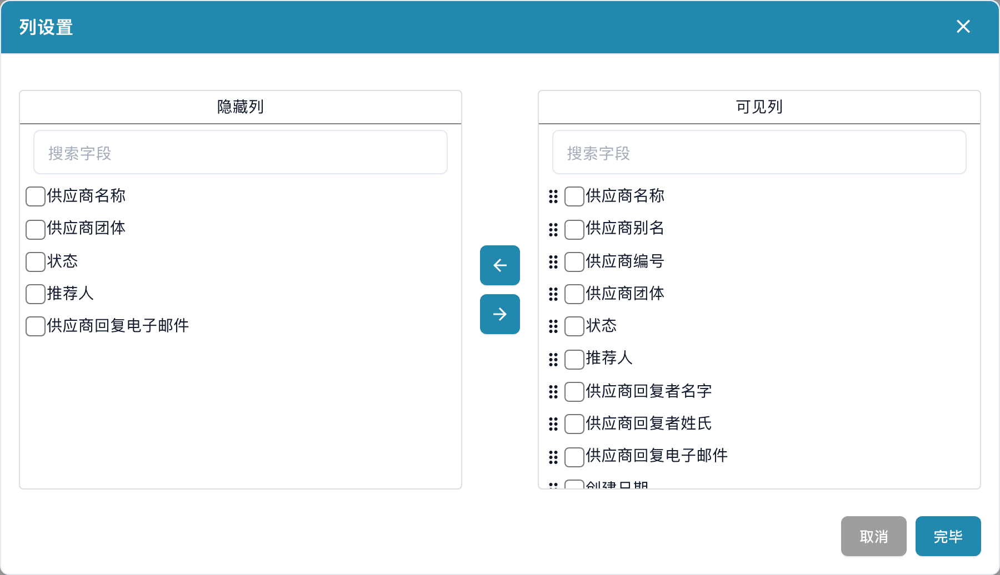
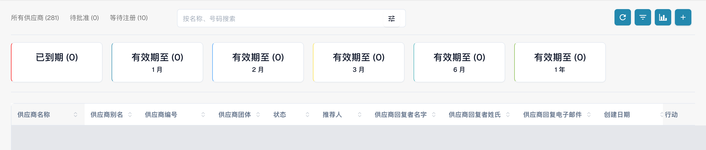
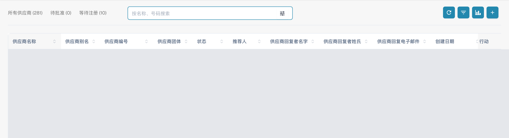
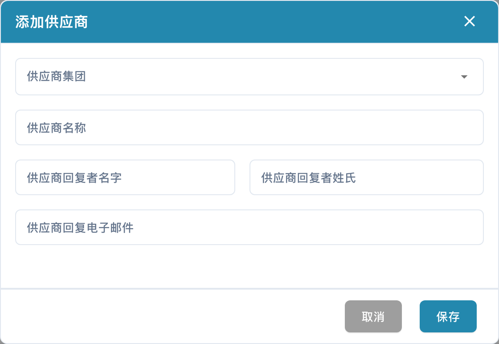

# 供应商门户

**供应商门户**让管理员能够向其公司的供应商提供 **DocBits** 访问入口。管理员启用门户，并配置哪些供应商可以使用门户以及他们可以查看哪些信息。

受邀供应商完成注册后，使用自己的账户登录，即可查看向其开放的信息，例如自己的采购订单和发票状态。具体可用功能取决于组织的配置。

## 视频：准备供应商门户及访问权限

管理员演示门户选项、套餐选择、邀请准备和注册入口。启用、发送邀请、注册和审批分别作为独立步骤说明。



[打开带中文字幕和章节选择的视频](https://docbits-videos.fra1.cdn.digitaloceanspaces.com/settings-assistant/supplier-portal-access-admin/v1/zh.html)

## 管理员：启用门户

1. 在设置中打开模块，然后选择**文档集成**。
2. 展开**运输和供应商**并启用**供应商门户**。
3. 如果出现激活对话框，请核对显示的套餐并确认所需的激活操作。

<figure><figcaption>
中文 Dev 环境的真实界面，运输和供应商：此测试组织的供应商门户已经启用。拍摄时没有更改开关。
</figcaption></figure>

## 管理员：配置门户

发送第一批邀请前，请先为组织配置门户：

- [供应商常规设置](../../settings/supplier-setting/supplier-general-settings.md): 额外邀请字段、状态、标志和隐私信息。
- [电子邮件模板](../../settings/supplier-setting/editing-email-templates.md): 邀请邮件的内容和格式。
- [供应商布局](../../settings/supplier-setting/supplier-layout.md): 供应商注册和内部供应商管理的字段。请选择相应的布局类型。
- [供应商权限](../../settings/supplier-setting/supplier-permissions.md): 将内部员工分配到供应商组。这些内部职责与供应商自己的门户访问权限是不同的。

<figure><figcaption>
真实的供应商门户附加邀请字段界面：选项已经启用，字段保留已配置的 Assigned User 值。没有保存任何更改。
</figcaption></figure>

## 管理员：搜索和筛选供应商

打开供应商仪表板进行内部管理。所有供应商、待批准和等待注册计数器可用于限定显示的列表。按名称、号码搜索输入框可按名称或编号查找供应商。

打开搜索框中的筛选按钮，使用供应商团体、状态和创建日期。每页供应商用于设置每页数量；清除筛选条件用于清除当前搜索筛选。这些控件作用于供应商列表。

<figure><figcaption>
筛选菜单显示供应商团体、状态、创建日期、每页供应商和清除筛选条件。截图仅展示可用控件，不代表已对筛选结果进行功能测试。
</figcaption></figure>

## 管理员：选择可见列

在刷新按钮旁打开列设置，提示文字为设置表格列以进行组织。在隐藏列或可见列中选择字段，使用箭头在两侧列表之间移动。拖动手柄可调整可见列的顺序。完毕将选择应用到组织；取消关闭窗口而不应用选择。表格宽于屏幕时，可通过水平滚动查看其他列。

<figure><figcaption>
列设置包含隐藏列、可见列、方向箭头、取消和完毕。拍摄后使用取消关闭，未更改列选择。
</figcaption></figure>

## 管理员：查看到期分析

使用列设置旁的图表图标分析，显示或隐藏到期情况概览。卡片按界面标签显示已到期、有效期至，以及 1 月、2 月、3 月、6 月和 1 年。选择卡片可将列表限定到相应时间范围。计数器涉及与供应商相关的有效期限。

<figure><figcaption>
分析显示已到期，以及一个月、两个月、三个月、六个月和一年内到期的计数。供应商数据行已遮盖，未选择任何卡片。
</figcaption></figure>

## 管理员：邀请供应商

打开供应商管理。在邀请前，请核对公司、供应商组、联系人和电子邮件地址。创建新供应商时，保存会请求发送注册邀请，而不只是保存草稿。对于现有供应商，请使用相应的邀请操作。发送确认并不代表邮件已送达或注册已完成。

<figure><figcaption>
内部仪表板包含所有供应商、待批准、等待注册、搜索框和工具栏。现有供应商的数据行已遮盖。
</figcaption></figure>

<figure><figcaption>
空白的添加供应商表单，包含供应商集团、供应商名称、供应商回复者名字、供应商回复者姓氏、供应商回复电子邮件以及取消和保存。左侧是联系人的名字，右侧是姓氏。保存会请求发送注册邀请；拍摄时只使用了取消。
</figcaption></figure>

## 管理员：从供应商仪表板打开详情

内部员工可从供应商仪表板中的供应商行打开详情。该视图包含供应商填写的同样六个部分及其状态，可用于查看和更新已提交的信息，并执行相应审批。为拍摄这些截图，没有打开任何现有供应商的数据行。

## 供应商：注册并访问 DocBits

供应商打开邀请，创建或使用指定的个人账户，并完成配置的注册步骤。随后即可在 DocBits 中查看组织向其开放的信息。具体流程和可用功能由组织决定。

[供应商注册指南](supplier-registration.md).

## 区分访问权限与各个状态

门户已启用、邀请已发送、注册已完成和审批已通过是不同的状态。存在供应商记录或已保存主数据，并不能证明门户访问已经就绪。供应商界面取决于分配的权限，与内部管理员界面不同。

截图来自获授权的 Dev 测试账户和中文界面。已核对界面及列表的只读请求、可见控件，以及未更改并取消的表单。没有保存门户配置或列选择，没有创建或更改供应商，也没有执行邀请、注册或审批。未声称已对搜索和筛选结果或邮件送达进行功能测试。保留了现有视频，没有重新进行音频、语言或同步评审。
