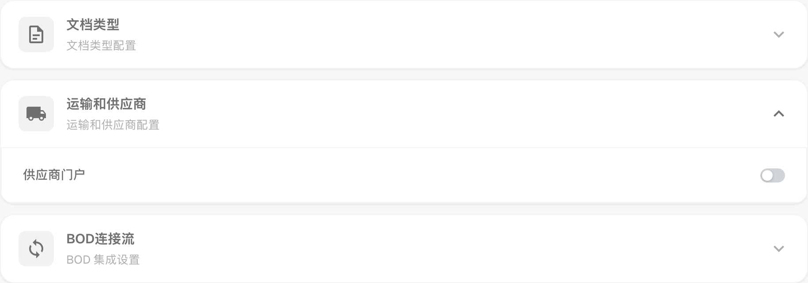
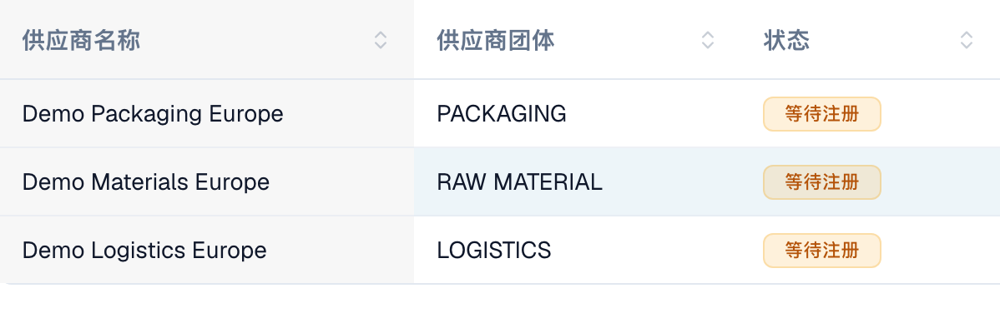
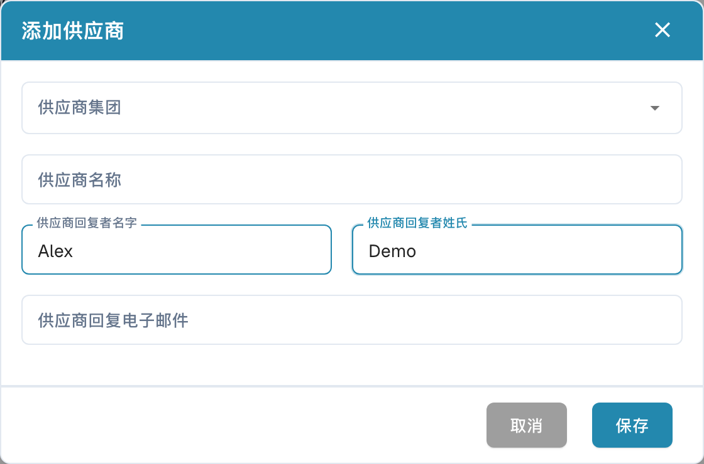

# 供应商门户

**供应商门户**让管理员能够向其公司的供应商提供 **DocBits** 访问入口。管理员启用门户，并配置哪些供应商可以使用门户以及他们可以查看哪些信息。

受邀供应商完成注册后，使用自己的账户登录，即可查看向其开放的信息，例如自己的采购订单和发票状态。具体可用功能取决于组织的配置。

## 管理员：启用门户

1. 在设置中打开模块，然后选择**文档集成**。
2. 展开**运输和供应商**并启用**供应商门户**。
3. 如果出现激活对话框，请核对显示的套餐并确认所需的激活操作。

<figure><figcaption>
发货和供应商模块中的门户选项。此开关用于为组织启用该功能。
</figcaption></figure>

## 管理员：配置门户

发送第一批邀请前，请先为组织配置门户：

- [供应商常规设置](../../settings/supplier-setting/supplier-general-settings.md): 额外邀请字段、状态、标志和隐私信息。
- [电子邮件模板](../../settings/supplier-setting/editing-email-templates.md): 邀请邮件的内容和格式。
- [供应商布局](../../settings/supplier-setting/supplier-layout.md): 供应商注册和内部供应商管理的字段。请选择相应的布局类型。
- [供应商权限](../../settings/supplier-setting/supplier-permissions.md): 将内部员工分配到供应商组。这些内部职责与供应商自己的门户访问权限是不同的。

<figure><figcaption>
供应商常规设置，其中包含额外邀请字段选项。
</figcaption></figure>

## 管理员：邀请供应商

打开供应商管理。在邀请前，请核对公司、供应商组、联系人和电子邮件地址。创建新供应商时，保存会请求发送注册邀请，而不只是保存草稿。对于现有供应商，请使用相应的邀请操作。发送确认并不代表邮件已送达或注册已完成。

<figure><figcaption>
内部供应商管理中的三家虚构公司。此处三条状态均为等待注册。
</figcaption></figure>

<figure><figcaption>
创建并邀请供应商的表单。保存前请核对公司、联系人和电子邮件地址。
</figcaption></figure>

## 供应商：注册并访问 DocBits

供应商打开邀请，创建或使用指定的个人账户，并完成配置的注册步骤。随后即可在 DocBits 中查看组织向其开放的信息。具体流程和可用功能由组织决定。

[供应商注册指南](supplier-registration.md).

## 区分访问权限与各个状态

门户已启用、邀请已发送、注册已完成和审批已通过是不同的状态。存在供应商记录或已保存主数据，并不能证明门户访问已经就绪。供应商界面取决于分配的权限，与内部管理员界面不同。
