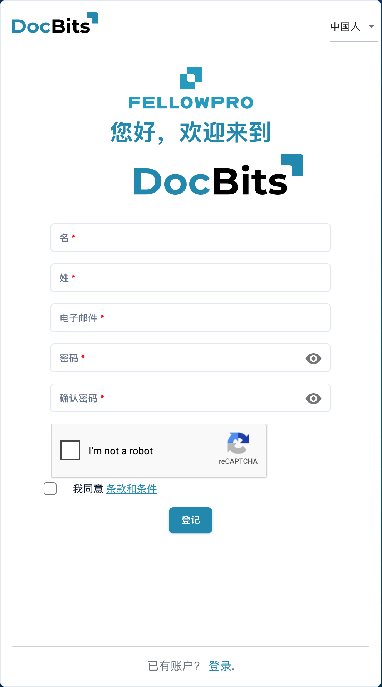

# 供应商注册

本指南适用于受邀访问某组织 DocBits 门户的供应商。请使用邀请中的链接。您拥有自己的供应商账户；邀请您的组织决定可访问的信息和必要的注册步骤。

## 1. 打开邀请

核对邀请来自哪个组织，以及邀请发往哪个电子邮件地址。打开该邀请中的注册链接。如果链接已过期或收件人有误，请联系邀请方获取新邀请。

## 2. 设置自己的账户

核对预先填写的姓名和电子邮件地址。填写要求的账户信息，并遵守页面显示的密码规则。阅读条款和隐私信息，然后使用注册功能完成账户注册。已有账户与首次注册属于不同情况，请按照邀请对应的流程操作。

<figure><figcaption>
供应商账户注册表单。此示例尚未填写；通过邀请进入时，部分信息可能已预先填写。
</figcaption></figure>

## 3. 完善供应商信息

补充组织要求的信息及相关证明材料。字段和章节取决于配置的供应商布局。必填标记和校验提示会说明需要填写的内容。如果页面支持保存进度，可先保存；保存并不自动等于最终提交。

## 4. 检查注册与审批结果

使用指定的完成操作提交信息。如果组织配置了审核或审批，请等待处理结果。随后使用自己的账户登录。您可查看的采购订单、发票和其他信息由组织决定。

## 无法访问时怎么办

如果邀请链接无效、缺少权限或不清楚必填信息，请联系邀请您的组织。内部系统中的供应商记录不能代替您的注册或必要的访问审批。

[供应商门户设置](README.md).
