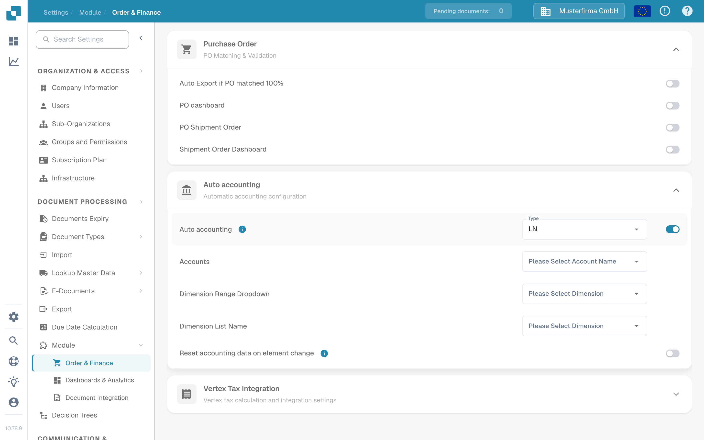

# 测试自动记账

自动记账需要启用相应模块、配置会计主数据，并准备一张包含可用金额或行项目的发票。本指南将可在打开发票前检查的设置，与需要配置 LN 或 M3 连接后才能进行的检查分开说明。

## 检查模块设置

1. 打开 **Settings → Module → Order & Finance**，展开 **Auto accounting**。旧路径 **Document Processing → Module → Purchase Order / Auto Accounting** 已不再是当前应用中显示的路径。
2. 为已连接的系统选择 **Type**（**LN** 或 **M3**）。只有在所需主数据和连接都已就绪时，才启用 **Auto accounting**。
3. 启用后，选择 **Accounts** 列表以及适用于你所用系统的维度列表。对于 LN，可见字段包括 **Dimension Range Dropdown** 和 **Dimension List Name**。M3 的字段有所不同。仅当需要在元素更改后重新计算时，才使用 **Reset accounting data on element change**。

<figure><figcaption>
在英文 Sandbox 测试组织中，Auto accounting 处于关闭状态。
</figcaption></figure>

<figure><figcaption>
启用该设置后显示的字段。截图完成后已再次关闭该设置；未配置账户或维度。
</figcaption></figure>

## 使用已配置的发票进行测试

使用一张行项目和会计主数据均可用的发票。在验证界面中打开该发票，然后选择 **Auto Accounting**。如果看不到此操作，请检查模块设置以及该发票是否符合条件。请先验证发票再继续操作；选择此操作时，应用会保存并验证发票。

在会计界面中，使用你自己的 LN 或 M3 数据检查以下内容：

1. 在可用时运行 **Validate Setup**，并在继续操作前补齐缺失的账户或维度配置。绿色结果仅表示你所在环境中的检查结果。
2. 检查发票应按**总额**还是按**各个行项目**分配。将会计金额与原始发票进行比较。
3. 如果要拆分金额，请为每个拆分行选择目标账户。输入金额或百分比，并检查分配值的总和是否与上级金额一致。仅在需要时添加或删除行。
4. 检查是否存在任何 **Unsettled amount** 或验证警告，并在保存或导出前予以更正。另请在已连接的系统中确认结果。

以上截图所用的 Sandbox 测试组织未配置账户和维度列表，也没有用于此流程的发票行项目。因此，**本页未测试或展示**会计界面、金额拆分和导出。请勿将设置截图作为会计处理或导出成功的证明。

如需了解特定系统的设置，请继续阅读 [LN 指南](ln.md)或 [M3 指南](m3.md)。
