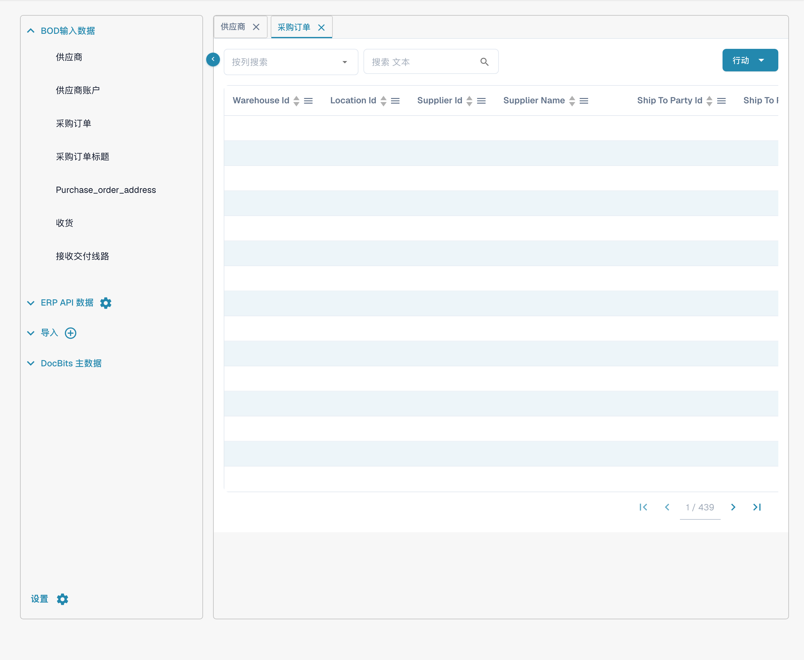

# PO 匹配

测试前，在获准的 LN/M3 测试环境准备一张具有唯一标识的采购订单及对应发票。分别验证主数据传输、匹配结果和导出响应，不要用其中一个阶段的成功代替全流程验证。

## 在 INFOR 中创建采购订单

* LN: https://docs.infor.com/ln/10.4/en-us/lnolh/docs/ln\_10.4\_procpoug\_\_en-us.pdf
* M3：[Infor 采购订单创建、发布与查看指南](https://docs.infor.com/m3udi/latest/en-us/m3beud/prochs/pps600.html)，采购订单入口为 PPS200。

按已配置的集成流程传输订单后，前往**设置 → 文档处理 → 查找主数据 → BOD输入数据 → 采购订单**，搜索该测试编号，并比较供应商、行号、数量、单位、单价、币种及状态。

<figure><figcaption>
当前中文“BOD输入数据 → 采购订单”只读列表，记录值已隐藏。Warehouse Id、Supplier Id 等列名仍为英文，属于产品翻译缺口。本图说明查看位置；没有执行导入，不能据此证明某次 M3/LN 传输或采购订单匹配成功。
</figcaption></figure>

找到编号只证明这一记录可见；还需要核对字段及来源日志，不能据此认定所有 INFOR 数据已正确同步。

现在上传一张发票，其数量和单价与您创建的采购订单相符。验证文档，并在验证界面选择 PO Matching。

检查发票和订单的引用、供应商、行项目、单位、数量、单价及容差规则，再运行获准的匹配测试。逐行核对实际结果；数量和单价相同不保证自动匹配。只有验证和审批条件也满足时，再按组织流程测试导出，并核对目标系统的接收结果。如果遇到导出错误，请创建工单联系 DocBits 支持团队寻求帮助。如果您不确定如何在 DocBits 中创建工单，请参阅 DocBits Overview 文档以获取帮助。

\\
