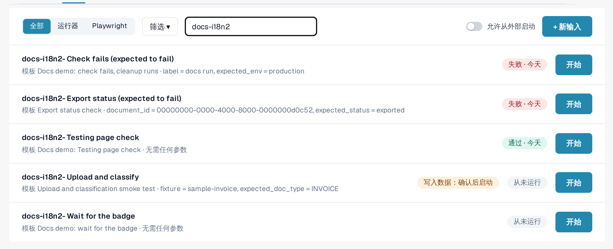
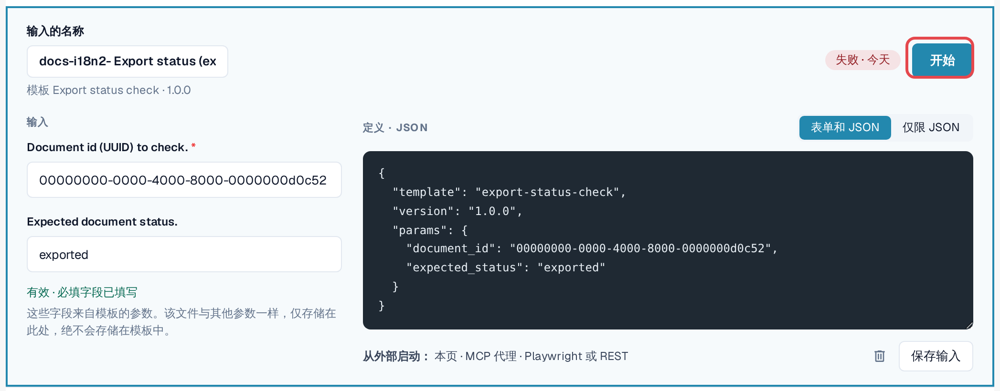
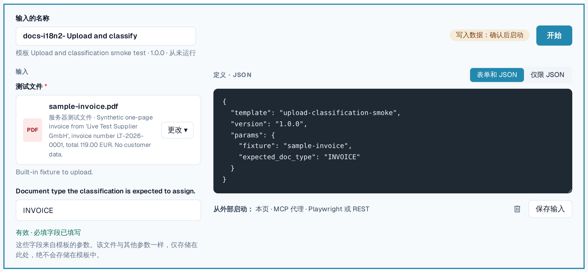

# 输入

输入以您选择的名称，保存 **贵组织的值**，对应某个模板的参数。
模板加输入就是一个可以反复启动的测试，可以手动启动，也可以自动启动。

示例：默认模板 *Default smoke: validation contract* 会打开一份文档并检查其状态和
文档类型。它需要一个文档 ID。您的输入 *Invoice LT-2026-0001 ready for validation* 保存了贵组织中某份文档的 ID 以及您期望的状态。

打开 **设置 → Testing**，进入 **输入** 标签页。

<figure><figcaption>
输入标签页，显示已保存的输入及其最新结果。
</figcaption></figure>

每一行显示输入名称、其模板和版本、最新结果以及 **开始**。**有可用更新**
表示模板有比该输入保存时所用版本更新的版本。**写入：需确认后开始**
标签表示其模板会更改数据的输入。

## 创建输入

1. 在 **模板** 标签页中，在模板上选择 **创建输入**。（或者在 **输入** 标签页中，选择
   **+ 新建输入** 并选择模板。）
2. 输入 **输入名称**，例如用途和组织。
3. 填写参数。必填字段以星号标记。您可以在 **表单和 JSON**
   与 **仅 JSON** 之间切换；两者保持同步。
4. 检查表单下方的一行：*有效 · 必填字段已填写* 表示该输入可以启动。
5. 选择 **保存输入**。

<figure><figcaption>
输入编辑器，包含名称、参数和有效性提示行。
</figcaption></figure>

### 作为参数的文件

有些模板会上传文档。它们的文件参数提供 **组织文件**（贵组织为测试而上传的、最大 10 MB 的 PDF、PNG 或 JPEG）和 **服务器测试文件**（由 DocBits 提供的合成测试文件）。
文件保存在贵组织中，绝不会保存在模板里。

<figure><figcaption>
文件参数，包含组织文件和服务器测试文件。
</figcaption></figure>

### 绝不会保存的值

标记为敏感的参数（例如外部系统的密码）绝不会被存储。输入只会记住需要该值；您需要在每次启动时输入它（*仅在启动时发送；从不保存。*）。
日志中此类值显示为 *启动时提供*。

## 更改或删除输入

从列表中打开输入，进行修改，然后选择 **保存输入**。若要删除，请选择编辑器中的垃圾桶图标并确认。删除输入不会删除其日志。


如果贵组织维护 **测试用例**，则输入标签页筛选菜单中的 **测试用例** 链接会列出这些用例，并显示哪些用例有模板。没有模板的用例可由有权限的人员手动确认。

