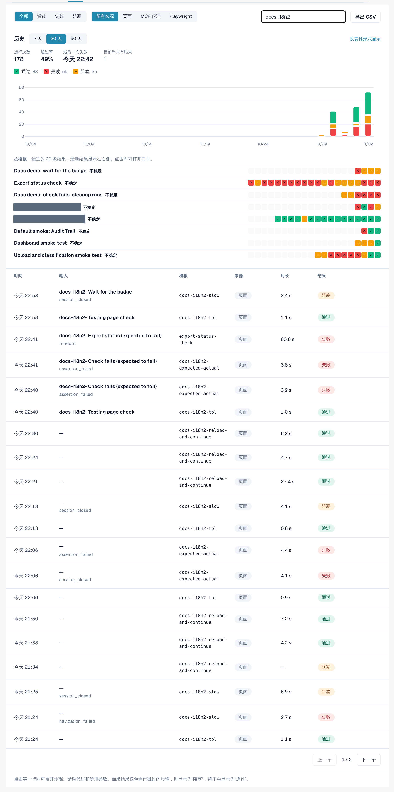
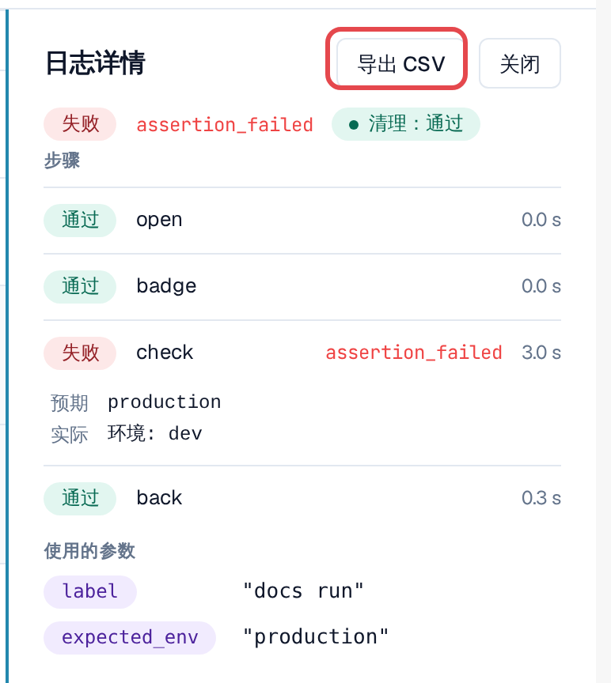
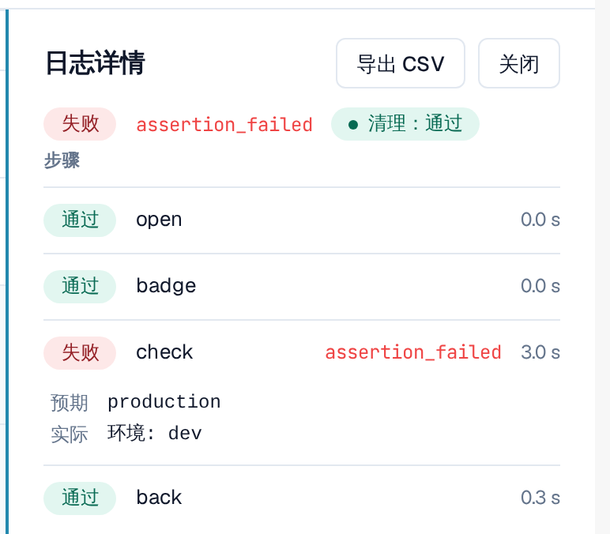
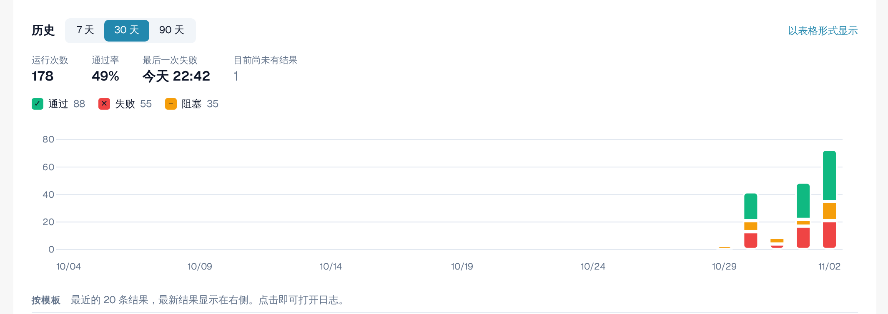
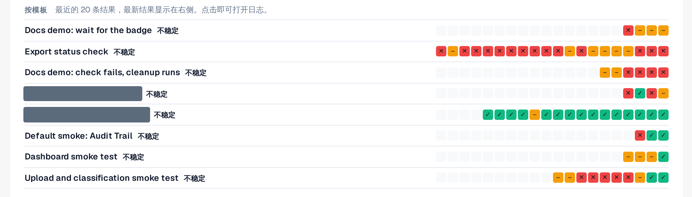

# 日志和历史

每次运行，无论以何种方式启动，最终都会进入 **日志** 标签页：结果、各个步骤、失败步骤的错误代码以及所使用的参数。日志不存储页面内容，也不存储屏幕截图。

打开 **设置 → Testing**，进入 **日志** 标签页。

<figure><figcaption>
日志标签页，包含各种结果和来源。
</figcaption></figure>

## 阅读列表

| 列 | 含义 |
|---|---|
| **时间** | 运行开始的时间。 |
| **输入** | 所启动的输入（或测试计划用例）。 |
| **模板** | 模板 ID。 |
| **来源** | **页面**（在浏览器中启动）、**MCP 代理**、**Playwright**、**手动**（手动确认的用例）。 |
| **时长** | 运行所用的时间。 |
| **结果** | **通过**：所有步骤均通过。**失败**：有步骤失败。**已阻止**：无法对该次运行作出判断，例如因为步骤被跳过；仅由已跳过的步骤组成的运行绝不会显示为通过。 |

可通过 **全部 / 通过 / 失败 / 已阻止**、**所有来源 / 页面 / MCP 代理 / Playwright** 或
**搜索日志** 进行筛选。

## 打开日志

选择一行。**日志详情** 会显示每个步骤及其结果、失败步骤的错误代码，以及
**已使用的参数**（敏感值仅显示为 *启动时提供*）。如果存在对应的测试计划用例，**打开用例** 会跳转到该用例。

<figure><figcaption>
失败运行的日志详情。
</figcaption></figure>

### 预期值和实际值

在失败的检查下方，**日志详情** 会显示该检查预期的内容和实际找到的内容：

* **预期**：模板要求的值。
* **实际**：页面上实际存在的值。

两者仅在 **开发和测试环境** 中显示，会被截短为 120 个字符，并且在步骤使用敏感值时省略。在客户环境（沙盒、生产环境）中，日志只保留错误代码。

### 清理

如果模板包含[清理步骤](steps-and-blocks.md)，结果旁边的标签会显示清理的结束情况：
**清理：通过**、**清理：失败** 或 **清理：已跳过**（例如因为运行被停止）。即使检查失败，清理步骤也会运行。清理失败不会改变运行结果，但测试数据（例如已上传的文档）可能会被遗留下来。打开日志即可查看是哪个清理步骤失败。

<figure><figcaption>
日志详情：失败的检查及其预期和实际值，以及标签“清理：通过”。
</figcaption></figure>

## 历史图表

在列表上方，**历史** 显示测试随时间的运行情况。可在 **显示为图表** 和 **显示为表格** 之间切换。

* **每日结果**：每天按您所在时区统计通过、失败或被阻止的运行次数。选择
  **时间范围**（7 到 90 天，默认 30 天）。选择某一天即可将列表筛选为当天的记录；**重新显示所有日期** 可取消筛选。
* **通过率** 和 **最近一次失败** 汇总所选时间范围。仍在进行的运行计为 *尚无结果*。
* **按模板**：每个模板最近的 20 个结果，最新的在右侧，并带有标签：**稳定**（全部
  通过）、**不稳定**（结果不一）或 **未通过**（仅有失败或被阻止的结果）。选择某个结果即可打开其日志。
  不稳定的模板排在最前面。

<figure><figcaption>
历史：每日结果。
</figcaption></figure>

<figure><figcaption>
按模板：最近 20 个结果及稳定性。
</figcaption></figure>

## 导出为 CSV

选择工具栏中的 **导出 CSV**，即可下载与所选结果和来源相符的日志（最多 5,000 条；
不应用搜索文本）。在 **日志详情** 中，**导出 CSV** 会下载包含所有步骤的单条日志。

该文件可直接在 Excel 中打开（UTF-8）。时间为 UTC。其中包含的信息与页面相同：没有
敏感值，也没有页面内容。

<figure><figcaption>
日志工具栏中的“导出 CSV”。
</figcaption></figure>
