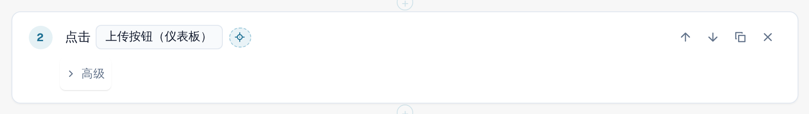
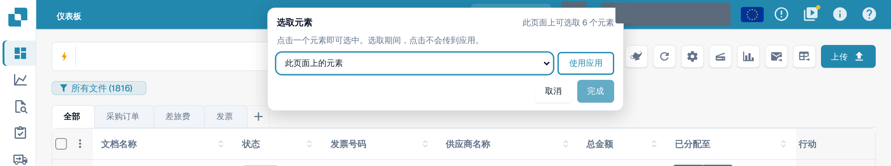
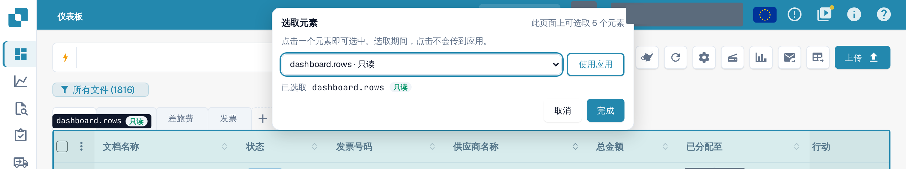
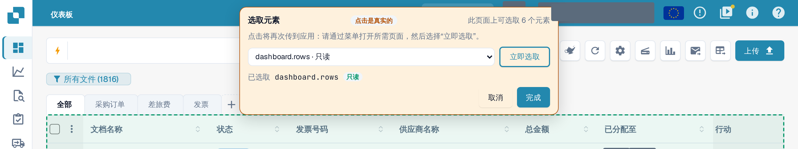

# 在应用中选取元素

每个步骤都需要知道它作用于页面上的 **哪个元素**：按钮、字段还是表格。您无需在冗长的列表中查找，而可以直接在真实应用中指向它。

## 选取元素

1. 在模板编辑器中，选择步骤元素旁边的十字准星按钮 **在应用中选取**。

<figure><figcaption>
“点击”步骤的元素旁边的“在应用中选取”按钮
</figcaption></figure>

2. DocBits 会打开测试在此步骤所处的页面：即最近的前一个 **打开页面** 步骤所指向的页面。
   如果该步骤使用了输入值，DocBits 会询问要打开哪个页面。您的草稿会保留且不会保存，
   应用仍留在这个浏览器标签页中。
3. 页面顶部会出现 **选取元素** 栏。它会告知此页面上有多少个元素可以选取。将鼠标移到页面上：
   DocBits 会为指针下方的元素描出轮廓，并显示其名称及类别：
   **读取**（仅读取）、**更改数据**、**不可逆** 或 **未知**。

<figure><figcaption>
悬停在文档列表上：轮廓标出元素 dashboard.rows 及其类别“读取”
</figcaption></figure>

4. 点击该元素。该栏会在 **已选择** 下显示它。您也可以从栏中的列表
   **此页面上的元素** 选择元素，该列表支持键盘操作，也支持屏幕阅读器。

<figure><figcaption>
点击后的栏：已选择 dashboard.rows，“完成”可用
</figcaption></figure>

5. 选择 **完成**。编辑器会重新打开，其中包含您的草稿以及步骤中的该元素。选择 **取消** 则不作更改直接返回。
   无论哪种情况，草稿都不会被保存：满意之后，请在编辑器中选择 **保存**。

选取期间，**应用不会收到您的点击。** 选取 **删除** 按钮不会删除任何内容。请通过 **完成** 或 **取消** 退出选取器；任何按键（包括 Esc）都无法将其关闭。当测试在此标签页中运行时，该按钮会被禁用。

## 选取表格、列或行操作

**表格** 组的步骤（**检查表格行**、**点击表格行**、来自表格单元格的 **记住值**）只接受表格。点击表格中的某个单元格：DocBits 会选取该表格，并将该单元格所在的列以及该行的其他列作为建议，填入步骤的列字段。对于 **点击表格行**，请点击行内的按钮，以选取该行操作。**检查数量** 接受任何元素，包括表格。

## 选取时使用应用

您需要的元素可能在另一个页面上。选择 **使用应用**。栏会变成橙色并显示 **点击为真实操作**：
从现在起，您的点击会再次传到应用中，因此可以通过正常菜单打开其他页面。
该栏会保留，其列表会随页面变化。选择 **立即选取** 即可重新选取。

<figure><figcaption>
“使用应用”模式：点击为真实操作，“立即选取”返回选取状态
</figcaption></figure>


在 **使用应用** 模式下，点击就是真实点击：它可能会在您的组织中保存、删除或发送数据。
在点击任何您不想执行的操作之前，请先通过 **立即选取** 切换回来。

