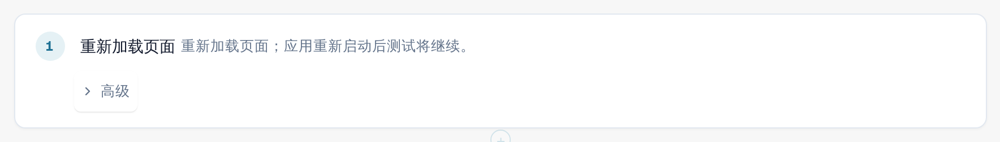

# 重新加载与继续

有些内容只有在页面重新加载之后才能检查，例如某项设置在重新加载后是否仍然存在。**重新加载页面** 步骤会在测试进行过程中重新加载浏览器页面，之后测试会继续进行。

## 添加重新加载步骤

1. 在模板编辑器中，选择 **+ 添加步骤**，然后选择 **页面** 组，再选择 **重新加载页面**。
2. 把该步骤放在需要重新加载的位置。其后的步骤会在重新加载后的页面中运行。

<figure><figcaption>
模板编辑器中的“重新加载页面”步骤
</figcaption></figure>

## 运行期间会发生什么

1. 标签页保存测试进度，然后重新加载页面。
2. 应用重新启动期间，顶部会出现横幅 **页面已重新加载，测试继续进行**，后面是测试名称。请勿关闭标签页。
3. 重新加载后的页面会接管该次运行，并继续执行下一个步骤。重新加载之前的步骤保留各自的结果，**重新加载页面** 步骤显示为已通过，测试的计时在重新加载期间继续进行。

<figure><figcaption>
重新加载后的横幅：页面已重新加载，测试继续进行
</figcaption></figure>

记住的值在重新加载后会保留，但您标记为机密的值除外（请参阅
[步骤和现成步骤块](steps-and-blocks.md)）。请确保重新加载之后的任何步骤都不需要机密值。

## 须知

* 只有此步骤能在不结束测试的情况下重新加载页面。如果您自己重新加载或关闭标签页，该次运行会以
  **已取消** 结束。
* 页面必须在大约两分钟内恢复。否则该次运行会以 **已取消** 或 **无法投递** 结束。
* 一个测试最多可以包含五个重新加载步骤。
* 测试在同一个浏览器标签页中以同一用户继续运行。如果浏览器不允许标签页保存进度（例如因为存储被阻止），重新加载步骤会在页面重新加载之前失败。
* 该测试需要模板 schema 1.3，添加此步骤时编辑器会自动设置。
