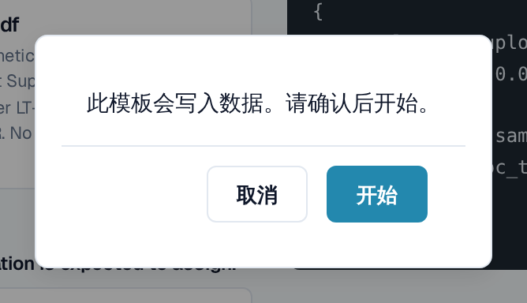
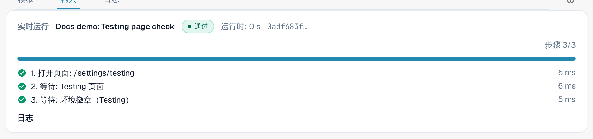
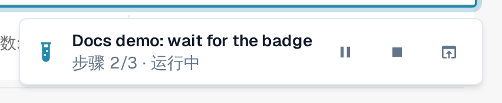
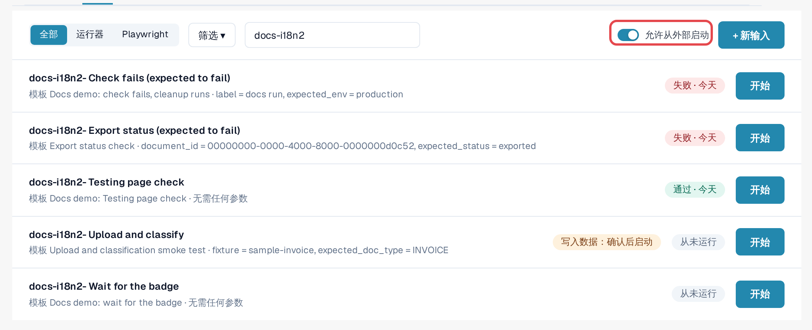
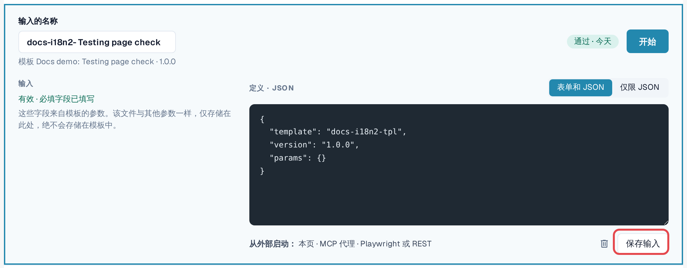

# 启动测试

测试就是模板加输入。Testing 模块负责运行并控制测试；您选择如何启动它。这三种方式是平等的，每次运行都会进入[日志](logs.md)。

| 方式 | 适用场景 | 在日志中显示为 |
|---|---|---|
| **在浏览器中** | 您想立即运行一项检查并观察其过程。 | **页面** |
| **AI 助手（MCP）** | 您使用已连接 DocBits 的 AI 助手，并希望由它运行和评估检查。 | **MCP 代理** |
| **从外部（Playwright 或 REST）** | 您的测试自动化或 CI 流水线启动检查，例如在部署之后。 | **Playwright** |

无论哪种情况，点击操作都发生在 **组织管理员的 DocBits 浏览器标签页** 中，并使用该用户的权限。该标签页必须保持打开；重新加载或关闭它会结束运行。唯一的例外是测试自身的 **重新加载页面** 步骤
（请参阅[重新加载与继续](reload-and-resume.md)）。

## 在浏览器中启动

1. 打开 **设置 → Testing**，进入 **输入** 标签页。
2. 在输入上选择 **开始**（或打开该输入并选择 **开始**）。
3. 如果模板会更改数据，DocBits 会询问：*此模板会写入数据。确认后开始。* 选择 **开始** 继续。
4. 测试在此标签页中运行。在 Testing 页面上，**实时运行** 面板显示状态、**当前操作**、
   步骤进度以及 **暂停**、**继续** 和 **停止**。当测试打开其他页面时，右下角的小型指示器
   会在该页面上显示进度。测试结束时，指示器会显示结果，并提供
   **打开日志** 和 **关闭**。
5. 测试结束后，打开 **日志** 标签页查看结果。

<figure><figcaption>
写入数据的测试启动前的确认。
</figcaption></figure>

<figure><figcaption>
测试通过后的实时运行面板。
</figcaption></figure>

<figure><figcaption>
在其他页面右下角显示的运行指示器。
</figcaption></figure>


**测试期间的上传：** 如果您的组织有子组织，且仪表板显示所有子组织，上传对话框通常会询问文档属于哪个子组织。测试运行期间，上传会直接进入
**对话框提供的第一个子组织**，不再询问。若要上传到特定的子组织，请从该子组织的视图中启动
测试。


## 允许从外部启动

AI 助手或 Playwright 脚本无法自行点击；它们会请求 DocBits 在 **您已注册的浏览器标签页** 中运行测试：

1. 在应运行测试的浏览器标签页中，打开 **设置 → Testing**，进入 **输入** 标签页。
2. 开启 **允许从外部启动**。该标签页现在接受启动请求，并显示其会话 ID。
3. 保持该标签页打开。标签页重新加载或关闭时，注册即告结束。

<figure><figcaption>
已开启“允许从外部启动”，并显示会话 ID。
</figcaption></figure>

输入编辑器会在 **从外部开始** 下提示这三种方式：**此页面**、**MCP 代理**、
**Playwright 或 REST**。

<figure><figcaption>
输入编辑器中的“从外部开始”一行。
</figcaption></figure>

## 从 AI 助手启动（MCP）

如果您的 AI 助手已连接到 DocBits（请参阅 [DocBits MCP](https://docs.docbits.com/advanced-functions-and-tools/docbits-mcp)
和[使用 Claude 或 Codex 配置 DocBits](https://docs.docbits.com/advanced-functions-and-tools/docbits-mcp/configuration-with-claude-or-codex)）：

1. 在某个浏览器标签页中允许从外部启动（见上文）。
2. 向助手发出请求，例如：*“列出我的 DocBits 测试输入，并在我已注册的浏览器标签页中启动‘Invoice LT-2026-0001 ready for validation’。然后告诉我结果。”*
3. 如果注册了多个标签页，助手会询问使用哪个标签页；在启动会更改数据的测试之前，它也会先征求您的同意。随后它会读取日志并报告结果。

## 从 Playwright 或其他工具启动（REST）

您的测试自动化通过一次 API 调用启动一个输入，然后读取其日志。它需要：

* 该组织的组织管理员令牌（请参阅 [API 密钥](https://docs.docbits.com/administration-and-setup/settings/global-settings/integration/api-key)）；
* 输入的 ID；
* 已开启 **允许从外部启动** 的浏览器标签页的会话 ID。

调用方式及示例见[面向开发人员](for-developers.md)。

## 客户环境

在沙盒和生产环境中，**环境** 徽章为红色。更改数据的测试在每次启动时都需要明确确认；除非模板声明会写入数据，否则导出、删除或批准步骤会被阻止。请尽可能在测试环境中运行
会写入数据的测试。
