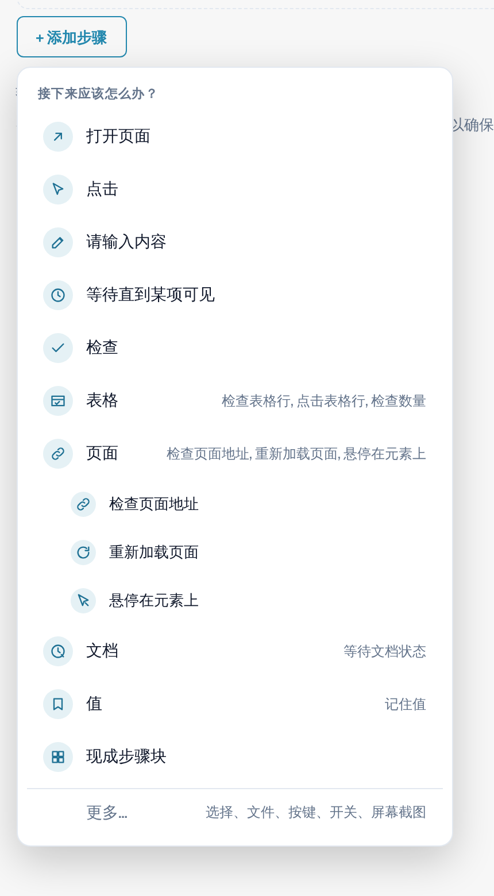
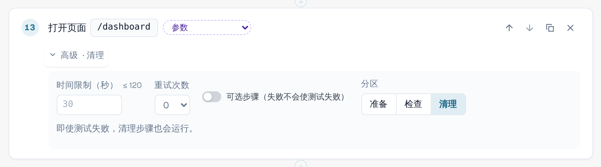
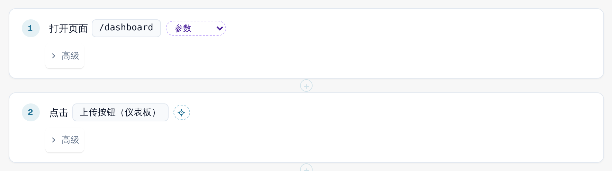
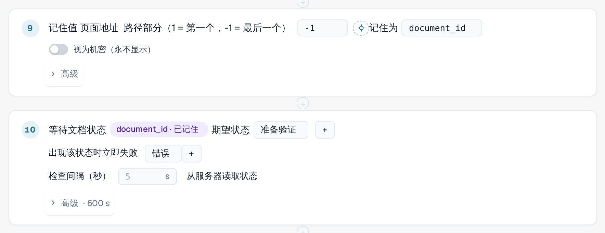

# 步骤和现成步骤块

本页说明如何在编辑器中构建模板（[模板](templates.md)）：步骤组、步骤的 **高级** 设置、现成步骤块，以及测试如何把值从一个步骤传递到下一个步骤。

## 添加步骤

在模板编辑器中，选择 **+ 添加步骤**。菜单 **接下来应该怎么办？** 会列出各个步骤。五个基本步骤是 **打开页面**、**点击**、**请输入内容**、**等待直到某项可见** 和 **检查**。
另有四个 **组** 包含更专门的步骤。选择某个组即可查看其中的步骤：

| 组 | 步骤 |
|---|---|
| **表格** | **检查表格行**、**点击表格行**、**检查数量**。用于仪表板上的文档列表等列表。 |
| **页面** | **检查页面地址**、**重新加载页面**（请参阅[重新加载与继续](reload-and-resume.md)）、**悬停在元素上**。 |
| **文档** | **等待文档状态**：等待文档达到某个状态，例如 *待验证*。 |
| **值** | **记住值**：保留页面中的一段文本，供后续步骤使用。 |

**现成步骤块** 一次添加多个步骤（见下文）。**更多…** 提供其他步骤：选择选项、上传文件、按键、
切换开关和截屏（浏览器内运行器会跳过截屏步骤）。

<figure><figcaption>
“添加步骤”菜单，其中包含表格、页面、文档和值这几个组；页面组已展开
</figcaption></figure>

若要让某个步骤指向页面上的某个元素，请在列表中选择该元素，或使用 **在应用中选取**
（[在应用中选取元素](pick-in-app.md)）。

## 步骤的高级设置

每个步骤都有一行 **高级**。选择它即可打开该步骤的设置。折叠状态下，这一行会显示您所做的更改，
例如 *高级 · 120 秒* 或 *高级 · 清理*。

| 设置 | 含义 |
|---|---|
| **时间限制（秒）** | 步骤最多可以耗时多久，最长 120 秒。留空则使用默认的 30 秒。等待文档的步骤有自己的、更长的限制。 |
| **重试次数** | 步骤失败时 DocBits 重复执行的次数（0 到 3）。 |
| **可选步骤（失败不会导致测试失败）** | 如果该步骤失败，日志会将其显示为已跳过并附上错误，测试继续进行。 |
| **阶段** | **准备**、**检查** 或 **清理**。默认为 **检查**。 |

**准备** 步骤负责搭建测试环境。**检查** 步骤是测试本身。**清理** 步骤负责清除测试留下的内容，
例如测试上传的文档。**即使测试失败或超时，清理步骤也会运行**，而且清理步骤失败不会改变测试结果。它们必须是模板的最后几个步骤；如果普通步骤排在清理步骤之后，编辑器会报告错误。如果您停止测试或关闭标签页，它们不会运行。
包含清理步骤的模板会保存为 schema 1.3（请参阅[面向开发人员](for-developers.md)）。

<figure><figcaption>
步骤的高级设置：时间限制、重试次数、可选步骤和阶段，其中已选择“清理”
</figcaption></figure>

## 现成步骤块

选择 **+ 添加步骤**，然后选择 **现成步骤块**。一个步骤块会添加某个常见序列的各个步骤以及所需的参数。之后您可以修改其中的每个步骤。

| 步骤块 | 添加的内容 |
|---|---|
| **上传文档** | 打开仪表板，打开上传对话框，选择测试文件并确认。 |
| **检查文档字段** | 打开文档，并将某个字段与预期值进行比较。 |
| **检查导出状态** | 打开文档并比较其状态。 |
| **上传文档并等待处理完成** | 上传测试文件，记住新文档，并等待其状态。 |
| **在表格中查找行** | 检查仪表板列表中是否存在具有指定发票号码的行，并将其打开。 |
| **记住值** | 记住页面中的一段文本，供后续步骤使用。 |

<figure><figcaption>
“添加步骤”菜单中的现成步骤块
</figcaption></figure>

### 上传文档并等待处理完成

当后续步骤需要用到测试刚刚上传的文档时，请使用此步骤块。它通过文档本身来识别新文档，而不是依据列表的第一行，因此绝不会误选较早的文档。随后它从页面地址中读取文档 ID，并等待文档达到预期状态
（默认为 *待验证*，最长 10 分钟；如果文档变为 *错误* 状态，则立即停止）。
它会添加输入值 **fixture**（测试文件）和 **expected_status**，并将整个测试的时间上限提高到至少 15 分钟。

<figure><figcaption>
“上传文档并等待处理完成”步骤块的各个步骤
</figcaption></figure>


**上传位置：** 如果您的组织有子组织，且仪表板显示所有子组织，上传对话框通常会询问文档属于哪个子组织。测试无法回答这个问题。当测试在标签页中运行时，上传会直接进入 **对话框提供的第一个子组织**，不再询问。
在测试之外不受影响。若要上传到特定的子组织，请从该子组织的视图中启动测试。


### 在表格中查找行

此步骤块检查仪表板列表中是否有具有指定发票号码的行（输入值 **row_value**），并将其打开。若要按其他列搜索，请在步骤中更改列和值。这两个步骤都属于
**表格** 组；**检查数量** 可统计行数或任何其他元素的数量。

## 记住一个值并在之后使用

测试常常需要一个仅在运行期间才存在的值，例如它刚刚上传的文档的 ID。

1. 添加 **记住值**（**值** 组）。选择值的来源：页面中的一段文本、页面地址
   （路径的一部分或查询参数）或表格行中的一个单元格。在 **记住为** 下输入名称，
   例如 `document_id`。对于不得在任何地方显示的值，请开启 **视为机密（永不显示）**。
2. 在后续步骤中，选择已记住的值，而不是手动输入。该步骤会显示类似
   *document_id · 已记住* 的标签。在模板 JSON 中，它写作 `{{vars.document_id}}`。

步骤中可以使用两种值：

| 种类 | 写法 | 来源 | 示例 |
|---|---|---|---|
| **输入** | `{{params.name}}` | 已保存的[输入](inputs.md)：该输入的每次运行都相同。使用值旁边的参数按钮来创建。 | *fixture · 每次运行的变化* |
| **记住的值** | `{{vars.name}}` | 同一次运行中较早的 **记住值** 步骤。 | *document_id · 已记住* |

<figure><figcaption>
“记住值”保存文档 ID；下一个步骤等待该文档
</figcaption></figure>

<figure><figcaption>
使用输入值 fixture 的步骤
</figcaption></figure>

记住的值只在当前运行中存在，绝不会保存到模板或日志中。除非被标记为机密，否则记住的值在测试内部的[页面重新加载](reload-and-resume.md)后仍会保留。
