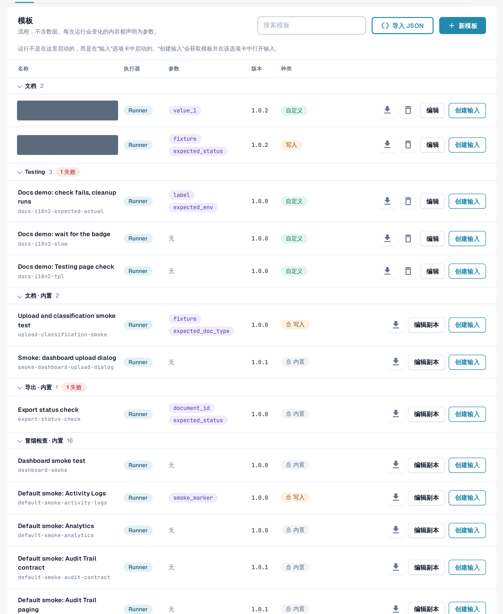
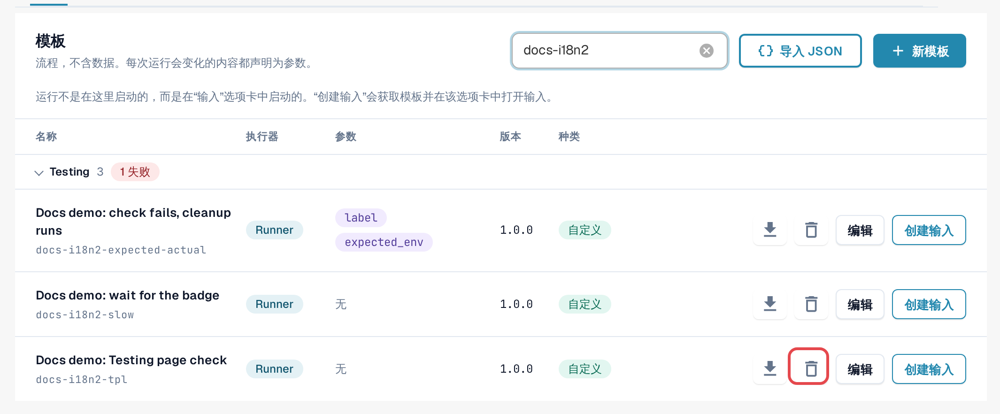
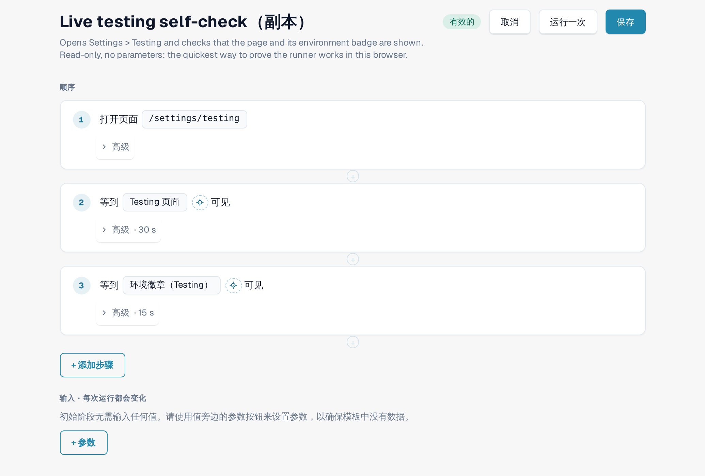
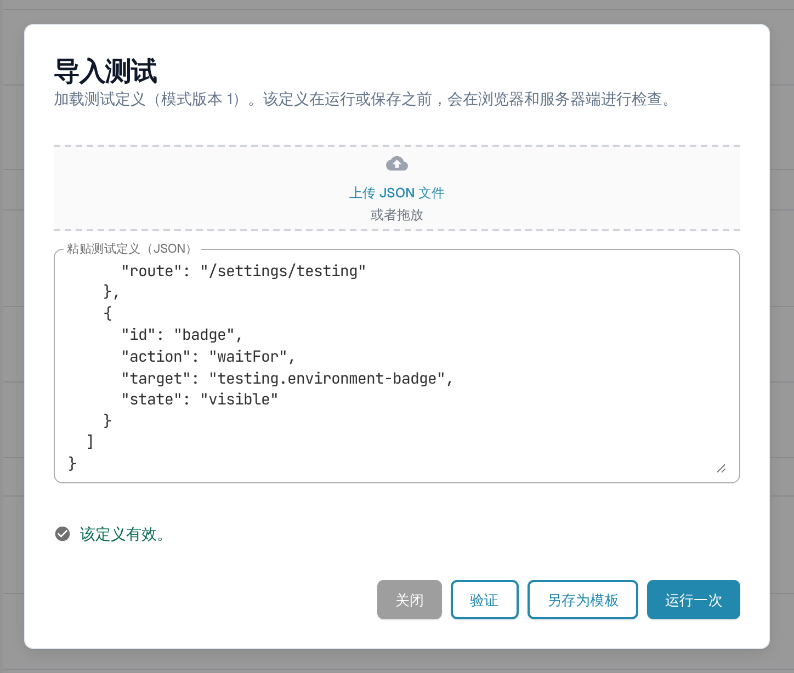
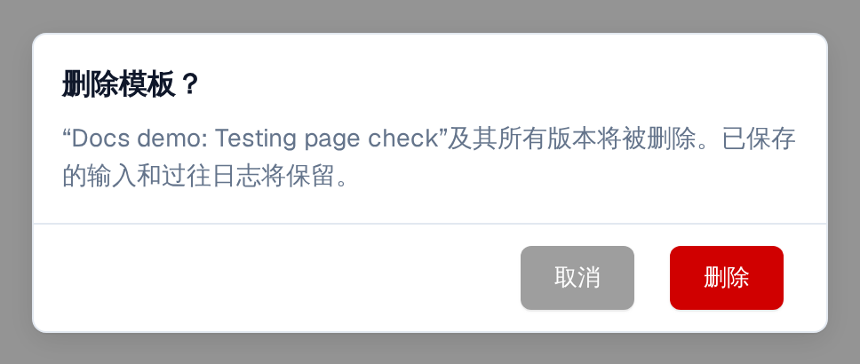

# 模板

模板描述 **检查什么**：打开哪个页面、点击或填写什么内容，以及最后必须看到什么或什么必须成立。它不包含贵组织的任何数据。因组织或因运行而异的值（例如文档 ID）会被声明为 **参数**，并由[输入](inputs.md)填入。

打开 **设置 → Testing**，进入 **模板** 标签页。

<figure><figcaption>
模板标签页：分组、列和行操作。
</figcaption></figure>

## 阅读列表

模板按类别分组（例如 **冒烟检查**、**验证**、**文档**、**导出**）。
选择组名即可折叠该组；组上的红色标签统计最近一次运行失败的模板数量。
**搜索模板** 按名称筛选。

| 列 | 含义 |
|---|---|
| **名称** | 模板名称，其下方是模板 ID。 |
| **执行器** | **运行器**：在此页面的浏览器标签页中运行。**Playwright**：由您的测试自动化运行的检查；可以在此处记录，但不能从此页面启动。 |
| **参数** | 输入必须提供的值。*无* 表示模板可直接运行。 |
| **版本** | 已保存的版本不会再改变。任何更改都会保存为新版本。 |
| **种类** | **内置**（锁形图标）：属于默认模板集，对所有组织都相同，只读。**自定义**：贵组织自己的模板。**写入**：模板会更改数据（例如上传文档），启动前需要确认。 |

行操作：

| 操作 | 作用 |
|---|---|
| 下载图标（**导出为 JSON**） | 将模板定义下载为 JSON 文件，例如用于留存或导入到另一个组织。 |
| **编辑副本**（内置）/ **编辑**（自定义） | 打开模板编辑器，其中是一份可更改的副本，您可以将其保存为自己的模板。 |
| **创建输入** | 打开[输入](inputs.md)标签页，并为该模板显示一个新输入。测试在那里启动，而不是在这里。 |
| 垃圾桶图标（**删除模板**） | 仅适用于您自己的模板。请参阅下文的 *删除自己的模板*。 |

<figure><figcaption>
一个默认模板行和一个自有模板行及其操作。
</figcaption></figure>

## 创建自己的模板

当没有默认模板能检查您所需的内容，或者您想要一份修改过的默认模板副本时，就需要创建自己的模板。

**从默认模板开始：** 在其所在行选择 **编辑副本**。**从空白开始：** 选择 **新建模板**。

在模板编辑器中：

1. 输入 **模板名称**，也可以选填该模板的用途。
2. 选择 **+ 添加步骤**，然后选择一个模块，例如 **打开页面**、**点击**、**填写**、**选择**、
   **等待**、**检查文本**、**检查字段** 或 **检查状态**。**现成步骤块** 可一次性添加常见的步骤序列，例如
   **上传文档** 或 **上传文档并等待处理完成**。有关步骤组、**高级** 设置和清理步骤，请参阅[步骤和现成步骤块](steps-and-blocks.md)。
3. 对于每个因组织或因运行而异的值，使用该值旁边的参数按钮。该值会成为 **输入 · 每次运行都会变化** 下的参数，并带有类型（**文本**、**数字**、**是/否**、
   **服务器测试文件**）、默认值，如果必须填写，则标记为 **必填**。
4. 选择 **保存**。如果想在不保存的情况下试运行草稿一次，请选择 **运行一次**。

若要通过在应用程序中指向的方式选择某个步骤的元素，请使用 **在应用中选取**
（[在应用中选取元素](pick-in-app.md)）。

会更改数据的步骤（例如上传文档）会标记为 **写入数据**。包含此类步骤的模板每次启动时都会要求确认。

<figure><figcaption>
包含两个步骤和一个参数的模板编辑器。
</figcaption></figure>

如果在此期间有人保存了该模板的同一版本（例如在另一个标签页中），DocBits 会保留您的草稿，并提供 **另存为下一个可用版本** 或 **重新加载最新版本**。

## 从 JSON 导入模板

1. 选择 **导入 JSON**。
2. 选择 **上传 JSON 文件**，或将定义粘贴到 **粘贴测试定义（JSON）** 中。
3. 选择 **验证**。DocBits 会在浏览器和服务器端检查该定义，并列出所有问题。
4. 选择 **另存为模板** 将其添加到您的模板中，或选择 **运行一次** 在不保存的情况下试运行。

<figure><figcaption>
“导入测试”对话框，其中显示已验证的定义。
</figcaption></figure>

格式说明请参阅[面向开发人员](for-developers.md)。

## 删除自己的模板

1. 在您自己的模板所在行，选择垃圾桶图标（**删除模板**）。
2. 阅读确认提示 **删除模板？**，然后选择 **删除**。

模板及其 **所有版本** 都会被移除。已保存的输入和以往的日志会保留，因此历史记录仍可查阅。
指向该模板的输入仍留在列表中；请编辑或删除它们。之后您可以再次保存一个 ID 相同的模板。内置模板和默认模板无法删除。

<figure><figcaption>
删除模板的确认对话框。
</figcaption></figure>
