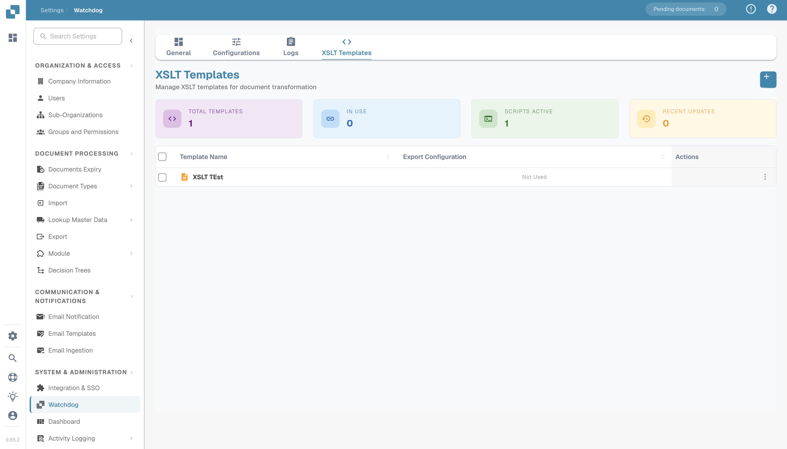

# WatchDog 管理员常见问题与故障排查

<figure><figcaption></figcaption></figure>

本文档帮助管理员了解 WatchDog 错误消息并排查问题。

**UI 位置：** 设置 → 文档处理 → WatchDog

---

## 1. WatchDog 设置页面（UI）

### 1.1 常规选项卡

<figure><figcaption></figcaption></figure>

* **下载：** 获取最新的 WatchDog.exe
* **API Key：** 复制配置命令
* **自动更新计划：** 配置更新频率
* **安装指南：** 分步设置说明

### 1.2 配置选项卡

* **导入配置：** 定义监视文件夹和文档类型
* **导出配置：** 定义导出目标位置和方法
* **批量复制：** 在子组织之间复制配置
* **导入/导出：** 以 JSON 格式导入/导出配置

> **重要：** 导出配置现在**必须指定文档类型**（`doc_type`）。缺少有效文档类型的配置将被拒绝。

### 1.3 状态选项卡

<figure><figcaption></figcaption></figure>

* 显示 WatchDog 的实时连接状态
* **新增字段：** `last_restart`、`version_first_seen`、`latest_version_checked_at`
* **系统信息：** 安装路径、可用 RAM、可用磁盘空间

### 1.4 日志选项卡

<figure><figcaption></figcaption></figure>

* 显示来自 OpenSearch 的所有 WatchDog 事件
* 可按事件类型、时间段等筛选
* **事件类型：**
  * `FILE_IMPORT_STARTED`：文件导入已开始
  * `FILE_IMPORT_COMPLETED`：导入成功
  * `FILE_IMPORT_FAILED`：导入失败
  * `EXPORT_STARTED`：导出已开始
  * `EXPORT_COMPLETED`：导出成功
  * `EXPORT_FAILED`：导出失败
  * `FOLDER_VALIDATION_FAILED`：文件夹无法访问
  * `CONFIG_LOADED`：配置已加载
  * `SERVICE_RESTART_INITIATED`：已请求重启服务
  * `SERVICE_RESTART_COMPLETED`：服务已重启

### 1.5 XSLT 模板选项卡

<figure><figcaption></figcaption></figure>

* 上传和管理 XSLT 转换模板
* 使用字段分析进行实时验证
* 将模板关联到导出配置

---

## 2. 文件夹验证错误消息

| 错误 | 含义 | 解决方案 |
| :--- | :--- | :--- |
| `not_found` | 文件夹不存在 | 创建文件夹或更正路径 |
| `no_read_access` | 没有读取权限 | 为 WatchDog 服务账户设置权限 |
| `no_write_access` | 没有写入权限 | 向服务账户授予写入权限 |
| `not_configured` | 未配置文件夹路径 | 在配置中输入路径 |

**受影响的文件夹：**

* **监视文件夹（导入）：** WatchDog 查找新文件的位置
* **成功文件夹：** 成功导入的文件移至此处
* **导出文件夹：** 写入导出的 XML/PDF 文件的位置

---

## 3. 导入错误消息

| 错误 | 含义 | 解决方案 |
| :--- | :--- | :--- |
| `file_not_found` | 文件在导入前已被删除 | 重新提供文件 |
| `invalid_file_type` | 仅支持 PDF 文件 | 移除其他文件类型 |
| `api_not_accessible` | 无法访问 DocBits API | 检查网络/防火墙，并确认 API URL |
| `api_check_failed` | API 健康检查失败 | 检查 API Key 和连接 |
| `upload_failed` | 上传到 API 失败 | 检查 API Key、网络和服务器状态 |

---

## 4. 导出错误消息

| 错误 | 含义 | 解决方案 |
| :--- | :--- | :--- |
| `transformation_error` | XSLT 转换失败 | 检查 XSLT 模板并验证 XML 结构 |
| `folder_error` | 无法访问导出文件夹 | 创建文件夹并检查权限 |
| `file_write_error` | 无法写入文件 | 检查磁盘空间、权限和文件锁定状态 |
| `permission_denied` | 没有写入权限 | 设置服务账户权限 |
| `creation_failed` | 无法创建文件夹 | 检查父文件夹权限 |
| `no_config_match` | 没有匹配的导出配置 | 创建文档类型正确的导出配置 |

> **注意：** 导出配置必须指定 `doc_type`。如果看到 `no_config_match`，请确认存在适用于该文档类型的启用导出配置。

---

## 5. 配置已禁用 — 原因

配置被禁用时，会显示以下原因之一：

| 禁用原因 | 含义 |
| :--- | :--- |
| `Watch folder: not_found` | 导入文件夹不存在 |
| `Watch folder: no_read_access` | 无法读取导入文件夹 |
| `Export folder: not_found` | 导出文件夹不存在 |
| `Export folder: no_write_access` | 无法写入导出文件夹 |
| `Success folder: not_found` | 成功文件夹不存在 |
| `Success folder: no_write_access` | 无法写入成功文件夹 |

**自动重新启用：** WatchDog 会定期检查文件夹（每 60 秒）。文件夹一旦重新可访问，配置就会自动重新启用。

---

## 6. 错误文件夹（`_error`）

失败的文件会移至 `_error` 文件夹：

**位置：** `{import_folder}/_error/{error_type}/`

**文件格式：** `{original_name}_{YYYYMMDD_HHMMSS}.pdf`

**伴随文件：** 每个失败文件都有一个 `.error` 伴随文件，其中包含：

```
Error Type: transformation_error
Error Message: XSLT template not found
Timestamp: 2026-03-26 08:30:15
Original File: invoice_001.pdf
Original Path: C:\WatchDog\Import\invoice_001.pdf
```

---

## 7. 心跳与连接状态

WatchDog 每隔约 10 秒向 DocBits 发送一次心跳，并附带系统信息：

| 发送的数据 | 说明 |
| :--- | :--- |
| Timestamp | 当前时间 |
| Version | 已安装的 WatchDog 版本 |
| Last Restart | 上次重启服务的时间 |
| Auto-Update Enabled | 是否启用了自动更新 |
| Latest Version | 可用的最新版本 |
| Installation Path | WatchDog 的安装位置 |
| Free RAM / Disk | 可用系统资源 |

### 连接状态

| 状态 | 含义 |
| :--- | :--- |
| ✅ **在线** | WatchDog 已连接并处于活动状态 |
| ⚠️ **离线** | 超过 30 秒未收到心跳 |
| ❌ **未安装** | WatchDog 从未连接过 |

**心跳错误：**

* `Heartbeat failed - invalid API key` → API Key 无效
* `Heartbeat failed: 401` → 身份验证失败
* `Heartbeat failed: 5xx` → 服务器问题

---

## 8. 常见问题与解决方案

### 问题：WatchDog 不导入文件

1. 检查服务是否正在运行：`services.msc` → WatchDog
2. 检查日志：设置 → WatchDog → 日志选项卡
3. 检查 WatchDog 服务账户的文件夹权限
4. 测试 API 连接：在 CMD 中运行 `WatchDog.exe debug`
5. 确认文件类型为 PDF

### 问题：导出无法正常工作

1. 是否存在文档类型正确的导出配置？
2. 文档和配置中的文档类型是否匹配？
3. 是否已关联 XSLT 模板（用于文件夹导出）？
4. 服务账户是否有权写入导出文件夹？
5. 对于 Infor 导出：ION 凭据是否配置正确？

### 问题：配置已禁用

1. 文件夹路径是否存在？
2. `NT AUTHORITY\LOCAL SERVICE` 或服务账户是否拥有相应权限？
3. 网络驱动器是否可访问？（检查 UNC 路径）
4. 文件夹重新可用时，WatchDog 会自动重新启用配置

### 问题：XSLT 转换失败

1. XSLT 模板是否有效？（在 XSLT 模板选项卡中使用 Validate）
2. 模板是否适用于该文档类型？
3. 检查文档的 XML 结构
4. V3 文件夹导出使用服务器端转换——请检查 API 连接

### 问题：REST API 导出失败

1. 是否在导出配置中配置了 ION OAuth 凭据？
2. WatchDog 服务器是否可以访问目标 API 端点？
3. 检查有效负载格式是否符合目标 API 的要求
4. 检查请求链配置中是否存在 JSONPath 错误

---

## 9. 命令行命令

```bash
# Configure API connection
WatchDog.exe -api YOUR_API_KEY

# Install Service
WatchDog.exe install

# Start Service
WatchDog.exe start

# Stop Service
WatchDog.exe stop

# Run in debug mode (console output)
WatchDog.exe debug

# Uninstall Service
WatchDog.exe remove

# Show version
WatchDog.exe --version

# List watch folders
WatchDog.exe --list-folders

# Add/remove watch folder
WatchDog.exe --add-folder "C:\Import\Invoices"
WatchDog.exe --remove-folder "C:\Import\Invoices"

# Check Windows service status
sc query WatchDog
```

---

## 10. 日志文件

**位置：** `C:\WatchDog\logs\{module}\`

**日志格式：**
```
INFO  - 2026-03-26 10:00:00 - module_name - Message - function=func_name - line=42
```

**日志级别：** DEBUG、INFO、WARNING、ERROR

**远程日志：** WatchDog 也会将日志发送到 DocBits（可在日志选项卡中查看），并可选择发送到 Logtail 云日志服务。
