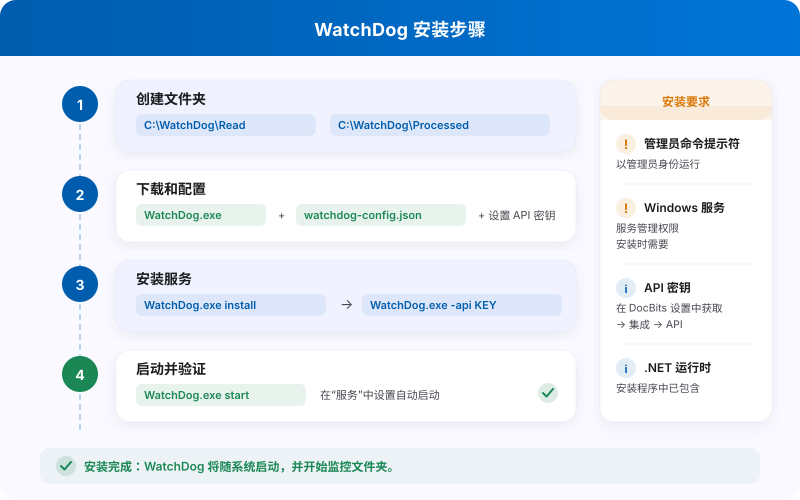
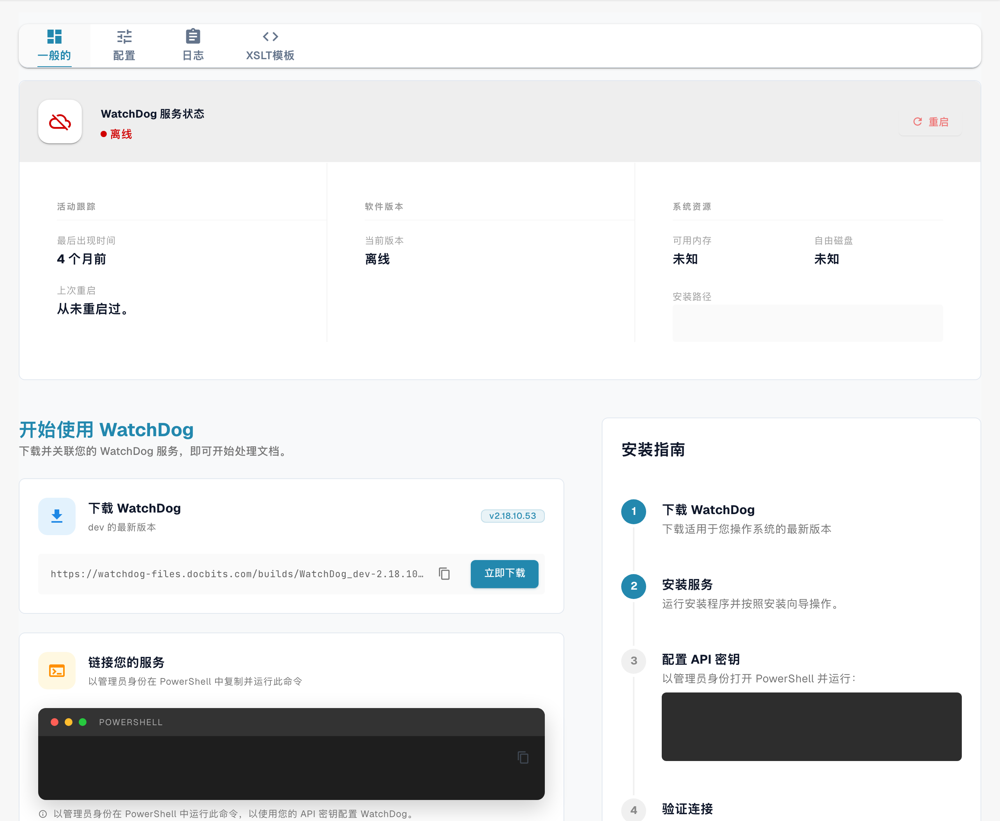

# WatchDog 安装

<figure><figcaption><p>WatchDog 安装流程与主要要求。</p></figcaption></figure>

> **推荐：** 使用下文介绍的现代设置方式。现在可以直接在 DocBits 应用中创建 WatchDog 配置，无需本地配置文件。

## 前提条件

* Windows Server 或 Windows 10/11
* 管理员权限
* 可连接到 DocBits API 的网络
* DocBits API 密钥（可在“设置 → 文档处理 → WatchDog → 常规”选项卡中获取）

## 安装步骤

### 1. 创建所需文件夹

创建一个主目录和子文件夹，用于 WatchDog：

```
C:\WatchDog\              ← WatchDog executable
C:\WatchDog\Import\       ← Watch folder for incoming documents
C:\WatchDog\Processed\    ← Success folder for processed documents
C:\WatchDog\Export\        ← Export folder for exported files
```

> **注意：** 建议使用本地路径。支持 UNC 网络路径（例如 `\\server\share`），但要可靠地检测文件，可能需要使用 Polling Observer。

### 2. 下载 WatchDog

从 DocBits 应用中下载 `WatchDog.exe`：

**设置 → 文档处理 → WatchDog → 常规选项卡 → 下载**

将下载的 `WatchDog.exe` 文件放在 `C:\WatchDog\` 中。

### 3. 配置 API 连接

以**管理员**身份打开**命令提示符（CMD）**并运行：

```powershell
cd C:\WatchDog
WatchDog.exe -api YOUR_API_KEY
```

此操作会将 WatchDog 连接到你的 DocBits 组织，并自动获取配置。

### 4. 安装为 Windows 服务

```powershell
WatchDog.exe install
```

### 5. 启动服务

```powershell
WatchDog.exe start
```

### 6. 在 DocBits 中创建配置

在 DocBits 中导航至**设置 → 文档处理 → WatchDog → 配置**选项卡：

* 点击**新建导入配置**以设置监视文件夹
* 点击**新建导出配置**进入通用导出向导，选择文档类型和导出类型，再设置对应目标。

> **重要：** 导出配置需要指定**文档类型**。所有配置都在 DocBits 中集中管理，而不是保存在本地配置文件中。

### 7. 设置自动启动

1. 打开**服务**（`Win + R` → `services.msc`）
2. 在服务列表中找到 **WatchDog**
3. 双击打开属性
4. 将**启动类型**设为**自动（延迟启动）**
5. 点击**确定**

## 验证安装

安装完成后，请在 DocBits 中查看 WatchDog 状态：

**设置 → WatchDog → 常规选项卡**

<figure><figcaption><p>当前中文 WatchDog“一般的”页面，同时展示服务状态和安装入口。图中的离线状态只是测试环境的当前值；命令和安装路径已隐藏，未重启或配置服务。</p></figcaption></figure>

* ✅ **在线** — WatchDog 已连接并正在发送心跳信号
* 应显示版本、上次重启时间和系统信息

## 命令参考

| 命令 | 描述 |
| :--- | :--- |
| `WatchDog.exe -api KEY` | 配置 API 密钥 |
| `WatchDog.exe install` | 安装为 Windows 服务 |
| `WatchDog.exe start` | 启动服务 |
| `WatchDog.exe stop` | 停止服务 |
| `WatchDog.exe debug` | 在控制台模式下运行（用于故障排查） |
| `WatchDog.exe remove` | 卸载服务 |
| `WatchDog.exe --version` | 显示当前版本 |
| `WatchDog.exe --list-folders` | 列出已配置的监视文件夹 |
| `WatchDog.exe --add-folder PATH` | 添加监视文件夹 |
| `WatchDog.exe --remove-folder PATH` | 移除监视文件夹 |

---

## 旧版：V1 配置（已弃用）

以下使用本地配置文件的 V1 设置方式已**弃用**。请改用上文介绍的基于 API 的现代设置方式。

<details>
<summary>V1 设置（点击展开）</summary>

### 在 DocBits 中配置 WatchDog（V1）

1. **访问 WatchDog 设置**
   * 导航至**设置 → 文档处理 → WatchDog**
2. **文件夹设置**
   * 定义路径：`C:/WatchDog/Read` 和 `C:/WatchDog/Processed`

   <!-- Obsolete illustration retired: Retire obsolete English V1 configuration illustration. The complete explicitly deprecated V1 instructions remain in their historical section, without substituting an unrelated modern screen. -->

3. **常规设置**
   * 选择文档类型，配置导出目标位置

   <!-- Obsolete illustration retired: Retire obsolete English V1 configuration illustration. The complete explicitly deprecated V1 instructions remain in their historical section, without substituting an unrelated modern screen. -->

4. **导出配置**
   * 显示为本地部署处理配置的导出项

   <!-- Obsolete illustration retired: Retire obsolete English V1 configuration illustration. The complete explicitly deprecated V1 instructions remain in their historical section, without substituting an unrelated modern screen. -->

5. **下载配置**
   * 下载 `watchdog-config.json` 并将其放在 `C:\WatchDog\` 中

   <!-- Obsolete illustration retired: Retire obsolete English V1 configuration illustration. The complete explicitly deprecated V1 instructions remain in their historical section, without substituting an unrelated modern screen. -->

</details>
