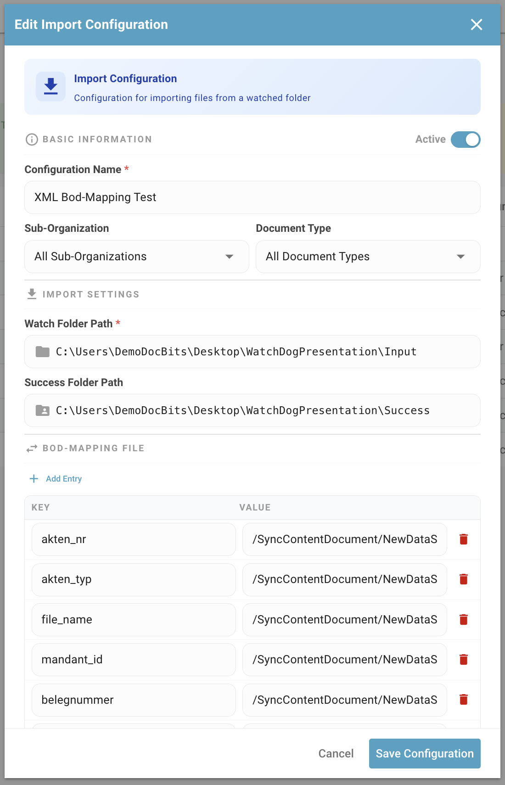
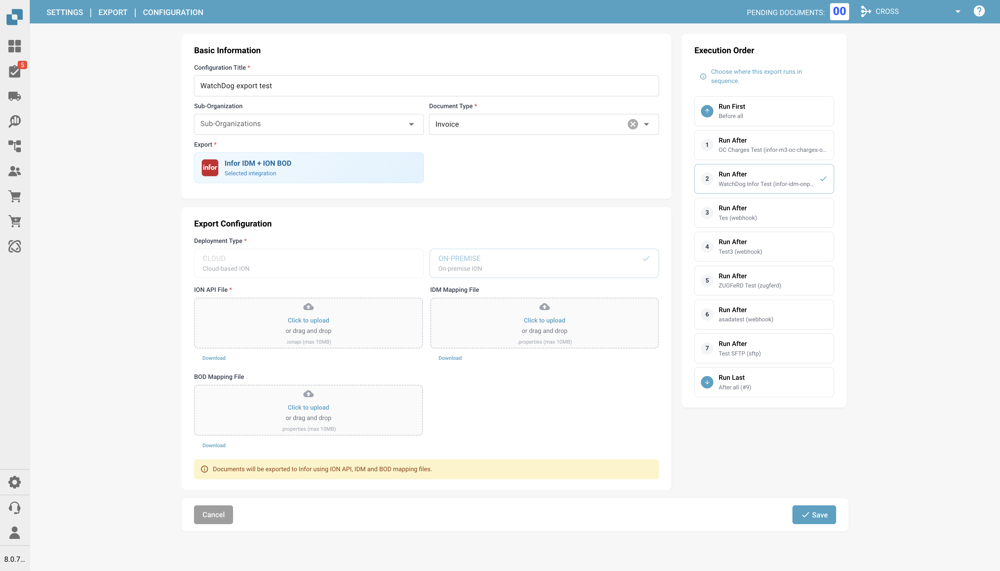

# WatchDog 配置

本指南介绍如何在 DocBits 应用中配置 WatchDog 服务。所有配置均可直接在 **设置 → 文档处理 → WatchDog** 中管理。

<figure><figcaption></figcaption></figure>

---

## 1. 常规选项卡

“常规”选项卡提供设置说明、下载链接和更新设置。

<figure><figcaption></figcaption></figure>

### 1.1 下载和设置

* 直接从“常规”选项卡下载最新版本的 `WatchDog.exe`
* 复制显示的 API Key
* 在管理员命令提示符中运行配置命令：

```powershell
WatchDog.exe -api YOUR_API_KEY
```

### 1.2 自动更新计划

| 选项 | 间隔 |
| :--- | :--- |
| 仅在启动时 | 启动时检查一次 |
| 每小时 | 每 3600 秒 |
| 每天 | 每 86400 秒 |
| 每周 | 每 604800 秒 |

---

## 2. 配置选项卡

创建和管理导入与导出配置。所有配置均直接在 DocBits 中创建，无需本地配置文件。

<figure><figcaption></figcaption></figure>

### 2.1 导入配置

定义 WatchDog 监控新文档的位置。

<figure><figcaption></figcaption></figure>

| 字段 | 描述 |
| :--- | :--- |
| **名称** | 此配置的显示名称 |
| **监控文件夹** | 监控新文档的目录（必填） |
| **成功文件夹** | 成功导入后移动文件的位置 |
| **文档类型** | INVOICE、CREDIT\_NOTE、PURCHASE\_ORDER 等 |
| **子组织** | 可选 — 将文档路由到特定子组织 |

### 2.2 导出配置

定义已处理文档的导出方式和位置。

> **重要：**导出配置现在**必须指定文档类型**（`doc_type`）。未指定文档类型的配置将被系统拒绝。

| 字段 | 描述 |
| :--- | :--- |
| **名称** | 此配置的显示名称 |
| **文档类型** | 必填 — INVOICE、CREDIT\_NOTE 等 |
| **导出方式** | 文档的导出方式（见下文） |
| **导出文件夹** | 文件夹导出的目标目录 |
| **执行顺序** | 匹配多个配置时的优先级（默认值：1） |
| **XSLT 模板** | 可选 — XML 转换模板 |

### 2.3 导出方式

| 方式 | 描述 |
| :--- | :--- |
| **文件夹（监控器）** | 将 PDF + XML 导出到本地文件夹 |
| **Infor IDM** | 上传到 Infor Document Management |
| **Infor BOD** | 将 BOD XML 发送到 Infor LN/M3 |
| **ION API** | 调用 Infor ION API 端点 |
| **GLS840MI** | M3 批处理（通过 REST API） |
| **REST API** | 使用 ION OAuth 身份验证发送到外部 API |

<figure><figcaption></figcaption></figure>

### 2.4 处理选项

* **条码分隔符：**根据条码自动拆分多页文档
* **DocBits 操作器：**启用浏览器自动化任务

---

## 3. 状态选项卡

监控 WatchDog 服务的运行状况和活动。

<figure><figcaption></figcaption></figure>

### 状态信息

| 字段 | 描述 |
| :--- | :--- |
| **在线/离线** | 当前连接状态（心跳阈值为 30 秒） |
| **版本** | 已安装的 WatchDog 版本 |
| **首次检测到版本的时间** | 首次报告此版本的时间 |
| **上次重启时间** | 服务上次重启的时间戳 |
| **已启用自动更新** | 自动更新是否处于启用状态 |
| **最新版本** | 当前可用的最新版本 |
| **上次检查最新版本的时间** | 上次检查最新版本的时间 |
| **系统信息** | 安装路径、可用 RAM、可用磁盘空间 |

### 运行状况指示器

| 状态 | 含义 |
| :--- | :--- |
| ✅ **在线** | WatchDog 已连接并处于活动状态 |
| ⚠️ **离线** | 超过 30 秒未收到心跳 |
| ❌ **未安装** | WatchDog 从未连接到此组织 |

---

## 4. 日志选项卡

查看存储在 OpenSearch 中的所有 WatchDog 事件。

<figure><figcaption></figcaption></figure>

* 按日期、事件类型或关键字筛选
* 事件类型：`FILE_IMPORT_STARTED`、`FILE_IMPORT_COMPLETED`、`FILE_IMPORT_FAILED`、`EXPORT_STARTED`、`EXPORT_COMPLETED`、`EXPORT_FAILED`、`FOLDER_VALIDATION_FAILED`、`CONFIG_LOADED`、`SERVICE_RESTART_INITIATED`、`SERVICE_RESTART_COMPLETED`

---

## 5. XSLT 模板选项卡

管理用于 XML 导出的 XSLT 转换模板。

<figure><figcaption></figcaption></figure>

* 上传和编辑 XSLT 模板
* **实时验证** — 使用示例 XML 测试模板并分析字段
* 将模板关联到导出配置
* 查看使用次数（每个模板被哪些配置使用）

<figure><figcaption></figcaption></figure>

---

## 6. 导出配置选项卡

查看所有启用的导出配置及其连接状态。

* 监控上次成功连接的时间戳
* 直接管理配置（编辑、复制、删除）
* 批量将配置复制到多个子组织
