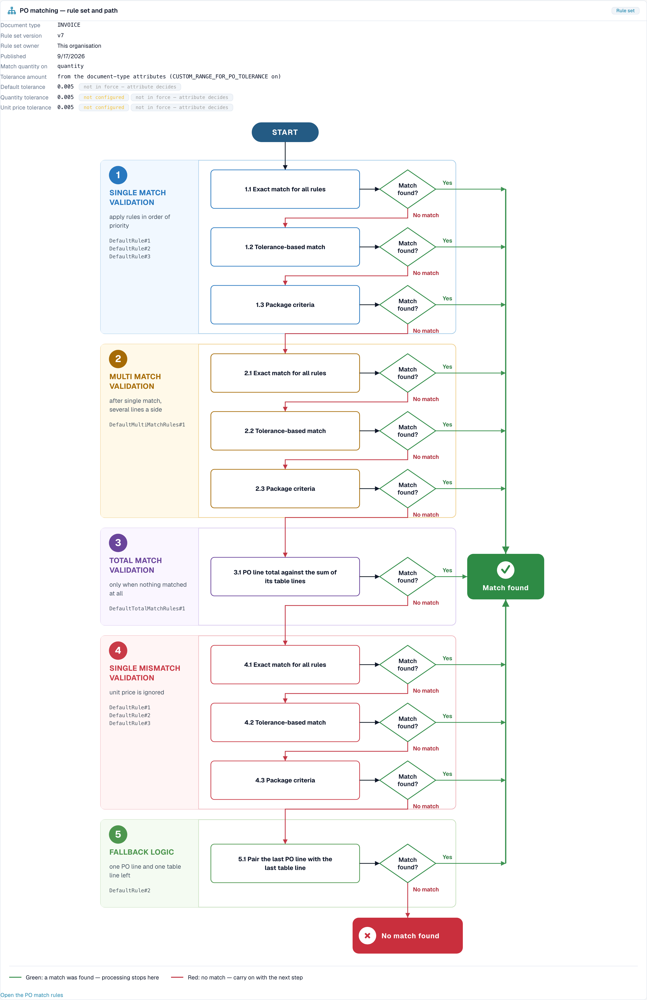

# 无接触智能：采购订单匹配诊断

## 概述

许多发票会卡在采购订单匹配环节。发票上写的内容与采购订单（PO）上的内容不一致，DocBits 无法自行判断两者是否对应。每份这样的文档都需要人工处理，因此它**不是无接触式处理**。

无接触智能会告诉你 PO 匹配失败的**原因**，以及 DocBits **如何**尝试匹配。本页介绍涉及的两个流水线阶段、你会看到的失败原因，以及**PO 匹配决策流程**——一张按顺序展示匹配步骤的图。

### 在无接触智能中查看 PO 匹配的位置

| 位置 | 你会看到的内容 |
| --- | --- |
| **无接触率首次损失的位置**（概览标签页） | 一条状态栏，例如 *PO 行项目匹配：PO 项目不匹配*。它会告诉你有多少份文档卡在此处 |
| **供应商机会** | 根本原因是 **PO 匹配**的供应商 |
| **供应商诊断**中的 **此组织的匹配方式**部分和**问题簇** | 包含你所在组织规则集的决策流程 |
| **文档追踪** | 状态为 **已阻止**且附有原因的 **PO 行项目匹配**阶段 |
| **设置 → 文档类型 → 更多设置 → 采购订单** | 匹配规则本身。请参阅[采购订单匹配规则](settings/global-settings/document-types/more-settings/purchase-order/purchase-order-matching-rules.md) |

## PO 的两个阶段

| 阶段 | 要解决的问题 | 停止时显示 |
| --- | --- | --- |
| **9 · PO 查找** | 此发票是否存在对应的采购订单？ | *未找到采购订单* |
| **10 · PO 行项目匹配** | 每个发票行项目是否都匹配一个 PO 行项目？ | *PO 项目不匹配*、*PO 行项目标识符不匹配*、*单位价格超出 PO 容差*、*数量超出 PO 容差* |

在第 9 或第 10 阶段停止的文档，会在供应商队列中显示首个阻止原因 **PO 匹配**。

## PO 匹配失败的原因

| 你看到的原因 | 含义 | 典型原因 | 应更改的内容 |
| --- | --- | --- | --- |
| **未找到采购订单** | DocBits 未找到发票上 PO 编号对应的采购订单 | PO 编号读取错误或缺失；PO 尚未导入；PO 属于其他供应商 | 检查此供应商的 PO 编号提取、PO 主数据导入以及供应商关联 |
| **PO 项目不匹配** | 发票行项目与 PO 行项目未能匹配 | 供应商使用自己的项目编号；描述不同；行项目被合并或拆分 | 检查项目编号映射和匹配规则中的**规则优先级**；针对供应商识别行项目的方式添加规则 |
| **PO 行项目标识符不匹配** | 发票上的行号或标识符与 PO 不匹配 | 供应商重新编排行项目 | 按项目和数量匹配，而不是按行号匹配 |
| **单位价格超出 PO 容差** | 价格差异超过允许的容差 | 实际价格变更、舍入差异或价格单位不同 | 检查规则集中的**单位价格容差**；更正 PO 或联系供应商 |
| **数量超出 PO 容差** | 数量差异超过允许的容差 | 部分交付、超量交付 | 检查**匹配数量依据**和**数量容差** |
| **PO 匹配服务错误** | 匹配服务无法响应 | 临时技术问题 | 重新处理这些文档；如果问题反复出现，请联系支持团队 |
| **已禁用自动导出** | 设置 **PO 100% 匹配时自动导出**处于关闭状态，因此已匹配的文档不会自动导出 | 设置已关闭 | 如果需要自动导出，请开启此设置。请参阅[PO 100% 匹配时自动导出](settings/document-processing/module/auto-export-if-po-matched-100.md) |


并非所有 PO 匹配原因都能在 DocBits 中解决。如果供应商发送了错误的 PO 编号，卡片会显示**仅需供应商处理**：供应商必须更正文档并重新发送。


## PO 匹配决策流程

决策流程会展示 DocBits 如何尝试将发票行项目与 PO 行项目匹配。流程包含**五个阶段**，一旦匹配成功便会停止：

1. **单行匹配验证**：按优先级顺序应用规则。这是常见情况，即一个发票行项目对应一个 PO 行项目
2. **多行匹配验证**：单行匹配之后，当其中一侧涉及多个行项目时执行
3. **总额匹配验证**：仅当完全没有匹配结果时执行。将 PO 行项目总额与其表格行项目之和进行比较
4. **单行不匹配验证**：忽略单位价格，因此即使价格不同，也可以按项目和数量匹配行项目
5. **后备逻辑**：剩下一个 PO 行项目和一个表格行项目时，将两者配对

在各阶段中，DocBits 会按以下顺序尝试：

* **所有规则的精确匹配**：每个比较值都完全相同
* **基于容差的匹配**：数值允许在容差范围内偏差
* **包装标准**：最后一次尝试，依据规则集中的包装相关标准进行匹配

每个步骤都会询问**是否找到匹配项？**答案为**是**（绿色）时，会进入**已找到匹配项**，文档继续处理。答案为**未匹配**（红色）时，会进入下一步；最后一步之后，结果为**未找到匹配项**：文档停止处理并需要人工处理。

<figure><figcaption>
PO 匹配决策流程，可从供应商诊断页面的<strong>此组织的匹配方式</strong>中打开。标题显示规则集（版本 7，由此组织拥有）和容差。下方的五个阶段及其尝试步骤从上到下运行。绿色表示进入<strong>已找到匹配项</strong>，红色表示进入下一步，最终到达<strong>未找到匹配项</strong>。示例组织使用演示数据。
</figcaption></figure>

### 图表标题中的信息

| 字段 | 含义 |
| --- | --- |
| **文档类型** | 规则集所属的文档类型，例如 INVOICE |
| **规则集版本** | 匹配规则的版本，例如 v3 |
| **规则集所有者** | **此组织**（你自己的规则）或 **Shipped default rule set**（DocBits 的标准规则） |
| **发布日期** | 版本的发布日期 |
| **匹配数量依据** | 比较哪种数量（订购数量、未结数量） |
| **容差金额** | 容差来自文档类型属性还是规则集 |
| **单位价格容差** / **数量容差** | 价格或数量允许的偏差范围 |
| **默认容差** | 其他所有数值的容差 |

在上面的示例中，容差显示为**未配置**和**未生效：由属性决定**。这表示规则集本身没有单独设置容差，并且**容差金额**一栏显示容差来自**文档类型属性**。只有在容差生效时，它才会影响判断。当价格或数量差异导致文档被阻止时，请先查看这一栏：它会告诉你应在**哪里**更改容差。

规则集的状态会以备注形式显示：**活动版本**（这些规则用于匹配）、**已批准，未激活**、**草稿，尚未生效**或**版本状态未知**。只有活动版本会用于匹配。

如果转换规则在匹配前更改了文档，图表会说明这一点，例如 *已应用 2 项：（名称）* 或 *“（规则）”重建了（表格）：PO 匹配在此处丢失*。这是一个经常被忽视的原因：重新格式化表格的规则可能会破坏原本有效的匹配。

## 示例

以下示例中的数字仅用于说明。

### 示例 1：价格在容差范围内

发票行项目的单位价格为 **10.40**。PO 行项目上的价格为 **10.00**。单位价格容差为 **5 %**。

* **精确匹配**失败（10.40 不等于 10.00）。
* **基于容差的匹配**成功：差异为 **4 %**，在 5 % 的容差范围内。
* 行项目匹配成功。**已找到匹配项。**

如果容差为 **3 %**，基于容差的匹配也会失败。所有阶段结束后，文档会因**单位价格超出 PO 容差**而停止。图表会准确显示此路径。解决方法是调整容差（如果 4 % 的差异符合你的业务要求），或要求供应商更正。

### 示例 2：供应商的项目编号与你的不同

供应商为项目 **“A-4711-X”**开具发票，而你的 PO 上写的是 **“4711”**。没有规则比较这两个编号，因此找不到匹配项。无接触智能会将此供应商的所有发票归入同一个问题簇：**PO 行项目匹配，PO 项目不匹配**，共 27 份文档。

* 在问题簇中，你会看到*影响 27 份，可恢复 27 份*，预期提升例如为 **+8.7 pp**。
* 解决方法在你这一侧：添加或调整规则顺序，使其按供应商项目编号或描述匹配，或者在主数据中维护供应商项目编号。
* 更改规则后，通过[更改提案](touchless-change-proposals.md)应用更改；两周后查看**更改历史记录**，了解更改前后的纯比率。

### 示例 3：采购订单尚未导入

发票先于 PO 到达。它们会在 **PO 查找**阶段因**未找到采购订单**而停止。问题簇会显示一个短暂峰值。解决方法是调整流程顺序或 PO 导入计划，而不是修改匹配规则。请检查**无接触率首次损失的位置**：如果每次导入间隔之后，*PO 查找：未找到采购订单*状态栏都会增长，就说明很可能是这个原因。

### 示例 4：一条规则重建了表格

某供应商的表格转换规则上线后，该供应商的匹配率大幅下降。受影响文档的图表显示 *“（规则）”重建了（表格）：PO 匹配在此处丢失*。解决方法是调整或撤销转换规则，而不是修改匹配规则。

## PO 匹配问题的处理流程

1. 打开**无接触率首次损失的位置**。PO 匹配阶段是否排在前三位？
2. 打开**供应商机会**并按**预期提升**排序。选择根本原因是 **PO 匹配**且状态为 **可恢复**的供应商。
3. 打开**供应商诊断**并查看问题簇：原因、受影响的文档、**应更改的内容**、**缺少的证据**。
4. 打开**此组织的匹配方式**并检查规则集：版本、所有者和容差。
5. 打开一份**示例文档**及其[文档追踪](touchless-document-trace.md)：是哪个阶段、什么原因？
6. 通过预览只更改**一项**内容（规则顺序、容差或项目映射），以便通过**更改历史记录**衡量效果。

## 相关页面

* [无接触智能](touchless-intelligence.md)
* [供应商诊断和问题簇](touchless-supplier-diagnosis.md)
* [文档追踪](touchless-document-trace.md)
* [更改提案和报告](touchless-change-proposals.md)
* [采购订单匹配规则](settings/global-settings/document-types/more-settings/purchase-order/purchase-order-matching-rules.md)
* [PO 匹配卡片：完整指南](workflow/cards-overview/po-matching-complete-guide.md)
