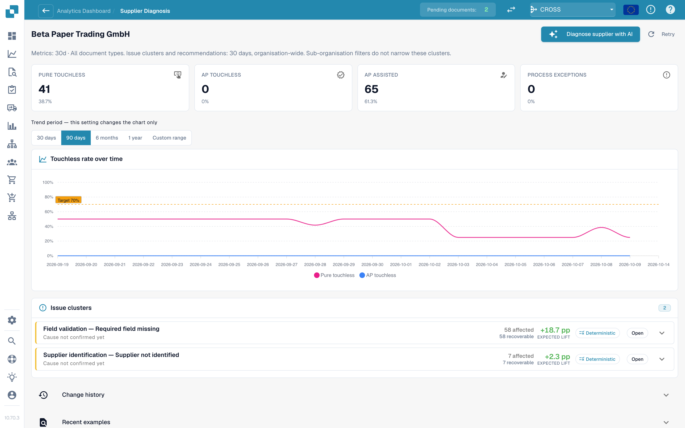

# 无接触智能：供应商诊断与问题集群

点击队列中的供应商，打开其诊断页面。

<figure><figcaption>
供应商诊断页面：结果磁贴、带周期选择器的趋势图，以及按预期提升幅度排序的两个问题集群。示例组织使用演示数据；供应商名称均为虚构。
</figcaption></figure>

页面显示：

* **六个结果磁贴**（纯无接触、应付账款无接触、应付账款辅助处理、流程异常、处理中、不符合条件），每个磁贴都链接到相应文档。
* **趋势图**及其独立的周期选择器：30 天、90 天、6 个月、1 年或自定义范围（最长两年）。此设置只影响图表。
* **问题集群**（见下文）。
* **变更历史**：你为该供应商应用的变更及其影响。
* **最近示例**：示例文档，分为两个标签页：**需要关注**和**已实现无接触处理**。
* **使用 AI 诊断供应商**：分析该供应商的所有集群（管理员可用）。

简短说明会解释页面为空的原因，例如：*该供应商的 5 份文档仍在处理中，尚无分析结果。* 或 *该供应商已完成的 40 份文档均以无接触方式处理：没有需要诊断的问题。*

### 问题集群

**集群**会将同一供应商因**相同的首个原因**而停滞的文档归为一组。你看到的是“3 个问题”，而不是 40 个单独的问题。

<figure><figcaption>
已展开的集群卡片：首个阻塞原因、<strong>需要变更的内容</strong>，以及包含风险、范围和待解答问题的<strong>变更提案</strong>。此处的集群涵盖 58 份文档，预计可提升 +18.7 个百分点。示例组织使用演示数据；供应商名称均为虚构。
</figcaption></figure>

**集群示例（仅供说明）。**

* **标题**：阶段 *字段验证* 中的 *缺少必填字段*
* **受影响文档**：28 份。**可挽回文档**：28 份。**预期提升**：+2.8 个百分点
* **疑似原因**：供应商将采购订单编号打印在表格下方，提取过程不会查找该位置
* **需要变更的内容**：*主数据变更*：添加该供应商的版式。点击**打开**可转到相应的设置页面
* **负责人**：顾问。**置信度**：中。**来源**：假设

集群卡片会显示以下内容：

| 部分 | 含义 |
| --- | --- |
| **首个阻塞原因**和**阶段** | 文档停止处理的原因及其所在的工作流阶段。原因有 30 多种，例如 *未识别供应商*、*未找到采购订单*、*单价超出采购订单容差*、*被 ERP 拒绝*、*电子发票验证失败* |
| **受影响文档 / 可挽回文档 / 预期提升** | 受影响文档数量、可挽回的文档数量，以及预计可提升的百分点 |
| **疑似原因 / 已确认原因** | DocBits 推测的原因（或已由人员确认的原因） |
| **证据**和**缺失的证据** | 该发现的依据，以及 DocBits **无法**确定的内容。相信其他信息之前，请先阅读**缺失的证据** |
| **需要变更的内容** | 具体步骤及指向设置页面的**打开**链接。标签会标明类型：*配置变更*、*主数据变更*、*供应商模板变更*、*流程变更*、*需要供应商采取行动*、*无法修复* |
| **负责人** | DocBits、客户、顾问、供应商或未分配 |
| **示例文档** | 可供查看的该集群真实文档 |

**可在 DocBits 中修复**和**仅需供应商采取行动**会分组显示。对于*仅需供应商采取行动*的情况，DocBits 中的任何变更都不会改变结果：供应商必须更正文档并重新发送。

### 建议的来源

每个原因都会显示其**来源**，以便你区分推导出的发现和猜测：

| 来源 | 含义 |
| --- | --- |
| **确定性** / **基于规则** | 根据记录的工作流证据，通过规则推导得出。未使用语言模型 |
| **假设** | 语言模型根据集群证据提出。请将其作为线索，并在采取行动前进行核实 |
| **已确认** | 人员审查证据后确认了原因 |

AI 文本会使用你所在组织的语言。如果集群使用了其他语言分析，请使用**用此语言分析**。

## 采购订单匹配集群

如果集群的首个阻塞原因与采购订单匹配有关（例如 *采购订单行项目不匹配* 或 *未找到采购订单*），集群卡片会显示 DocBits 如何尝试将发票与采购订单匹配。请参阅[采购订单匹配诊断](touchless-po-matching-diagnosis.md)。

## 相关页面

* [无接触智能](touchless-intelligence.md)
* [采购订单匹配诊断](touchless-po-matching-diagnosis.md)
* [文档追踪](touchless-document-trace.md)
* [变更提案与报告](touchless-change-proposals.md)
