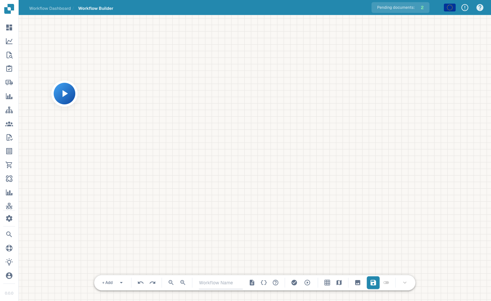

# 高级工作流

**高级工作流**构建器是一种节点图编辑器，适用于需要分支、并行路径和流程控制的工作流，可实现标准构建器中线性的 When/And/Then 流程无法满足的需求。你可以在画布上排列节点并将它们连接起来，以定义执行流程。

## 视频：在 DocBits 中配置发票处理路径

视频展示真实 DocBits 界面中已配置的工作流，包括金额检查、两个操作、路径连接和测试用例准备。



[字幕文件（WebVTT）](https://docbits-videos.fra1.cdn.digitaloceanspaces.com/settings-assistant/advanced_workflows_canvas/v2/zh.vtt)

画面中是尚未保存的演示草稿。`total_amount` 和 `approval_route` 是示例字段键名。`Approval` 和 `Standard` 用于标记路径。请为自己的流程配置实际的业务操作。

文字稿

**一张发票，两条路径**

这是 DocBits 中真实的高级工作流界面。发票金额检查连接到两个操作。连接关系决定执行哪一个操作。本示例使用尚未保存的草稿和演示字段。

**配置金额检查**

打开添加菜单，选择 And，再选择文档字段条件。设置金额字段，选择大于，并输入一千。请使用文档配置中准确的字段键名。

**配置操作卡片**

添加两张 Then 卡片。两张卡片都设置演示字段 approval route。一张写入 Approval，另一张写入 Standard。这些值用于标记路径。生产工作流需要配置实际的业务操作。

**连接不同结果的输出**

将 Start 连接到条件的输入端。将蓝色成功输出连接到 Approval，将橙色条件不满足输出连接到 Standard。红色错误输出用于单独处理求值错误。仅移动卡片的位置不会建立执行路径。

**准备测试用例**

在工具栏中打开测试。选择测试文档，或以 JSON 格式输入完整的文档数据。分别检查大于、小于和等于一千的金额，以及缺失值。执行后，请检查各个节点的结果。

**验证、保存并检查启用状态**

验证连接和卡片设置。明确保存到服务器，然后单独检查工作流是否已启用。浏览器自动草稿不能代替保存。执行工作流和访问日志需要相应的模块及订阅。

## 如何访问

从工作流区域（高级构建器画布）打开高级工作流设计器。你可以从 **Start** 节点开始，通过添加节点逐步构建流程。

<figure><figcaption>
高级工作流画布——包含缩放、运行、网格和保存控件的节点图。请在工具栏中为工作流命名。
</figcaption></figure>

## 添加节点

点击 **+ Add** 打开节点菜单。除了熟悉的 **When**、**And** 和 **Then** 卡片，高级构建器还提供流程控制节点：

<figure><figcaption>
<strong>+ Add</strong> 节点菜单：When / And / Then，以及 Wait ALL、Wait ANY、OR 和 Note。
</figcaption></figure>

* **When / And / Then** — 与标准构建器中的条件卡片和操作卡片相同。
* **Wait ALL** — 等待所有传入分支完成后再继续。
* **Wait ANY** — 任意一个传入分支完成后立即继续。
* **OR** — 将流程分支到不同的替代路径。
* **Note** — 在画布上添加自由文本注释（不影响执行）。

使用播放控件运行流程，验证流程，并点击工具栏中的保存按钮保存。

## 后续步骤

* 在 **Cards** 部分了解每种卡片的功能。
* 对于简单的线性自动化，使用 **Standard Workflow** 构建器可以更快完成设置。
