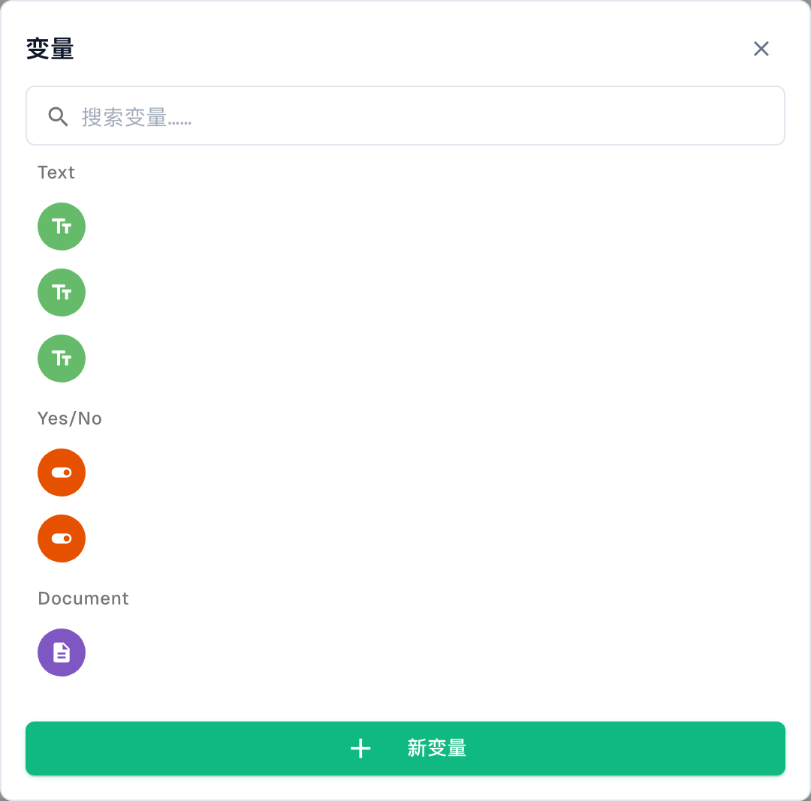

# 变量

## 视频: 变量、测试与激活



[打开视频](https://docbits-videos.fra1.cdn.digitaloceanspaces.com/settings-assistant/advanced_workflows_testing/v3/zh.mp4) · [字幕文件（WebVTT）](https://docbits-videos.fra1.cdn.digitaloceanspaces.com/settings-assistant/advanced_workflows_testing/v3/zh.vtt) · 1:50

文字稿

**选择变量类型**

点击花括号图标打开变量。选择文本、数字、是或否，或者文档，并按名称搜索。Document 变量存储由专用工作流动作设置的文档引用。此表单不接受文档值。

**变量属于整个组织**

设置唯一名称、类型和初始值。创建、修改或删除变量会立即保存到组织。其他工作流可以共用这些值。保存或放弃画布都无法撤销变量更改。

**先验证结构**

点击验证，查看画布上方的错误和警告。点击消息可以定位节点。检查动作、入口连接、输出、环路和合并节点。结构验证通过，并不代表运行时数据正确。

**选择测试上下文**

工具栏播放按钮打开测试文档选择器。选择文档、自定义数据，或对独立卡片选择无文档测试。Start 的播放按钮直接运行。测试使用当前画布，包括未保存的修改，并模拟破坏性动作。

**准备和检查测试场景**

分别准备用于大于、小于、等于一千以及缺少数据的测试。运行后，检查节点消息和耗时：绿色表示成功，橙色表示条件不成立，红色表示错误，灰色表示跳过。修正后重新测试。使用测试管理器重复运行测试场景。

**保存后再激活**

自动保存会在更改后约每三十秒保留本地浏览器草稿。请明确保存到服务器。首次保存前无法激活。在预期自动执行之前，检查工作流列表中的启用状态。

[查看全部五个章节](videos.md)

**变量**可让你只需存储一次值，就能在高级工作流的各个节点中重复使用，例如阈值、固定收件人，或从文档中读取并传递给后续节点的值。点击工具栏中的**变量**按钮（`{ }` 图标）打开变量面板。

<figure><figcaption>
中文高级工作流变量窗口。变量名称和值已隐藏；界面仍使用 Text、YesNo、Document 等英文类型标签，分别表示文本、是／否和文档。未创建、修改或删除组织变量。
</figcaption></figure>

## 变量类型

变量按类型分组：

- **文本** — 字符串值（例如描述或固定标签）。
- **是/否** — 布尔标记（是 / 否）。
- **文档** — 文档引用，由相应工作流动作设置；不是在此面板中直接输入文档字段值。

列表变长后，可使用搜索框快速查找变量。

## 创建变量

点击**New Variable**，为变量命名、选择类型并设置值。之后，你便可以在节点卡片中引用该变量，从而将配置集中管理，并且无需逐个编辑节点即可更改配置。

## 后续步骤

- 查看节点如何使用这些值：[节点](nodes.md)。
- 在[验证与测试](validation-and-testing.md)中验证并运行工作流。

## 数值变量

**Number（数值）**是独立的变量类型，与 Text、Yes/No 和 Document 并列。请输入不带货币符号的数值。组织变量由多个工作流共享；创建、修改和删除会立即保存，不受画布保存或放弃操作的影响。修改前请检查使用该变量的工作流，并测试低于、等于和高于阈值的情况。
