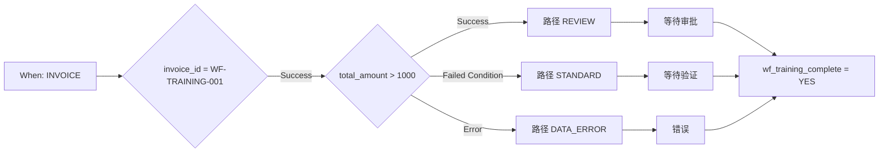

# 高级案例：发票路由

培训发票金额超过 1000 EUR 时需要审核；小于或等于 1000 EUR 时走标准路径。金额缺失或无法作为数字解析时，走数据修正路径。三条路径最后进入同一个完成操作。

## 前提与结构

使用已获得 Advanced 授权的测试组织和[练习包](workflow-training-kit.md)。通过 **Import Workflow** 导入 `advanced-workflow.json`，保持停用状态并打开流程图。When 检查发票类型；第一张 And 卡片将练习限制为 `invoice_id = WF-TRAINING-001`。流程没有配置接收人或导出。

前置检查使用 `invoice_id`、`eq` 和 `WF-TRAINING-001`；其他编号会跳过全部后续操作。金额检查使用 **Docfield is** 版本 2，参数为 `total_amount`、`gt`、`1000`。文本操作写入 `wf_training_route`。状态卡片使用版本 3，且 **Trigger Workflows = false**。

**v2：** 所选路径的状态卡片直接连接共同的 Then 卡片 `complete`，写入 `wf_training_complete = YES`，不再依赖等待中的 OR。v1 只证明测试模式：存在未到达前驱时，正常调度器可能跳过测试仍会求值的汇合节点。[P0 指南](masterclass/control-nodes.md)解释这一区别。共同 Then 的直接连接不能替代多个同时执行的必需操作所需的等待屏障。

## 搭建与验证

1. 验证整个流程图。
2. 按练习包说明，为自己的组织准备输入文件。
3. 打开 **Test → Custom Data**，使用各案例的完整文件。仅含 `total_amount` 的对象不够。
4. 从完整入口运行，检查 `amount` 的结果出口、实际到达的路径、状态消息 和 `complete`。
5. 对照独立定义的预期结果。包内保存的测试响应展示了实际观察到的节点结果。

| 案例 | 金额 | amount 出口 | 路径 / 状态 | 整体结果 |
| --- | --- | --- | --- | --- |
| above | 1785.00 | Success | REVIEW / validated_pending_approval | success |
| below | 999.00 | Failed Condition | STANDARD / ready_for_validation | success |
| boundary | 1000.00 | Failed Condition | STANDARD / ready_for_validation | success |
| just-above | 1000.01 | Success | REVIEW / validated_pending_approval | success |
| missing | 缺失 | Error | DATA_ERROR / error | error |
| invalid-number | invalid | Error | DATA_ERROR / error | error |
| other-invoice | 1785.00 | 未执行 | 其他发票编号；无操作 | failed_condition |

错误案例中的 `data_error` 和 `complete` 可以成功，但整体结果仍为 **error**。错误处理成功不会消除最初的求值错误。

## 扩展业务流程

测试于 2026 年 10 月 21 日针对已部署的 Dev 服务 DocFlow **2.10.38** 执行。练习包包含真实测试响应，其中字段和状态变更是模拟操作。它不包含持久化的文档 Workflow Logs，也不证明个人审批或真实导出交付已经完成。

实际业务中，应将路由标记替换为已配置的分配和审批操作。导出必须接在明确验证过的审批条件之后。使用自己的培训文档和指定测试目标，分别在文档上确认真实执行，并在接收端确认交付。[诊断指南](workflow-troubleshooting.md)说明了所需证据。

## WF-02: 练习与验收

运行全部七个用例，记录 amount 出口、所选路径、状态消息、complete 和整体结果。分别验收测试与真实文档运行；不能因完成节点成功就把已处理错误记录为无错误运行。

[学习路径](workflow-learning-path.md)
