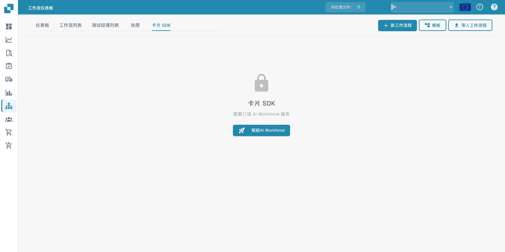

# Card SDK

**Card SDK** 可让合作伙伴和开发者为 DocFlow 构建自定义工作流卡片。您可以将卡片打包为合作伙伴应用并上传，也可以直接从 GitHub 导入。

<figure><figcaption>
Card SDK 显示所需的 AI Workforce 订阅。
</figcaption></figure>

## 工作原理

- **下载 SDK 模板** — 从包含预期结构的官方模板开始。
- **上传 ZIP 文件** — ZIP 文件必须包含 `app.json` 和带有卡片定义的 `.docflowcompose/flow/` 文件夹（最大 10 MB）。Upload &#x26; Validate 会在接受软件包之前对其进行检查。
- **GitHub 导入** — 直接从 GitHub 仓库导入卡片定义。
- **提交** — 跟踪您提交的卡片状态。

通过验证并获接受后，您的自定义卡片会与内置卡片一起显示在 **添加卡** 库中。
