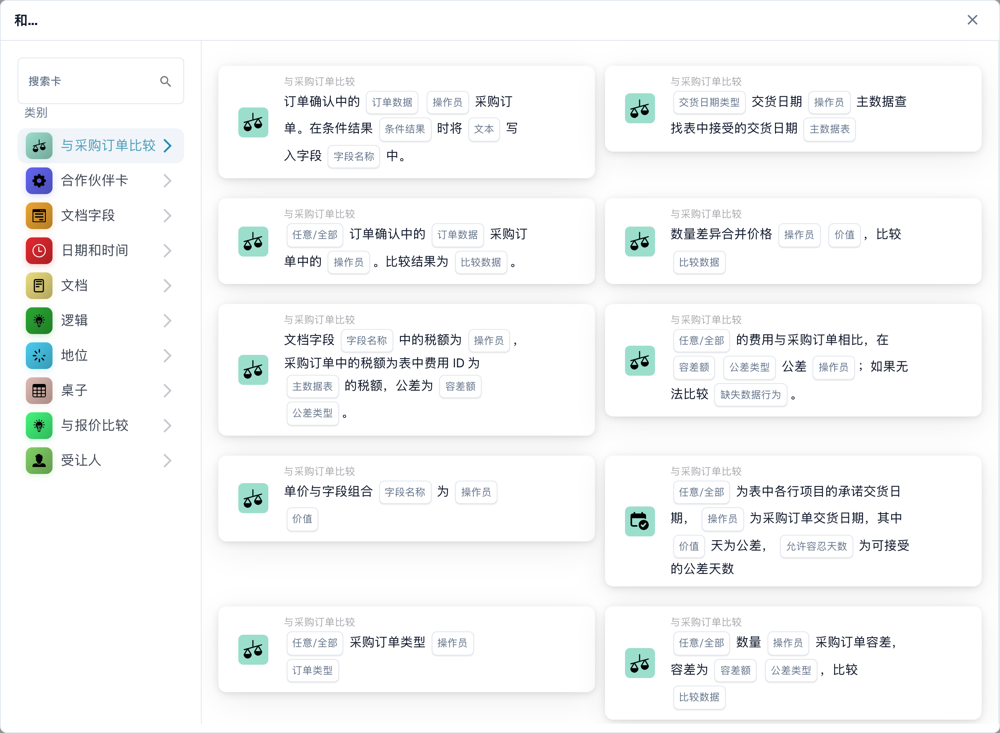
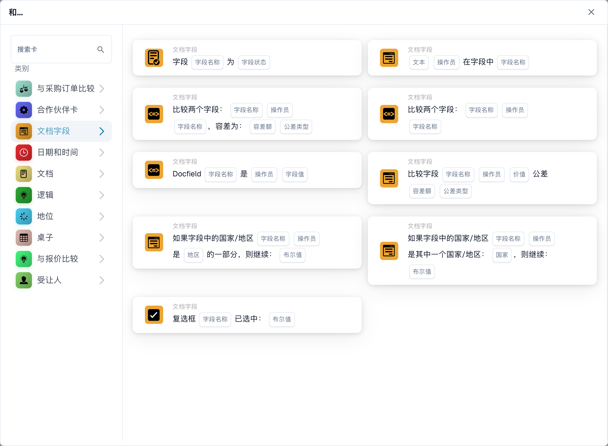
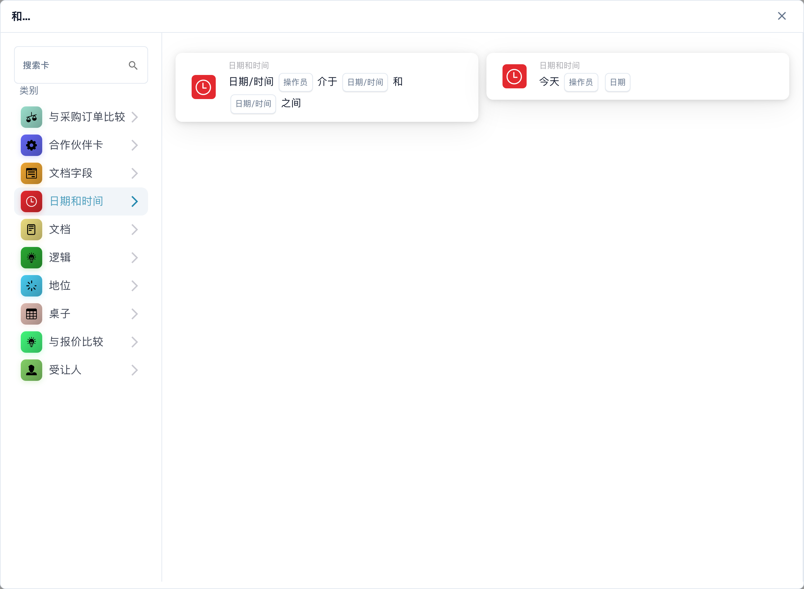
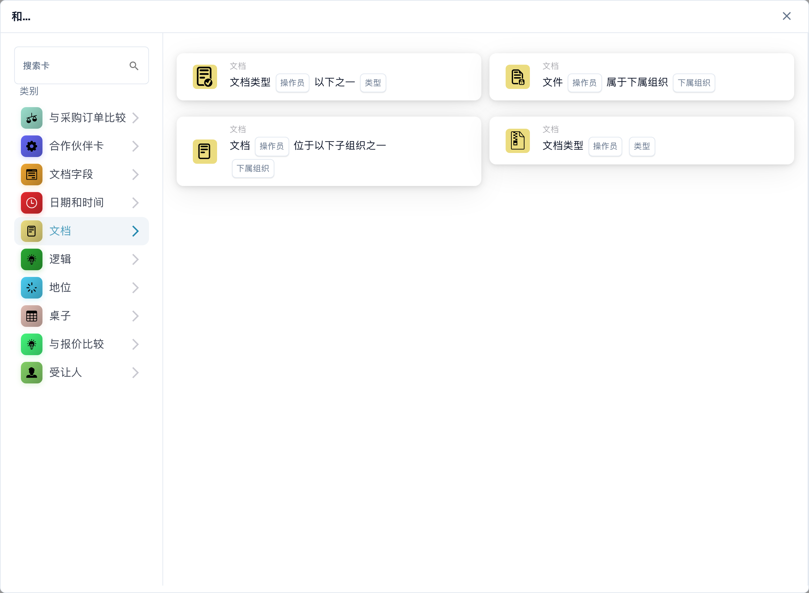
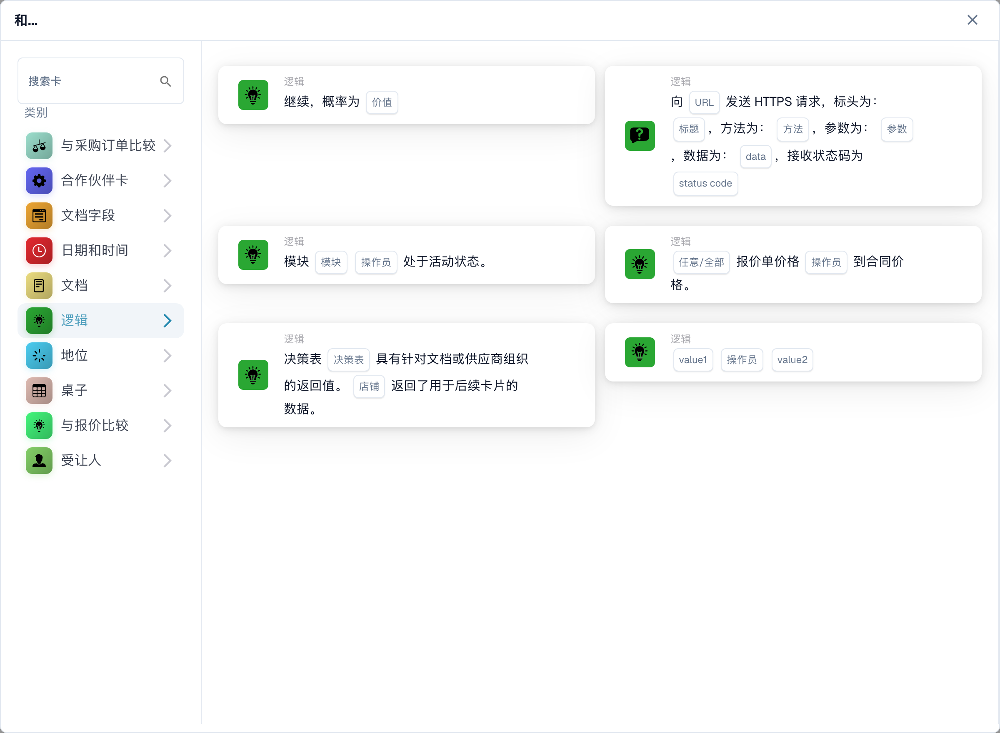
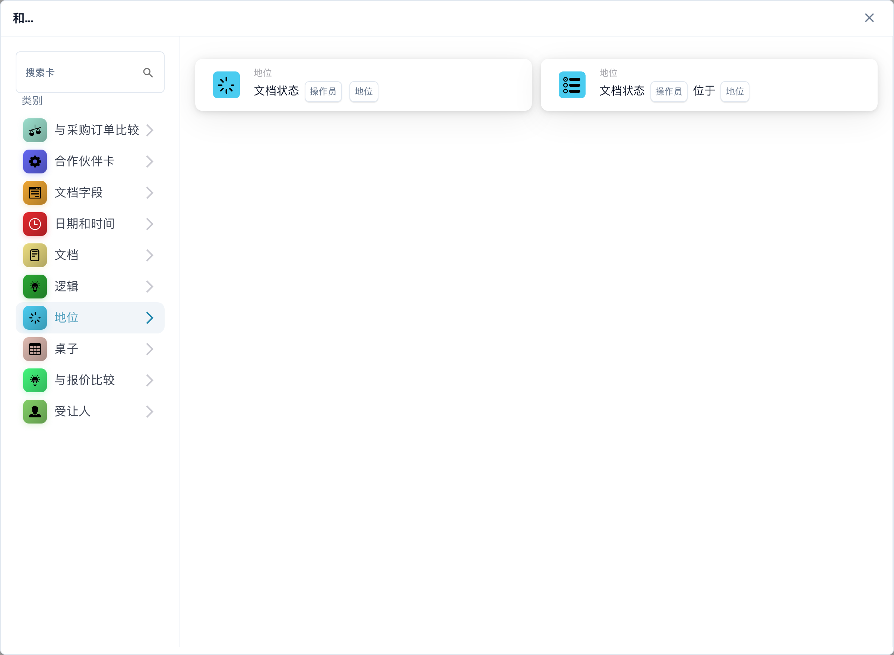
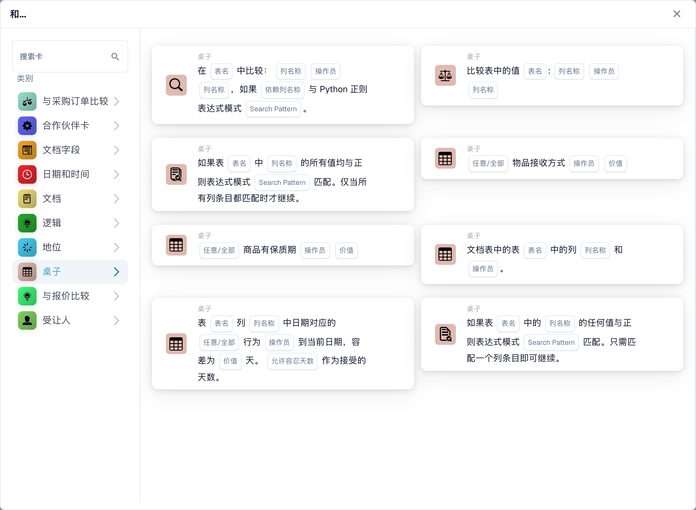
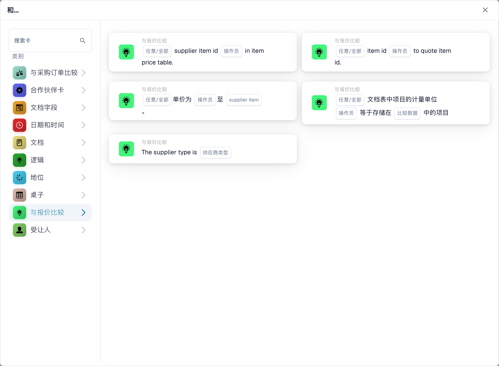
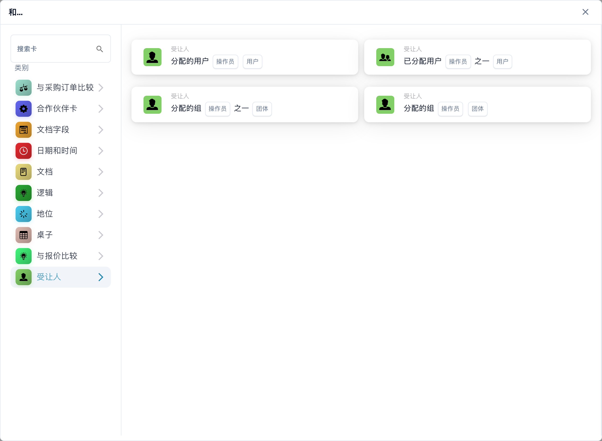

# 且

使用 **且** 卡来决定工作流在 **当** 触发后是否应继续。在 **则** 操作之前添加所需的检查。每张卡片都会显示需要填写的字段，例如**操作符**、**字段名称**或**值**；屏幕截图显示可用的卡片模板，而不是完整的规则。

在**工作流程构建器**中，选择**和...**下的**添加卡**。在左侧选择类别，或在**搜索卡片**中输入卡片名称。选择卡片预览以将其添加到工作流程中。您可以滚动预览列表以查看更多卡片。使用**×**关闭选择器而不选择另一张卡。配置卡后，保存工作流程。请参阅[工作流程](../..)，了解周围的**当**、**且**和**则**步骤。

## 与采购订单比较

使用这些卡将订单或发票数据与采购订单进行比较，例如单价、承诺的交货日期、费用或数量。选择字段、运算符以及所选卡要求的任何容差。各卡参见[与采购订单比较](compare-with-purchase-order)]。

<figure><figcaption>
所选类别中的可用卡片。使用前请填写所需字段。 此版本界面的部分标签尚未翻译或翻译不准确。本页说明使用正确术语；图片保留了实际界面。
</figcaption></figure>

## 文档字段

选择此类别可检查复选框或字段状态、将字段与值进行比较或比较两个字段。填写所选卡片上的**字段名称**和**运算符**占位符。有些比较还要求有一定的宽容度。请参阅[文档字段](document-field)。

<figure><figcaption>
所选类别中的可用卡片。使用前请填写所需字段。 此版本界面的部分标签尚未翻译或翻译不准确。本页说明使用正确术语；图片保留了实际界面。
</figcaption></figure>

## 日期和时间

使用 **日期和时间** 将日期或时间与范围进行比较，或将 **今天** 与所选日期进行比较。选择卡中的 **运算符** 和日期值。请参阅[日期和时间](date-and-time)。

<figure><figcaption>
所选类别中的可用卡片。使用前请填写所需字段。 此版本界面的部分标签尚未翻译或翻译不准确。本页说明使用正确术语；图片保留了实际界面。
</figcaption></figure>

## 文件

当工作流程应依赖于**文档类型**或**子组织**时，请使用这些卡。选择卡片中命名的类型或组织。请参阅[文档](document)。

<figure><figcaption>
所选类别中的可用卡片。使用前请填写所需字段。 此版本界面的部分标签尚未翻译或翻译不准确。本页说明使用正确术语；图片保留了实际界面。
</figcaption></figure>

## 逻辑

此类别包括使用决策表、HTTPS 响应、模块可用性、报价项目价格、机会值或两个值的检查。打开特定卡片并填写其命名占位符；例如，HTTPS 卡要求 URL、方法和接受的状态代码。参见[逻辑](logic)。

<figure><figcaption>
所选类别中的可用卡片。使用前请填写所需字段。 此版本界面的部分标签尚未翻译或翻译不准确。本页说明使用正确术语；图片保留了实际界面。
</figcaption></figure>

## 状态

使用**状态**检查文档是否具有选定状态或者其状态是否在选定集中。选择卡片中的**运算符**和**状态**。请参阅[状态](status)。

<figure><figcaption>
所选类别中的可用卡片。使用前请填写所需字段。 此版本界面的部分标签尚未翻译或翻译不准确。本页说明使用正确术语；图片保留了实际界面。
</figcaption></figure>

## 表

这些卡检查文档表行。可见选项包括日期检查、文本模式、保质期和列之间的比较。在选择运算符或模式之前，选择**表名称**和**列名称**。参见[表](table)。

<figure><figcaption>
所选类别中的可用卡片。使用前请填写所需字段。 此版本界面的部分标签尚未翻译或翻译不准确。本页说明使用正确术语；图片保留了实际界面。
</figcaption></figure>

## 与报价比较

使用这些卡将商品与报价数据进行比较。可见选项包括项目 ID、供应商类型、供应商项目 ID、单价和计量单位。 **运算符** 和数据占位符取决于您选择的卡。

<figure><figcaption>
所选类别中的可用卡片。使用前请填写所需字段。 此版本界面的部分标签尚未翻译或翻译不准确。本页说明使用正确术语；图片保留了实际界面。
</figcaption></figure>

## 分配对象

当条件取决于分配的用户或组时，使用**分配对象**。选择是否与一个用户或组或选定的组进行比较。请参阅[分配对象](assignee)。

<figure><figcaption>
所选类别中的可用卡片。使用前请填写所需字段。 此版本界面的部分标签尚未翻译或翻译不准确。本页说明使用正确术语；图片保留了实际界面。
</figcaption></figure>

[详细的报价比较卡和任何/所有行为](../quote-comparison-guide.md)。
