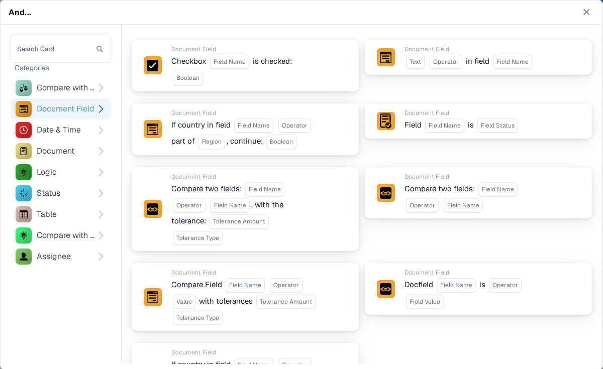
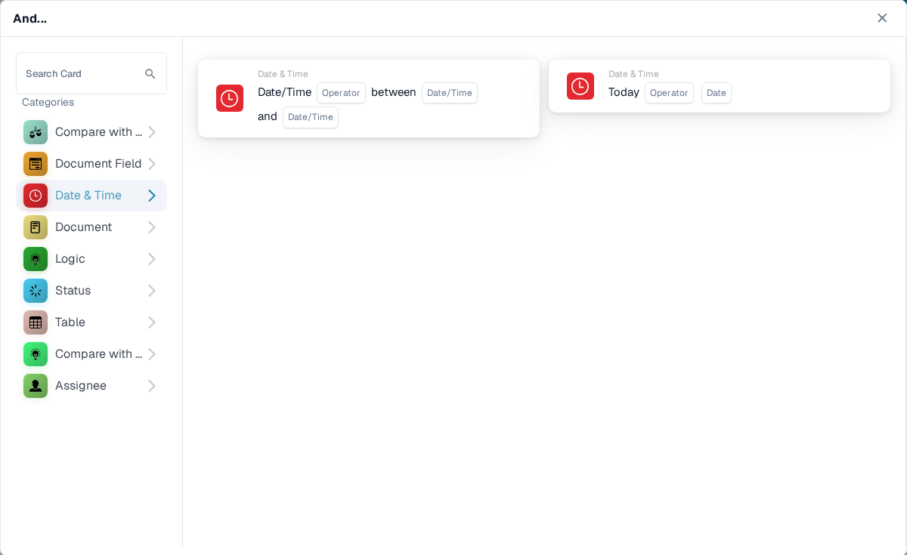

# 与（And）

使用 **And** 卡片，在 **When** 触发器之后决定工作流是否继续。在 **Then** 操作之前添加所需的检查。每张卡片都会显示需要填写的字段，例如 **Operator**、**Field Name** 或 **Value**；截图展示的是可用的卡片模板，而非已完成的规则。

在 **Workflow Builder** 中，选择 **And...** 下方的 **Add Card**。在左侧选择类别，或在 **Search Card** 中输入卡片名称。选择卡片预览，将其添加到工作流中。你可以滚动预览列表查看更多卡片。使用 **×** 关闭选择器，而不选择其他卡片。配置完卡片后，保存工作流。有关 **When**、**And** 和 **Then** 各步骤的整体说明，请参阅 [工作流](../../)。

## 与采购订单比较

使用这些卡片，将订单或发票数据与采购订单进行比较，例如单价、承诺交货日期、费用或数量。根据所选卡片的要求选择字段、运算符和任何容差。各张卡片的详情请参阅[与采购订单比较](compare-with-purchase-order/)。

<figure><figcaption>
Sandbox 英文环境中的 Compare with Purchase Order 类别。
</figcaption></figure>

## 文档字段

选择此类别可检查复选框或字段状态、将字段与某个值进行比较，或比较两个字段。在所选卡片中填写 **Field Name** 和 **Operator** 占位字段。有些比较还会要求填写容差。请参阅[文档字段](document-field/)。

<figure><figcaption>
文档字段检查使用当前文档中的值。
</figcaption></figure>

## 日期和时间

使用 **Date & Time** 将日期或时间与范围进行比较，或将 **Today** 与选定日期进行比较。在卡片中选择 **Operator** 和日期值。请参阅[日期和时间](date-and-time/)。

<figure><figcaption>
Date &#x26; Time 提供范围检查和与今天日期进行比较的检查。
</figcaption></figure>

## 文档

当工作流需要根据**文档类型**或**子组织**进行判断时，使用这些卡片。选择卡片中指定的类型或组织。请参阅[文档](document/)。

<figure><figcaption>
文档条件用于检查类型或子组织。
</figcaption></figure>

## 逻辑

此类别包含多种检查：使用决策表、HTTPS 响应、模块可用性、报价项目价格、概率值或两个值进行检查。打开相应卡片并填写其命名占位字段；例如，HTTPS 卡片要求填写 URL、方法和可接受的状态代码。请参阅[逻辑](logic/)。

<figure><figcaption>
Logic 提供多种不同的条件类型；请选择符合规则要求的类型。
</figcaption></figure>

## 状态

使用 **Status** 检查文档是否具有选定状态，或其状态是否属于选定集合。在卡片中选择 **Operator** 和 **Status**。请参阅[状态](status/)。

<figure><figcaption>
状态条件用于检查当前文档状态。
</figcaption></figure>

## 表格

这些卡片用于检查文档表格行。可见选项包括日期检查、文本模式、保质期以及列之间的比较。选择运算符或模式之前，请先选择 **Table name** 和 **Column Name**。请参阅[表格](table/)。

<figure><figcaption>
表格条件使用文档表格中的行和列。
</figcaption></figure>

## 与报价价格比较

使用这些卡片将项目与报价价格数据进行比较。可见选项涵盖项目 ID、供应商类型、供应商项目 ID、单价和计量单位。**Operator** 和数据占位字段取决于所选卡片。

<figure><figcaption>
在当前卡片选择器中，Compare with Quote Price 是单独的类别。
</figcaption></figure>

## 受派人

当条件取决于受派用户或组时，使用 **Assignee**。选择要与单个用户或组比较，还是与所选集合进行比较。请参阅[受派人](assignee/)。

<figure><figcaption>
受派人条件用于检查分配给文档的用户或组。
</figcaption></figure>
