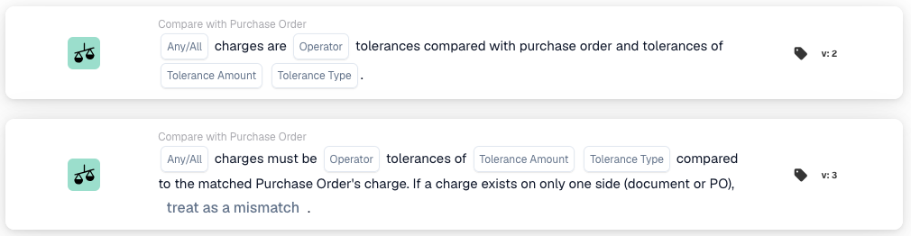

# 任意 / 全部费用

<figure><figcaption>
添加卡片库中的卡片。上方为版本 2，下方为版本 3。
</figcaption></figure>

## **用途：**

此工作流卡片会在设定的容差范围内，将文档上的附加费用与匹配的采购订单上的附加费用进行比较。它要回答一个问题：文档与采购订单上的附加费用是否一致？采购订单匹配所配对的每笔费用都会参与比较，因此无需在卡片上指定字段名称。

此卡片不同于**比较费用总额**，后者会将一个指定的文档字段与由 Charge ID 标识的一笔费用进行比较。当需要一次检查文档上所有已配对费用时，请使用此卡片。

此卡片运行前必须先完成采购订单匹配。如果文档没有匹配的采购订单，卡片会停止工作流并报告缺少数据。

## **卡片组成部分：**

1. **任意 / 全部：**
   * **说明**：如何将各笔费用的比较结果合并为卡片的单一结果。
   * **选项**：
     * **任意**：至少一笔费用必须满足比较条件。
     * **全部**：每笔费用都必须满足比较条件。
2. **运算符：**
   * **说明**：如何将每笔文档费用金额与采购订单中对应费用的金额进行比较。
   * **选项**：
     * **范围内**：两个金额必须在容差范围内一致。
     * **范围外**：两个金额的差异必须超过容差。
3. **容差金额：**
   * **说明**：文档费用与采购订单费用之间允许的差异。
4. **容差类型：**
   * **说明**：如何解释容差金额。
   * **选项**：
     * **百分比**：采购订单费用的百分比。
     * **数值**：固定金额。
5. **缺少数据时的行为（仅限版本 3）：**
   * **说明**：当费用只存在于文档或采购订单其中一侧、没有对应项可供比较时的处理方式。此选项位于版本 3 句子的末尾。
   * **选项**：
     * **视为不匹配**：工作流停止。这是默认选项。
     * **忽略并视为匹配**：工作流继续，视同该费用一致。

## **卡片的工作方式：**

卡片会按以下步骤运行。

1. **卡片需要匹配的采购订单。** 如果没有匹配的采购订单，卡片会立即停止并报告缺少数据。
2. **卡片读取容差**，即卡片上设置的**容差金额**和**容差类型**。
3. **版本 3 会将每个匹配的采购订单行归入以下四种情况之一**，判断依据仅为两侧是否存在任何费用：两侧都有费用、两侧都没有费用、只有文档有费用，或只有采购订单有费用。如果无法根据文档上的采购订单数据确定某一行，说明存在数据错误，卡片会停止。
4. **只在一侧出现费用时，整个卡片的结果就此确定。** 只要有一条匹配行在一侧有费用而另一侧没有费用，**缺少数据时的行为**就会决定结果，并且不会比较任何费用，包括正确配对行上的费用。运算符和容差都不会参与判断。
5. **如果所有行的两侧都没有费用**，则两侧都确认没有附加费用。**范围外**运算符不满足条件，因为没有任何差异超出容差，因此工作流会停止。其他运算符则会将这种一致视为满足条件，工作流继续。此时**缺少数据时的行为**不起作用。
6. **否则，卡片会逐笔比较费用**，将文档金额与采购订单金额按运算符和容差进行比较。如果费用金额不是数字，卡片会因缺少数据而停止。
7. **卡片会汇总所有比较结果，并统一合并一次。** 每条匹配行上的每笔费用都会加入同一组结果，再由**任意 / 全部**设置汇总为卡片的单一结果。汇总范围是整个文档，而非每一行，因此**任意**表示文档中的任意一笔费用。如果合并后的结果为真，工作流继续；否则工作流会因条件未满足而停止。

配置卡片前，有三点需要了解。

* **容差为 0 时，范围内要求金额完全相等。** 两个金额必须精确到分相同。
* **只在一侧出现费用会覆盖其他所有判断。** 由于第 4 步发生在任何比较之前，选择**忽略并视为匹配**也会跳过文档中每笔正确配对费用的金额检查。如果需要验证金额，请保留**视为不匹配**。
* **视为不匹配会将工作流作为错误停止，而不是因条件未满足而停止。** 尽管该选项的措辞如此，卡片实际会报告缺少数据；工作流日志和卡片测试中会以红色显示，而不是以橙色显示条件未满足。无论哪种情况，工作流都会停止。

## **设置和配置：**

在采购订单匹配之后添加此卡片作为 And 条件。选择必须满足比较条件的是全部费用还是任意费用，选择**范围内**或**范围外**运算符，并输入容差金额和类型。在版本 3 中，还要选择当费用只出现在一侧时的处理方式。

如需在不等待文档的情况下试用配置，请在 Workflow Builder 中打开卡片菜单，选择**测试卡片**，选取文档，然后选择**在文档上测试**。卡片日志会列出每笔已比较的费用及其两个金额、使用的运算符和容差；如果费用只出现在一侧，日志还会记录用于确定结果的**缺少数据时的行为**设置。

## **示例场景：**

一份订单确认单上有一笔 100.00 的运费，匹配的采购订单行上也有同样的 100.00 运费。设置为**全部**、**范围内**运算符，并将容差设为数值 0 时，两个金额相等，卡片通过，工作流继续。

如果订单确认单上的金额为 120.00，而采购订单上为 100.00，则相同配置不满足条件，工作流会因条件未满足而停止。

如果订单确认单和采购订单都没有任何费用，**范围内**运算符会将其视为一致，工作流继续；而**范围外**运算符会使工作流停止。

如果订单确认单上有一笔运费，而采购订单上没有，则运算符不再适用。选择**视为不匹配**时，工作流会停止，以便有人检查为何费用只出现在一侧。

## **版本差异：**

新卡片使用版本 3。现有工作流仍支持版本 2。两个版本都会逐笔比较费用，并使用**任意 / 全部**设置汇总整个文档的结果，但版本 2 没有情况分类，因此当费用没有同时出现在两侧时，处理方式会有所不同：

* 版本 2 没有**缺少数据时的行为**选项。其配置句子以容差类型结束。
* 版本 2 不会对匹配的行进行分类，因此无法识别只存在于一侧的费用。它会将实际存在的金额与缺失一侧的 0.00 进行比较，并由运算符决定结果：**范围内**不满足条件，工作流停止；**范围外**满足条件，工作流继续。卡片日志会显示与 0.00 的比较结果。
* 如果两侧都没有费用，版本 2 就没有可比较的内容，因此会报告缺少数据，而不会像版本 3 那样将两侧都没有费用视为一致。

## **结论：**

“任意 / 全部费用”卡片可自动检查已开票或已确认的附加费用是否与订购的附加费用一致。版本 3 会将两侧都没有费用视为一致，因此没有附加费用的文档无需人工干预即可通过；只出现在一侧的费用则会被拦截以供审核，除非明确允许这种情况。
