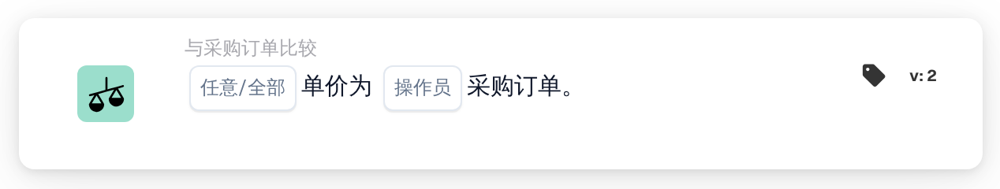
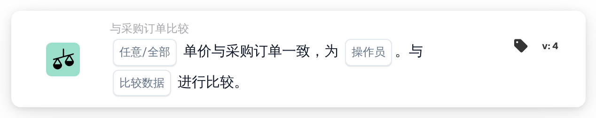
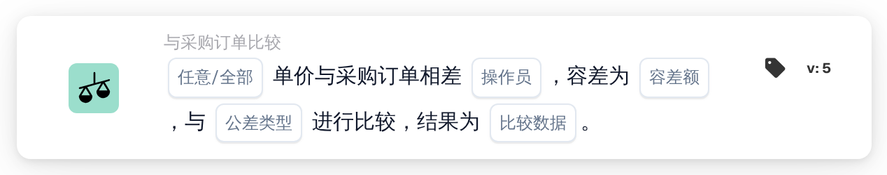

# 任何/所有单价为

<figure><figcaption>
版本 2
</figcaption></figure>

<figure><figcaption>
版本 3
</figcaption></figure>

<figure><figcaption>
版本 4
</figcaption></figure>

<figure><figcaption>
版本 5
</figcaption></figure>

## **目的：**

此工作流程卡用于将文档中的单价与采购订单中的单价进行比较，确保价格在定义的容差范围内一致。如果单价不符合预期，比较可以触发操作。 **版本4**允许用户选择不同的实体进行比较，从而增加了更多的灵活性，从而对定价和采购流程提供更深层次的控制。

## **卡的组成部分：**

1. **任何/全部：**
   * **描述**：定义条件是否适用于比较单价的任何或所有实例。
   * **选项**：
     * **任意**：任意单价满足指定的比较条件，则满足条件。
     * **全部**：仅当所有单价满足指定的比较条件时才满足条件。
2. **运算符：**
   * **描述**：定义将单价与指定值进行比较的条件。
   * **选项**：
     * **等于 (=)**：验证单价是否与指定值匹配。
     * **不等于(≠)**：确保单价与指定值不同。
     * **大于(>)**：验证单价是否大于指定值。
     * **大于或等于(≥)**：验证单价是否大于或等于指定值。
     * **小于(<)**：验证单价是否小于指定值。
     * **小于或等于 (≤)**：验证单价是否小于或等于指定值。

## **版本4中的附加组件：**

**比较类型：**

* **描述**：除了单价之外，还允许用户选择要比较的实体。
* **选项**：
  * **采购订单到单据**：将采购订单中的单价与单据中的单价进行比较。
  * **已接收到单据**：将匹配采购订单中派生的接收方金额与单据方金额进行比较。
  * **采购订单到接收**：将采购订单侧与派生的接收侧金额进行比较。

## **功能：**

* **条件评估：** 系统根据所选运算符将单据中的单价与采购订单（或其他所选实体，在版本 4 中）中的单价进行比较。如果比较为真，工作流将根据后续步骤继续进行，触发批准或停止流程。
* **动作执行：**
  * **真条件**：如果条件评估为真（例如，文档中的单价大于指定值），工作流将继续执行真操作（例如，审批、文档处理）。
  * **False 条件**：如果条件评估为 false（例如，文档中的单价不满足比较），工作流程将不会继续。

## **设置和配置：**

* **版本 3 设置：** 用户通过在文档中选择单价、选择适当的运算符来定义如何将单价与指定值进行比较以及设置要比较的值来配置卡。此外，用户还可以选择条件是否适用于单价比较的任何或所有实例。
* **版本 4 设置：** 在版本 4 中，用户可以选择比较类型的附加选项。这允许他们定义要比较的实体，例如采购订单与文档、接收到文档或采购订单与接收。这增强了卡在更复杂场景下比较单价的灵活性。

## **示例场景：**

*   **版本 3 示例：**

    发票显示单价为 50 美元。相关采购订单的单价为 45 美元。该卡使用“大于”运算符比较两个单价。由于文档中的单价 (50 美元) 大于采购订单中的单价 (45 美元)，工作流程将触发真实条件（例如，发送文档以供审核）。
* **版本 4 示例：**\
  发票显示单价为 50 美元，相关采购订单授权的单价为 45 美元。此外，收到的数量为 60 件。该卡使用“大于”运算符将收到的数量与文档的单价进行比较。由于收到的数量 (60) 大于单价 (50 美元)，工作流会触发真实条件，并且文档会被标记以供进一步审核。

## **结论：**

“单价比较”工作流程卡的版本 3 旨在确保文档中的单价与采购订单中的单价保持一致，并根据定义的条件触发操作。版本 4 通过引入更复杂的比较选项扩展了此功能，例如将采购订单与文档、接收数量与文档以及采购订单与接收数量进行比较。这种增加的灵活性使组织能够处理更复杂的定价和采购场景，从而提高工作流程的控制和准确性。

## 版本5及对比方向

版本5包括任意/全部、运算符、容差量、容差类型和比较侧选择。较新的版本提供了文档、采购订单和接收数据比较的两个方向。参考侧确定百分比公差的基础。有关所有六个选项、已保存卡片的迁移和测试示例，请参阅[PO 比较版本](../../po-comparison-versions-guide.md)。
