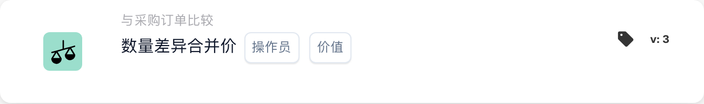
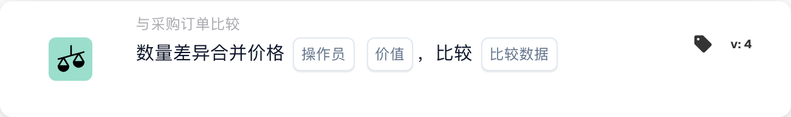

# 数量差异合并价格

<figure><figcaption>
所示版本的卡片字段。占位字段尚未配置。 此版本界面的部分标签尚未翻译或翻译不准确。本页说明使用正确术语；图片保留了实际界面。
</figcaption></figure>

<figure><figcaption>
所示版本的卡片字段。占位字段尚未配置。 此版本界面的部分标签尚未翻译或翻译不准确。本页说明使用正确术语；图片保留了实际界面。
</figcaption></figure>

## **目的**：

此工作流程卡评估数量差异的组合价格，并将其与指定值进行比较。它有助于根据相关文档之间的价格和数量差异自动执行操作，从而改进采购和接收工作流程。 **版本 4** 扩展了此功能，允许在不同实体（例如采购订单、收到数量和文档本身）之间进行比较，从而为工作流程增加了更多灵活性和控制力。

## **卡的组成部分**：

1. **运算符**：
   * **描述：**将组合价格与指定值进行比较的条件。
   * **选项：**
     * **等于 (=)**：检查组合价格是否与指定值匹配。
     * **不等于 (≠)**：确保组合价格与指定值不同。
     * **大于 (>)**：验证组合价格是否大于指定值。
     * **大于或等于 (≥)**：检查组合价格是否大于或等于指定值。
     * **小于 (<)**：验证组合价格是否小于指定值。
     * **小于或等于 (≤)**：检查组合价格是否小于或等于指定值
2. **值**：
   * **描述：**指定将与数量值的组合价格进行比较的值。
   * **详细信息：** 该值必须是数值。

## **版本 4**中的附加组件：

* **比较类型**：选择要比较的实体。选项包括：
  * **采购订单到单据**：比较采购订单和相关单据之间的数量和价格。
  * **已接收到文档**：将已接收数量与文档中的数量进行比较。
  * **采购订单到接收**：比较采购订单数量与接收数量。

## **功能**：

* **条件评估**：通过将数量差异乘以单位价格来计算组合价格，并使用所选运算符将其与指定值进行比较。\
  **版本 4** 添加了根据用户配置比较其他实体的选项，例如采购订单与收到的订单或采购订单与文档。
* **动作执行**：根据组合价格是否满足指定条件，工作流程将继续执行，条件为真或条件为假，以触发操作或停止工作流程。 **版本 4** 还允许执行更动态的操作，其中条件类型（例如，收到的采购订单）影响下一步。

## **设置和配置**：

* **版本 3**：用户通过选择数量差异和单位价格的文档字段来配置卡。然后选择运算符来定义如何将组合价格与指定值进行比较。最后，用户设置继续条件（真或假），这决定了工作流程的下一步。
* **版本4**：除了**版本3**中的配置外，用户还可以选择配置**比较类型**。这定义了将比较哪些实体，例如**采购订单到文档**、**已接收到文档**或**采购订单到已接收**。

## **场景示例**：

* 发票显示 50 件产品，每件 100 美元，总计 5000 美元。相关采购订单授权购买 45 件产品，金额为 4500 美元。数量差异为 5 件，差异的总价为 500 美元。该卡将采购订单数量（45 件）与接收数量（50 件）进行比较，并检查合并价格是否大于 400 美元（指定值）。使用**大于 (>)** 运算符，该卡可以识别差异并将其标记为供财务团队审核。

## **结论**：

“数量差异组合价格”工作流程卡的**版本 3**提供了一种直接的方法来比较数量差异并根据价格阈值触发操作。\
**版本 4** 通过允许不同实体（采购订单、收到的、文档）之间的比较来扩展此功能，从而提供更大的灵活性和对工作流程的控制。组织现在可以自动化更复杂的场景，并对采购和接收流程实施更严格的控制。

更改比较边之前请参阅[比较方向、公差基准和已保存的卡版本](../../po-comparison-versions-guide.md)。
