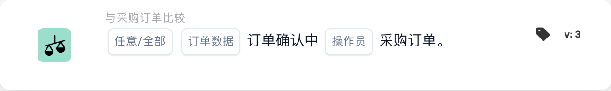
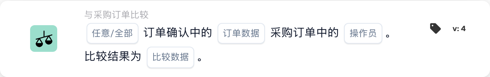

# 比较订单确认与采购订单

<figure><figcaption>
所示版本的卡片字段。占位字段尚未配置。 此版本界面的部分标签尚未翻译或翻译不准确。本页说明使用正确术语；图片保留了实际界面。
</figcaption></figure>

<figure><figcaption>
所示版本的卡片字段。占位字段尚未配置。 此版本界面的部分标签尚未翻译或翻译不准确。本页说明使用正确术语；图片保留了实际界面。
</figcaption></figure>

## 目的：

此 DocBits 卡旨在比较订单确认和采购订单之间的特定订单数据字段（例如数量、折扣或单价）。通过允许一次对一个字段进行集中比较，可以确保验证关键数据点的准确性，从而保持订单准确性。 **版本 4** 扩展了此功能，允许在不同实体（例如采购订单、收到数量和文档本身）之间进行比较，从而为工作流程增加了更多灵活性和控制力。

## 卡的组成部分：

1. **任意/全部**
   * **描述：**确定条件是否适用于订单确认中的任何或所有行。\
     **选项：**
     * **Any**：订单确认中任意行所选字段值与采购订单中对应值匹配时，将触发比较。
     * **All**：只有订单确认所有行中所选字段值与采购订单中对应值匹配时才会触发比较。
2. **订单数据字段**
   * **描述**：指定订单确认与采购订单进行比较的数据字段。
   * **详情**：用户可以选择以下字段之一进行比较：
     * **数量**：比较订购数量与确认数量。
     * **折扣**：验证确认中的折扣是否与采购订单相符。
     * **单价**：确保确认单中的单价与采购订单一致。
3. **运算符**
   * **描述**：定义应用于所选数据字段比较的条件。
   * **选项**：
     * **等于 (=)**：确认该值与采购订单相符。
     * **不等于 (≠)**：确保该值与采购订单不同。
     * **大于 (>)**：验证该值是否超过采购订单的值。
     * **大于或等于 (≥)**：确认该值等于或超过采购订单的值。
     * **小于 (<)**：检查该值是否低于采购订单的值。
     * **小于或等于 (≤)**：确认该值低于或等于采购订单的值。

## **版本 4**中的附加组件：

* **比较类型**：选择要比较的实体。选项包括：
  * **采购订单到文档**：将采购订单数据与相关文档进行比较。
  * **收到文档**：将收到的数据（例如收到的数量）与文档进行比较。
  * **采购订单到接收**：将采购订单数据与接收数量进行比较。

## 功能：

* **字段比较**：系统将订单确认中选定的订单数据字段（单价、折扣或数量）与采购订单中的相应值进行比较。
* **动作执行**：根据比较结果和运算符条件，卡片可以触发后续动作，例如通知或警报。

## 示例场景：

* 订单确认指定**单价**为 50 美元，而采购订单则指定为 45 美元。该卡使用“大于”运算符来标记差异，使采购团队能够在处理之前解决该问题。

## 结论：

该卡简化了各个订单数据字段的验证，确保符合采购订单条款。通过一次隔离一个字段进行比较，它支持订单处理中的有针对性的审查和错误预防。

更改比较边之前请参阅[比较方向、公差基准和已保存的卡版本](../../po-comparison-versions-guide.md)。
