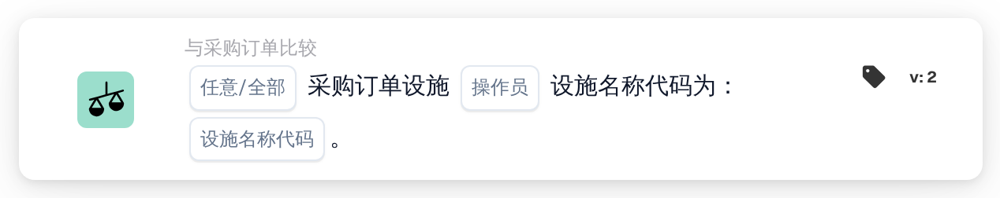

# 采购订单的设施

<figure><figcaption>
版本 2
</figcaption></figure>

## 用途：

此工作流卡片会将与文档匹配的采购订单的设施与一组设施代码进行核对。它可以根据订单所属的设施（地点）以不同方式处理文档，例如将文档路由给负责该设施的团队。

此卡片运行前应先完成采购订单匹配。如果没有匹配的采购订单，卡片会报告缺少数据。

## 卡片组件：

1. **任意/全部**
   * **描述：** 如何将匹配的采购订单的设施代码与列表进行比对。
   * **选项：**
     * **任何：** 至少有一个匹配的采购订单满足运算符。
     * **全部：** 每个有设施的匹配采购订单都满足运算符。如果未设置值，卡片会使用 **全部**。
2. **操作员**
   * **描述：** 设施应在列表中还是不在列表中。
   * **选项：**
     * **是**
     * **不是**
3. **设施名称代码**
   * **描述：** 与采购订单设施进行比较的设施代码。
   * **详细信息：** 可以输入多个代码，以逗号分隔。

## 功能：

* **条件评估：** 卡片读取与文档匹配的采购订单号，加载这些采购订单，并收集每个采购订单的设施（地点）。没有设施的采购订单会被跳过。随后，收集到的设施代码会与卡片上的 **设施名称代码** 进行比较。
  * 设施代码与输入的某个代码整体相同时，才算在列表中。比较时忽略大小写以及条目前后的空格，因此 `wh01` 与 `WH01` 匹配，但 `WH` 与 `WH01` 不匹配。
  * 使用 **是** 时，设施代码在列表中的采购订单满足条件。使用 **不是** 时，设施代码不在列表中的采购订单满足条件。
  * 使用 **任何** 时，至少有一个采购订单满足条件即可；使用 **全部** 时，每个有设施的采购订单都应满足条件。
  * 如果匹配的采购订单都没有设施，则 **全部** 满足条件，**任何** 不满足条件。
* **执行操作：**
  * **条件为真：**\
    如果条件满足，工作流继续，例如执行仅适用于所列设施的步骤。
  * **条件为假：**\
    如果条件不满足，工作流会因条件未满足而停止。
* **缺少数据：** 如果卡片上未输入任何设施代码，或文档没有匹配的采购订单，卡片不会评估条件，并会在工作流日志中报告缺少的数据。

## 设置和配置：

* 可以在采购订单匹配之后，从 **与采购订单比较** 类别中添加此卡片作为 And 条件，然后设置 **任何** 或 **全部**、运算符以及以逗号分隔的设施代码。大小写无关紧要，但应完整输入每个代码，因为代码的一部分不会匹配。
* 可以在 Workflow Builder 的卡片菜单中使用 **测试卡片**，在现有文档上试用配置。卡片日志会列出匹配的采购订单、在其上找到的设施代码以及未匹配的代码。

## 结论：

“采购订单的设施”工作流卡片将所订购货物的设施用作工作流条件。这样，一个工作流就能基于采购订单数据，而非文档上打印的内容，对不同设施的文档进行不同处理。
