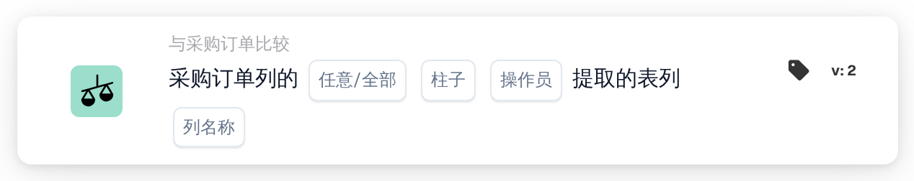
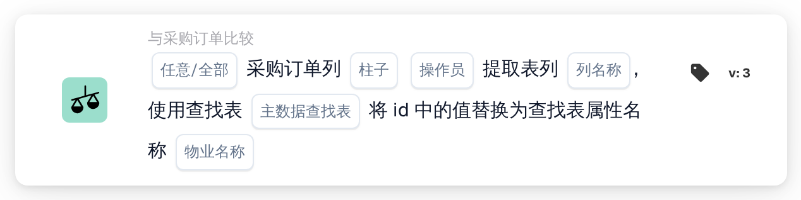

# 采购订单列与提取的表格列

<figure><figcaption>
版本 2
</figcaption></figure>

<figure><figcaption>
版本 3
</figcaption></figure>

## 用途：

此工作流卡片会将匹配的采购订单行中的某一列与文档上提取的行项目表中的某一列进行比较。对于采购订单匹配已与采购订单行配对的每一个文档行，系统会将所选采购订单列中的值与该行所选表格列中的值进行比较。然后，各项结果通过 **任意/全部** 设置合并为卡片的单一结果。

版本 3 还可以在比较之前通过主数据查找表转换采购订单的值。当采购订单和文档对同一事物使用不同代码时（例如不同的单位代码），这一功能很有帮助。

此卡片运行前应先完成采购订单匹配。如果没有匹配的采购订单，卡片会报告缺少数据。

## 卡片组件：

1. **任意/全部**
   * **描述：** 如何将各行的比较结果合并为卡片的结果。
   * **选项：**
     * **任何：** 至少有一个参与比较的行满足条件。
     * **全部：** 每个参与比较的行都满足条件。如果未设置值，卡片会使用 **全部**。
2. **柱子**
   * **描述：** 要比较其值的采购订单行列。
   * **详细信息：** 该值读取自与文档行匹配的采购订单行。
3. **操作员**
   * **描述：** 如何将采购订单的值与文档的值进行比较。采购订单的值位于比较的左侧，因此 **大于** 表示采购订单的值大于文档的值。
   * **选项：**
     * **等于**
     * **不等于**
     * **大于**
     * **大于或等于**
     * **少于**
     * **小于或等于**
4. **列名称**
   * **描述：** 文档上提取的表格中，与采购订单列进行比较的列。
   * **详细信息：** 卡片使用文档的第一个提取表格。
5. **主数据查找表（仅限版本 3）**
   * **描述：** 一个可选的查找表，用于在比较之前转换采购订单的值。
   * **详细信息：** 采购订单的值会转换为大写，然后在查找表属性 **codevalue** 中进行查找。如果找到记录，且该记录具有所选 **物业名称** 的值，则采购订单的值会被替换为该属性经过清理的值。如果未找到记录或值，则使用大写形式的采购订单值。文档的值不会被转换。
6. **物业名称（仅限版本 3）**
   * **描述：** 查找表记录中用于替换采购订单值的属性。
   * **详细信息：** **主数据查找表** 和 **物业名称** 可以同时留空，此时卡片会在不转换的情况下比较两个值。如果只设置了其中一项，卡片会报告缺少数据。

## 功能：

* **条件评估：** 对于每个匹配的采购订单行，卡片会找到与之配对的文档表格行（在版本 3 中可能是多行），并使用所选运算符比较两个值。
  * 如果两个值都是数字，则按数字进行比较。
  * 否则按文本进行比较。使用 **等于** 时，大小写差异不计。在版本 3 中，两个值在比较前都会转换为大写；取自查找表的值则按其在查找表中的存储形式使用。**大于** 和 **小于** 类运算符按普通字符顺序比较文本，因此主要适用于数值列。
* **执行操作：**
  * **条件为真：**\
    使用 **全部** 时，每个参与比较的行都满足运算符；使用 **任何** 时，至少有一行满足。工作流继续。
  * **条件为假：**\
    如果合并后的结果不满足，工作流会因条件未满足而停止。
* **缺少数据：** 在以下情况下，卡片不会评估条件，并会在工作流日志中报告缺少数据：
  * 文档没有匹配的采购订单，或匹配的采购订单的数据不可用，
  * 文档没有提取的表格，
  * 参与比较的某一采购订单行的采购订单列为空（数值 0 也视为空），
  * 参与比较的某一行的表格列为空或不存在，
  * 根本没有可以比较的行，
  * 某个必填输入未设置（在版本 3 中，只设置了两个查找输入中的一项时也属于此情况）。

## 设置和配置：

* 可以在采购订单匹配之后，从 **与采购订单比较** 类别中添加此卡片作为 And 条件，然后选择 **任意/全部**、采购订单的 **柱子**、**操作员** 以及文档表格的 **列名称**。在版本 3 中，如果采购订单使用的代码与文档不同，可以添加 **主数据查找表** 和 **物业名称**。
* 如需检查配置，可以在 Workflow Builder 的卡片菜单中对现有文档使用 **测试卡片**。卡片日志会列出每次比较的两个值及其结果。

## 结论：

“采购订单列与提取的表格列”工作流卡片会逐行将单个行项目列与匹配的采购订单进行核对。它可用于两侧都存在的任意列，版本 3 还涵盖了两侧对同一值使用不同代码的情况。
