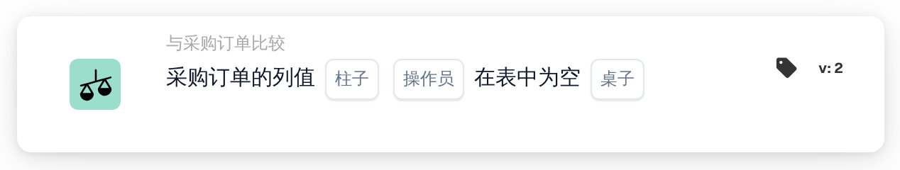

# 采购订单列为空

<figure><figcaption>
版本 2
</figcaption></figure>

## 用途：

此工作流卡片用于检查采购订单数据中的某一列是否为空。它直接查看已存储的采购订单、其订单行或其分配费用，例如可用于暂缓处理那些采购订单缺少后续步骤所依赖信息的文档。

## 卡片组件：

1. **柱子**
   * **描述：** 要检查的采购订单列。
   * **详细信息：** 列表包含采购订单抬头、采购订单行和分配费用中的列，例如 **供应商 ID**、**单价**、**数量** 或 **收费类型**。该列应属于在 **桌子** 中选择的表。
2. **操作员**
   * **描述：** 该列应为空还是不为空。
   * **选项：**
     * **是：** 如果至少有一条被检查的记录中该列为空，则条件满足。
     * **不是：** 如果每条被检查的记录中该列都有值，则条件满足。
3. **桌子**
   * **描述：** 读取该列所在的采购订单表。
   * **选项：**
     * **采购订单：** 采购订单抬头（一条记录）。
     * **采购订单行：** 采购订单的所有行。
     * **采购订单分配费用：** 采购订单的所有分配费用。

## 功能：

* **使用的采购订单：** 如果工作流运行本身带有采购订单，则检查该采购订单。否则，卡片会使用第一个匹配的文档行所对应的采购订单；如果没有任何行被匹配，则使用为该文档加载的第一个采购订单。
* **条件评估：** 卡片读取所选表中属于该采购订单的所有记录，并检查每条记录中的所选列。如果列没有值、为空文本或数值为 0，则视为空。是/否值始终视为已填写，即使其值为“否”。
* **列不在表中：** 如果所选列不存在于所选表中，卡片不会报告错误。使用 **是** 时，条件视为满足；使用 **不是** 时，视为不满足。
* **执行操作：**
  * **条件为真：**\
    使用 **是** 时，至少有一条记录中该列为空；使用 **不是** 时，每条记录中该列都有值。工作流继续。
  * **条件为假：**\
    否则，工作流会因条件未满足而停止。
* **缺少数据：** 当没有可用的采购订单（既不来自工作流运行，也未与文档匹配）、未设置 **柱子** 或 **桌子**，或者该采购订单在所选表中没有任何记录时，卡片不会评估条件，并会在工作流日志中报告缺少数据。

## 设置和配置：

* 可以从 **与采购订单比较** 类别中添加此卡片作为 And 条件，然后选择 **柱子**、运算符和 **桌子**。选择属于所选表的列，可以避免上文所述的无提示结果。
* 可以在 Workflow Builder 的卡片菜单中使用 **测试卡片**，在现有文档上试用此卡片。

## 结论：

“采购订单列为空”工作流卡片检查采购订单数据本身的完整性。当采购订单缺少审批、导出或其他工作流步骤所依赖的值时，它有助于尽早拦截文档。
