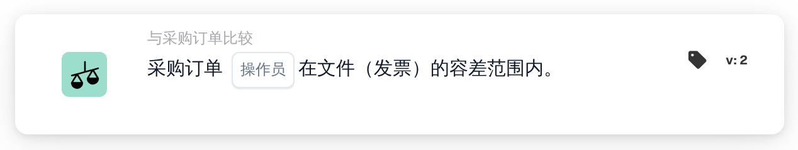

# 采购订单完全匹配

<figure><figcaption>
版本 2
</figcaption></figure>

## 用途：

此工作流卡片会检查匹配的采购订单在整体上是否在容差范围内与文档一致。每个匹配行的数量、单价和附加费用会在一个步骤中完成检查，因此一张卡片即可决定文档能否在无需人工审核的情况下处理。

此卡片运行前应先完成采购订单匹配。如果没有匹配的采购订单，卡片会报告缺少数据。

## 卡片组件：

1. **操作员**
   * **描述：** 采购订单是否应与文档完全匹配。
   * **选项：**
     * **是：** 如果每项检查都在容差范围内，则条件满足。
     * **不是：** 如果至少有一项检查超出容差，则条件满足。

## 功能：

* **条件评估：** 卡片会逐一检查每个匹配的采购订单行（包括子行），并使用采购订单匹配为其存储的比较数据：
  * **数量：** 在该行的数量容差范围内，将文档数量与采购订单数量进行比较。
  * **单价：** 在该行的单价容差范围内，将文档单价与采购订单单价进行比较。如果该行的比较数据中没有单价，只有其一般匹配信息中包含单价，卡片会使用为该文档类型配置的单价容差，而不是该行上存储的容差；此时百分比容差以采购订单价格为基准计算。
  * **附加费用：** 对于该行的每笔附加费用，会分别在各自的容差范围内将费率、单价和金额与采购订单进行比较。
  * 对于不含价格的送货单，只比较数量。
* 所有行的所有检查会合并在一起：只有每一项检查都在容差范围内时，采购订单才算完全匹配。
* **执行操作：**
  * **条件为真：**\
    使用 **是** 时，每项检查都在容差范围内；使用 **不是** 时，至少有一项不在容差范围内。工作流继续。
  * **条件为假：**\
    否则，工作流会因条件未满足而停止。
* **缺少数据：** 当文档没有匹配的采购订单，或某个匹配行缺少检查所需的部分数据时，例如数量、单价、附加费用值或其中某项的容差（包括在需要时，文档类型上的单价容差缺失或不可用），卡片不会评估条件，并会在工作流日志中报告缺少数据。缺失的容差不会被视为容差 0。这同样适用于 **不是**：缺少数据会作为缺少数据报告，而不是作为不匹配。

## 设置和配置：

* 可以在采购订单匹配之后，从 **与采购订单比较** 类别中添加此卡片作为 And 条件，然后选择运算符（**是** 或 **不是**）。容差本身并不在卡片上设置，而是来自采购订单匹配和文档类型设置。
* 可以在 Workflow Builder 的卡片菜单中使用 **测试卡片**，在现有文档上试用此卡片。卡片日志会列出每次数量、单价和费用比较，以及文档和采购订单上的值。

## 结论：

“采购订单完全匹配”工作流卡片将文档的采购订单比较汇总为一个条件。每一行都与采购订单一致的文档可以自动通过，而任何超出容差的差异都会被报告为条件未满足，缺失的比较数据则会被报告为缺少数据，绝不会被视为匹配。
