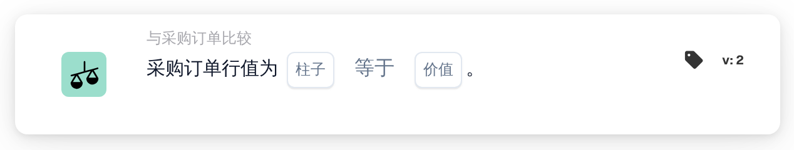

# 采购订单行值

<figure><figcaption>
版本 2
</figcaption></figure>

## 用途：

此工作流卡片会将匹配的采购订单行中的某一列与一个固定值进行比较。它可用于检查订购行中未打印在文档上的属性，例如状态、单位代码或送货方式，并据此处理文档。

此卡片运行前应先完成采购订单匹配。如果没有匹配的采购订单，卡片会报告缺少数据。

## 卡片组件：

1. **柱子**
   * **描述：** 要比较其值的采购订单行列。
2. **操作员**
   * **描述：** 如何将采购订单行的值与卡片上的值进行比较。默认值为 **等于**。
   * **选项：**
     * **等于：** 行值等于该值。对于文本，不区分大小写。
     * **不等于：** 行值与该值不同。对于文本，区分大小写。
     * **大于**、**大于或等于**、**少于**、**小于或等于：** 主要适用于数值列。
     * **包含：** 行值与 **价值** 中的某个条目完全一致，包括大小写。部分匹配不计。
     * **不包含：** 行值与 **价值** 中的任何条目都不一致（以同样的完全一致方式比较）。
3. **价值**
   * **描述：** 与采购订单行值进行比较的值。
   * **详细信息：** 使用 **包含** 和 **不包含** 时，可以输入多个条目，以逗号分隔。使用 **大于** 和 **小于** 类运算符时，不支持值列表。

## 功能：

* **条件评估：** 对于每个匹配的采购订单行（包括子行），卡片读取所选列的值，并使用运算符将其与 **价值** 进行比较。如果两者都是数字，则按数字比较，否则按文本比较。
* 每个参与比较的行都需要满足条件；此卡片没有 **任意/全部** 选项。
* **执行操作：**
  * **条件为真：**\
    如果每个参与比较的行都满足条件，工作流继续。
  * **条件为假：**\
    如果至少有一行不满足条件，工作流会因条件未满足而停止。
* **缺少数据：** 当未设置 **柱子** 或 **价值**、文档没有匹配的采购订单或其数据不可用、某个匹配行的所选列为空（数值 0 也视为空），或者没有任何行可以比较时，卡片不会评估条件，并会在工作流日志中报告缺少数据。
* **设置错误：** 如果 **价值** 中包含逗号，并且选择了 **大于** 或 **小于** 类运算符之一，卡片会以设置错误停止。

## 设置和配置：

* 可以在采购订单匹配之后，从 **与采购订单比较** 类别中添加此卡片作为 And 条件，然后设置采购订单行的 **柱子**、运算符和 **价值**。如需与多个允许的值进行核对，可以使用 **包含** 并输入以逗号分隔的列表。
* 可以在 Workflow Builder 的卡片菜单中使用 **测试卡片**，在现有文档上试用此卡片。卡片日志会列出每个参与比较的行值，以及所使用的运算符和值。

## 结论：

“采购订单行值”工作流卡片以简单条件的形式将采购订单行数据引入工作流。即使相关信息并未出现在文档本身上，工作流也能根据货物的订购方式作出响应。
