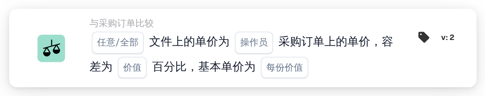

# 按基本单价计算的单价容差

<figure><figcaption>
版本 2
</figcaption></figure>

## 用途：

此工作流卡片会将文档上的单价与匹配的采购订单行上的单价进行比较，并使用随采购订单价格增长的百分比容差。容差以每个基本单价对应的百分比输入，因此价格较高的商品比价格较低的商品获得更大的百分比容差。

如需使用固定容差，可以使用卡片 **任意 / 全部单价为**。

此卡片运行前应先完成采购订单匹配。如果没有匹配的采购订单，卡片会报告缺少数据。

## 卡片组件：

1. **任意/全部**
   * **描述：** 如何将各行的比较结果合并为卡片的结果。
   * **选项：**
     * **任何：** 至少有一行满足比较条件。
     * **全部：** 每个参与比较的行都满足比较条件。如果未设置值，卡片会使用 **全部**。
2. **操作员**
   * **描述：** 在考虑容差的情况下，如何将文档单价与采购订单单价进行比较。
   * **选项：**
     * **等于：** 文档价格在采购订单价格上下的容差范围内。
     * **不等于：** 文档价格在容差范围之外。
     * **大于：** 文档价格高于容差范围。
     * **大于或等于：** 文档价格在容差范围内或高于容差范围。
     * **少于：** 文档价格低于容差范围。
     * **小于或等于：** 文档价格在容差范围内或低于容差范围。
3. **价值**
   * **描述：** 在基本单价下适用的容差百分比。
   * **详细信息：** 一个数字，例如 `1` 表示 1%。
4. **每份价值**
   * **描述：** 容差百分比所对应的基本单价。
   * **详细信息：** 一个大于 0 的数字，例如 `100`。

## 功能：

* **容差计算：** 对于每一行，容差百分比会按采购订单单价与基本单价之比进行缩放：\
  容差 % = **价值** × （采购订单单价 ÷ **每份价值**）\
  容差范围为采购订单单价加上和减去该百分比。\
  以 **价值** 为 1、**每份价值** 为 100 为例：采购订单价格为 50 时，容差为 0.5 %，因此范围为 49.75 至 50.25。采购订单价格为 200 时，容差为 2 %，因此范围为 196 至 204。
* **条件评估：** 对于每个匹配的采购订单行，系统会使用运算符和计算出的范围，将文档单价与该采购订单行的单价进行比较。没有采购订单行的匹配条目会被跳过。结果通过 **任意/全部** 合并。
* **执行操作：**
  * **条件为真：**\
    如果合并后的结果满足条件，工作流继续。
  * **条件为假：**\
    如果合并后的结果不满足条件，工作流会因条件未满足而停止。没有任何行可以比较时也是如此。
* **缺少数据：** 当未设置 **价值** 或 **每份价值**、文档没有匹配的采购订单，或者文档或采购订单缺少某个参与比较行的单价时（单价为空或数值为 0 均视为缺失），卡片不会评估条件，并会在工作流日志中报告缺少数据。
* **错误：** 当 **价值** 或 **每份价值** 不是数字、某个单价无法读取为数字、**每份价值** 为 0，或者某一行计算出的容差低于 0 % 或高于 100 % 时，卡片会以错误停止。

## 设置和配置：

* 可以在采购订单匹配之后，从 **与采购订单比较** 类别中添加此卡片作为 And 条件，然后输入 **任意/全部**、运算符、**价值** 中的容差百分比以及 **每份价值** 中的基本单价。基本单价的选择应确保在商品的价格范围内，计算出的容差保持在 0 % 到 100 % 之间。
* 可以在 Workflow Builder 的卡片菜单中使用 **测试卡片**，在现有文档上试用此卡片。卡片日志会显示每一行的两个价格、计算出的容差百分比以及由此得出的范围。

## 结论：

“按基本单价计算的单价容差”工作流卡片在与采购订单进行单价比较时应用随价格变化的容差。这样，一张卡片即可对低价商品使用较严格的容差，对高价商品使用较宽松的容差。
