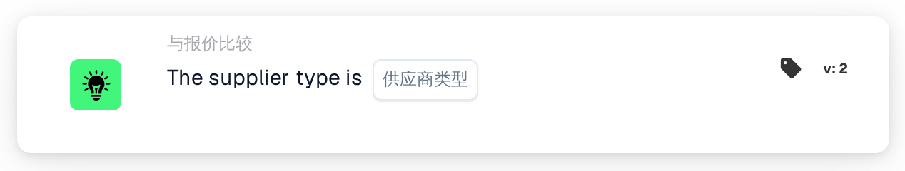

# 供应商类型

<figure><figcaption>
版本 2
</figcaption></figure>

## 用途：

此工作流卡片用于检查文档的供应商商品价格数据中商品的供应商类型，例如这些商品是合同商品还是托管商品。它可用于根据供应商商品的管理方式应用不同的审批规则。工作流会根据结果沿着真条件或假条件继续。

## 卡片组件：

1. **供应商类型**
   * **描述：** 用于核对文档的供应商类型。
   * **选项：**
     * **Contract：** 匹配管理类别为 "contract" 的条目。
     * **Managed：** 匹配管理类别为 "managed" 的条目。
     * **NonManaged：** 匹配管理类别为 "unmanaged" 的条目。

## 功能：

* **条件评估：** 卡片读取文档的供应商商品价格数据中每个条目的供应商类型（管理类别），并将其与卡片上所选的供应商类型进行比较。比较不区分大小写。
* **执行操作：**
  * **条件为真：**\
    供应商商品价格数据中的每个条目都具有所选的供应商类型。工作流沿着真条件继续，例如应用该供应商类型的规则。
  * **条件为假：**\
    如果至少有一个条目的供应商类型不同或没有管理类别，工作流沿着假条件继续。
* **缺少数据：** 如果卡片上未选择任何供应商类型，或文档没有供应商商品价格数据，卡片不会评估条件，并会在工作流日志中报告缺少的数据。

## 设置和配置：

* 可以从 **与报价比较** 类别中添加此卡片，然后在 **供应商类型** 字段中选择供应商类型。最后设置继续条件（真或假），以决定工作流的下一步。

## 结论：

“供应商类型”工作流卡片让报价工作流可以根据商品的供应商类型进行分支，从而使合同商品、托管商品和非托管商品各自按照相应的规则处理。
