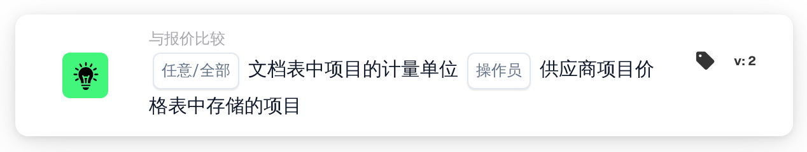
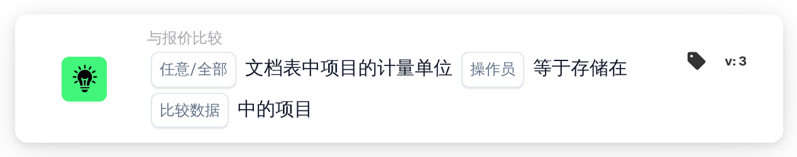

# 计量单位

<figure><figcaption>
版本 2
</figcaption></figure>

<figure><figcaption>
版本 3
</figcaption></figure>

## 用途：

此工作流卡片会将文档表格中商品的计量单位与其他位置为同一商品存储的计量单位进行比较。在版本 2 中，始终与供应商商品价格表进行比较。版本 3 增加了一个选项，可以在供应商商品价格表和匹配的采购订单的行项目之间进行选择。此卡片可用于发现商品的报价或开票单位与预期不同的行。工作流会根据结果沿着真条件或假条件继续。

## 卡片组件：

1. **任意/全部**
   * **描述：** 定义文档表格中应有一个还是每一个参与比较的行都满足条件。
   * **选项：**
     * **任何：** 如果至少有一个参与比较的行满足条件，则条件为真。
     * **全部：** 只有每个参与比较的行都满足条件时，条件才为真。
2. **操作员**
   * **描述：** 定义计量单位应相同还是不同。
   * **选项：**
     * **等于：** 文档行上的计量单位与存储的计量单位相同。
     * **不等于：** 文档行上的计量单位与存储的计量单位不同。
3. **比较数据**（仅限版本 3）
   * **描述：** 与文档计量单位进行比较的来源。
   * **选项：**
     * **供应商产品报价：** 供应商商品价格表中为该供应商商品存储的计量单位，与版本 2 相同。
     * **采购订单行项目：** 匹配的采购订单行的计量单位。

## 功能：

* **条件评估：** 卡片读取第一个文档表格中各行的计量单位（列 `UNIT`），并将其与所选来源进行比较。比较不区分大小写。随后，所有参与比较的行的结果通过 **任何** 或 **全部** 合并。
  * **供应商产品报价：** 只比较与匹配的报价数据中某个条目关联的行。对于每一个这样的行，使用为其供应商商品存储的计量单位。
  * **采购订单行项目**（版本 3）：只比较与采购订单行匹配的行。采购订单行的计量单位会先通过计量单位查找表进行转换（从 EDI 单位转换为 M3 单位）。在两侧，有几种写法会被视为相同："each" 视为 "ea"，"lbs" 和 "lbp" 视为 "lb"。
* **跳过的行：** 如果来源中没有某行的计量单位，则该行不参与比较。每个被跳过的行都会记录在工作流日志中。
* **执行操作：**
  * **条件为真：**\
    对于任何或全部参与比较的行，计量单位满足所选运算符。工作流沿着真条件继续。
  * **条件为假：**\
    如果条件不满足，工作流沿着假条件继续，例如将文档送交人工审核。如果没有任何行能与所选来源关联，或者在版本 3 中未选择任何 **比较数据** 选项（此时不会比较任何行），也会使用假条件。
* **缺少数据：** 在以下情况下，卡片不会评估条件，并会在工作流日志中报告缺少的数据：
  * 文档没有表格，
  * 使用 **供应商产品报价**（或版本 2），而文档没有匹配的报价数据或没有供应商商品价格数据，
  * 选择了 **采购订单行项目**，而文档没有匹配的采购订单，
  * 某个参与比较的行在文档上的计量单位为空，
  * 由于每一行都被跳过，没有任何行可以比较。

  如果未设置 **任意/全部** 选项，卡片会在日志中注明并使用 **全部**。
* **错误：** 使用 **采购订单行项目** 时，如果某个采购订单行被拆分为带有不同计量单位的子行，卡片会以错误结束。

## 设置和配置：

* 可以从 **与报价比较** 类别中添加此卡片，然后选择 **任何** 或 **全部** 以及运算符。在版本 3 中，还可以在 **比较数据** 字段中选择要比较的来源。最后设置继续条件（真或假），以决定工作流的下一步。
* 文档表格应包含 `UNIT` 列。如需与采购订单行项目进行比较，计量单位查找表应包含文档所用单位与采购订单所用单位之间的映射。

## 结论：

“计量单位”工作流卡片可确保商品以预期的单位报价或开票。没有存储计量单位的行会被跳过，而不会被计为差异；版本 3 还将检查范围从供应商商品价格表扩展到采购订单行。
