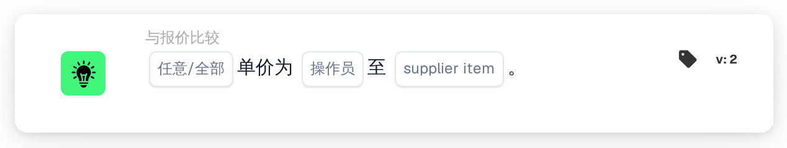

# 单价与供应商商品价格

<figure><figcaption>
版本 2
</figcaption></figure>

## 用途：

此工作流卡片会将文档每一行上的单价与供应商商品价格表中的某个价格进行比较，该价格可以是同一供应商商品的管理价格或最近一次支付的价格。它可用于在批准文档之前，检查报价是否与已知价格一致、高于已知价格或低于已知价格。工作流会根据结果沿着真条件或假条件继续。

## 卡片组件：

1. **任意/全部**
   * **描述：** 定义文档表格中应有一个还是每一个参与比较的行都满足条件。
   * **选项：**
     * **任何：** 如果至少有一个参与比较的行满足条件，则条件为真。
     * **全部：** 只有每个参与比较的行都满足条件时，条件才为真。
2. **操作员**
   * **描述：** 定义如何将文档上的单价与所选的供应商商品价格进行比较。
   * **选项：**
     * **等于：** 单价与供应商商品价格相同。
     * **不等于：** 单价与供应商商品价格不同。
     * **大于：** 单价高于供应商商品价格。
     * **大于或等于：** 单价高于或等于供应商商品价格。
     * **少于：** 单价低于供应商商品价格。
     * **小于或等于：** 单价低于或等于供应商商品价格。
3. **supplier item**
   * **描述：** 供应商商品价格表中与单价进行比较的价格。
   * **选项：**
     * **ManagedPrice：** 为该供应商商品存储的管理价格。
     * **LastPrice：** 该供应商商品最近一次支付的价格。

## 功能：

* **条件评估：** 对于文档表格中的每一行，卡片会在供应商商品价格表中查找该行的供应商商品 ID（列 `SUPPLIER_ITEM_NUMBER`），并将该行的单价（列 `UNIT_PRICE`）与所选价格进行比较。两个价格均按数字比较。随后，所有参与比较的行的结果通过 **任何** 或 **全部** 合并。
* **跳过的行：** 如果某行的单价为空或无法读取为数字，或者其供应商商品没有存储所选类型的价格（例如因为该供应商商品不在供应商商品价格表中），则该行不参与比较。每个被跳过的行都会连同缺少价格的一方一起记录在工作流日志中。
* **执行操作：**
  * **条件为真：**\
    对于任何或全部参与比较的行，单价满足所选运算符。工作流沿着真条件继续，例如批准文档。
  * **条件为假：**\
    如果条件不满足，工作流沿着假条件继续，例如将文档送交价格审核。
* **缺少数据：** 在以下情况下，卡片不会评估条件，并会在工作流日志中报告缺少的数据：
  * 卡片上未选择任何供应商商品价格，
  * 文档没有匹配的报价数据，
  * 文档没有表格、有多个表格，或无法从表格中读取任何行，
  * 由于每一行都被跳过，没有任何行可以比较。

  如果未设置 **任意/全部** 选项，卡片会在日志中注明并使用 **全部**。
* **错误：** 如果表格中的某一行没有 `SUPPLIER_ITEM_NUMBER` 列或 `UNIT_PRICE` 列，卡片会以错误结束。

## 设置和配置：

* 可以从 **与报价比较** 类别中添加此卡片，然后选择 **任何** 或 **全部**、运算符，并在 **supplier item** 字段中选择要比较的价格。最后设置继续条件（真或假），以决定工作流的下一步。
* 此卡片适用于恰好有一个表格且表格行包含供应商商品 ID 和单价的文档。

## 结论：

“单价与供应商商品价格”工作流卡片会将报价与管理价格或最近一次支付的价格进行核对。任一方没有价格的行都会被跳过，因此单个不完整的行不会决定结果；而没有任何可比较行的文档会被报告为缺少数据。
