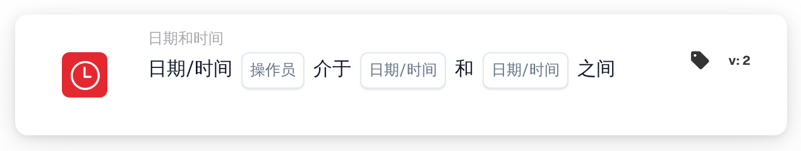

# 日期或时间

<figure><figcaption>
版本 2
</figcaption></figure>

## 用途：

此工作流卡片检查当前日期和时间是否位于卡片上设置的时间窗口之内或之外。它可用于将步骤限制在特定时段，例如工作时间或计划的维护窗口。

## 卡片组件：

1. **运算符**
   * **选项：**
     * **是：** 当前日期和时间位于时间窗口之内。
     * **不是：** 当前日期和时间位于时间窗口之外。
2. **第一个日期/时间**
   * **描述：** 时间窗口的一端，可以是日期和时间，也可以只是时间。
3. **第二个日期/时间**
   * **描述：** 时间窗口的另一端。

## 功能：

* **条件评估：** 当工作流到达此卡片时，卡片获取 UTC 当前日期和时间，并检查其是否位于卡片上的两个值之间。较早的值用作开始，因此两个字段的顺序无关紧要。
  * 只有时间的值（例如 `09:00`）会与今天的日期一起使用，因此时间窗口每天重复。
  * 开始和结束都属于时间窗口：恰好在开始或结束时间时，**是** 为真。
  * 跨午夜的时间窗口可以只用时间输入，例如 `22:00` 到 `04:00`。此时卡片每天检查 22:00 至 04:00 之间的时间，包括确切的开始和结束时间。
  * 如果使用两个不同日期的完整日期（例如 `2026-11-01 22:00` 到 `2026-11-02 04:00`），卡片检查从第一个时间点到第二个时间点的整个时间段，包括开始和结束。
* **执行操作：**
  * **条件为真：**\
    如果条件满足，工作流将继续执行后续卡片。
  * **条件为假：**\
    如果条件不满足，工作流将以条件未满足而停止。
* **缺少数据：** 如果卡片上缺少两个值中的任意一个，卡片不会评估条件，并会在工作流日志中报告缺少输入。

## 设置和配置：

* 可以从 **日期和时间** 类别中添加此卡片作为 And 条件，然后设置两个值和运算符。所有时间都应以 UTC 输入。
* **示例：** 使用 **是**、`09:00` 和 `17:00` 时，只要工作流在任意一天的 UTC 09:00 至 17:00 之间运行，卡片即满足条件。

## 结论：

“日期或时间”工作流卡片将运行时间变为工作流条件。无需每次修改工作流，即可将步骤限制在固定时段或某个计划的时间窗口内。
