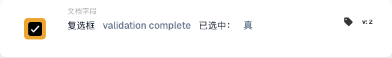

# 复选框已选中

## 何时以及在哪里使用此卡片

当后续操作取决于文档中的复选框状态时，使用此条件。例如，只有在审核完成标记被勾选后，才允许发票继续处理。

在工作流编辑器中，通过 **和… → 文档字段** 添加此卡片。卡片在工作流运行时比较字段值，不会持续监控 ERP 字段，也不会修改复选框。

## 前提条件

文档类型必须包含用于此复选框的布尔字段。请使用准确的技术字段标识符。本例使用 `validation_complete`；请替换为您所在组织中对应的字段。

## 配置卡片

1. 在 **文档字段** 中选择 **复选框 … 已选中**。
2. 在 **字段名称** 中输入 `validation_complete` 并确认。
3. 将 **布尔值** 设为 **真**，要求复选框已勾选。选择 **假** 则检查复选框是否未勾选。

## 实际示例：审核后继续处理

**何时使用：** 发票需要先经过审核，前置流程将审核完成状态记录到 `validation_complete`。

**放置位置：** 将卡片放在 **和…** 的条件中，位于 **然后…** 中配置的后续操作之前。后续操作和启动工作流的事件需要分别配置。

**示例配置：** 字段为 `validation_complete`，比较值为 **真**（`true`），卡片版本为 2。

<figure><figcaption>
版本 2 示例：将 validation complete 与真进行比较。
</figcaption></figure>

此配置的预期结果如下：

| 文档中的字段值 | 条件结果 |
| --- | --- |
| 字段存在且复选框已勾选（`true`） | 条件满足。 |
| 字段存在且复选框未勾选（`false`） | 条件不满足。 |
| 字段存在，但值为空（`None`） | 视为未勾选，条件不满足。 |
| 文档中不存在此字段 | 返回 `NOT_FOUND_IN_DOCUMENT`；这与字段存在但未勾选的情况不同。 |

如果选择 **假**，字段存在且未勾选时条件满足，已勾选时条件不满足。字段缺失仍会返回单独的错误结果。

## 启用前检查

确认所选字段为布尔类型，并且属于当前使用的文档类型。分别使用已勾选、未勾选以及缺少该字段的文档进行测试。每次都检查卡片结果和工作流的后续路径。

此卡片检查复选框状态；前置流程应设置审核完成标记。未经审核就自动勾选该标记，并不能证明审核已完成。
