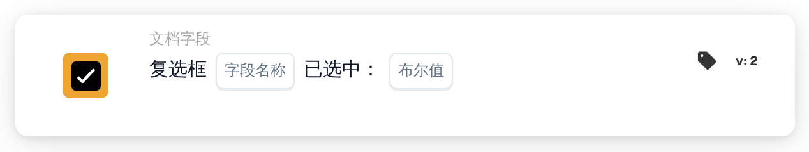

# 复选框已选中

<figure><figcaption>
版本 2
</figcaption></figure>

## 用途：

此工作流卡片用于检查文档上的某个复选框字段是已选中还是未选中。例如，可以用它让工作流仅在文档上设置了某个标记（例如审核标记）之后才继续执行。

## 卡片组件：

1. **字段名称**
   * **描述：** 文档上复选框字段的技术名称。
   * **详细信息：** 该字段应为文档类型中的复选框（布尔）字段。
2. **布尔值**
   * **描述：** 复选框应处于的状态。
   * **选项：**
     * **真：** 复选框应为已选中。
     * **假：** 复选框应为未选中。

## 功能：

* **条件评估：** 当工作流到达此卡片时，卡片读取文档上该字段的当前值，并将其与 **布尔值** 进行比较。卡片不会持续监视该字段，也不会修改它。
  * 空的复选框值视为未选中。
  * 如果未选择 **布尔值**，卡片将检查复选框是否为未选中。
  * 如果该字段不是复选框字段，卡片会在工作流日志中注明这一点，但仍会比较其值。
* **执行操作：**
  * **条件为真：**\
    如果复选框状态与 **布尔值** 一致，工作流将继续执行后续卡片。
  * **条件为假：**\
    如果不一致，工作流将以条件未满足而停止。
* **缺少数据：** 如果文档上不存在该字段，卡片不会评估条件。它会报告在文档上未找到该字段，这与复选框未选中是不同的结果。

## 设置和配置：

* 可以从 **文档字段** 类别中添加此卡片作为 And 条件，然后在 **字段名称** 中输入复选框字段的技术名称，并选择 **真** 或 **假**。
* 可以在 Workflow Builder 的卡片菜单中使用 **测试卡片**，分别在复选框已选中的文档、复选框未选中的文档以及没有该字段的文档上检查配置。

## 结论：

“复选框已选中”工作流卡片将文档上的复选框变为工作流条件。这样，工作流可以先等待某个手动步骤（例如审核完成），再执行后续操作。
