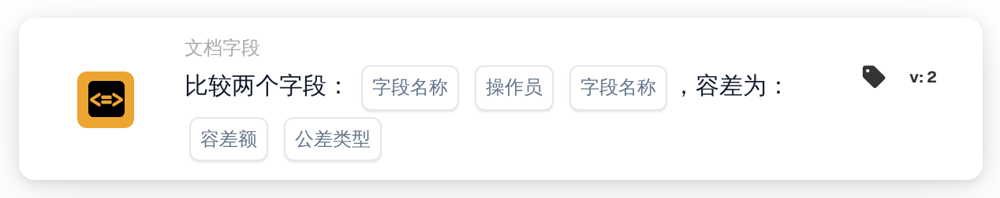

# 使用容差比较两个字段

<figure><figcaption>
版本 2
</figcaption></figure>

## **用途：**

此工作流卡片旨在通过比较两个指定文档字段的值来自动执行操作，并支持应用容差值。借助此功能，系统在比较字段值时可以考虑误差范围（容差），从而在工作流中实现更灵活的决策。

## **卡片组件：**

1. **字段名称 (1)**
   * **说明：**指定要比较的第一个文档字段。
   * **详情：**此名称必须与文档中第一个字段的准确标识符一致。
2. **运算符**
   * **说明：**定义两个字段之间要执行的比较类型。
   * **选项：**
     * **等于 (=)：**检查两个字段的值是否相等。
     * **不等于 (≠)：**确保两个字段的值不同。
     * **大于 (>)：**确认第一个字段的值是否大于第二个字段的值。
     * **大于或等于 (≥)：**验证第一个字段的值是否等于或大于第二个字段的值。
     * **小于 (<)：**检查第一个字段的值是否小于第二个字段的值。
     * **小于或等于 (≤)：**确保第一个字段的值小于或等于第二个字段的值。
3. **字段名称 (2)**
   * **说明：**指定要与第一个字段比较的第二个文档字段。
   * **详情：**此名称应与文档中第二个字段的准确标识符一致。
4. **容差值**
   * **说明：**定义比较时可接受的误差范围。
   * **详情：**容差值是一个数值，表示要使比较结果为真，两个字段值之间允许的最大差值。
5. **容差类型**
   * **说明：**指定容差值的计量单位。
   * **选项：**
     * **数值：**容差为绝对值，表示两个字段的差值可以达到指定的容差值。
     * **百分比：**容差按第二个字段值的百分比计算，从而提供相对误差范围。

## **功能：**

* **条件评估：**系统会评估两个指定字段中的值是否满足比较条件，并将设定的容差纳入考虑。如果两个字段之间的绝对差值或相对差值在容差范围内，则条件视为真。
* **执行操作：**
  * **条件为真：**\
    如果考虑容差后，两个字段的值符合比较条件，系统就会触发关联操作。这些操作可以包括推进工作流、更新记录、触发提醒或启用特定操作。
  * **条件为假：**\
    如果考虑容差后，两个字段的值不符合指定条件，则系统可能会执行其他操作，也可能不执行任何操作，具体取决于工作流的配置。

## **设置与配置：**

* 用户可从系统的可用字段列表中选择要比较的两个字段，以配置此卡片。运算符从可用比较选项的下拉列表中选择。用户输入容差值，并选择容差类型（数值或百分比）。

## **结论：**

“使用容差比较两个字段”工作流卡片是一款强大的工具，可在考虑数据允许偏差的同时比较文档字段。通过在字段比较中应用容差，此卡片提升了工作流的灵活性，使其能够处理真实场景中的数据差异。它有助于改进决策、支持数据验证，并增强整体工作流自动化。

<!-- workflow-card-practical-example-20261021 -->

## 实际例子

**何时使用：** 接受提取的金额和单独计算的金额之间的微小差异。

**配置：**选择数字字段`net_total`和`calculated_total`，相等比较和`5`的绝对容差。使用值 `103` 和 `100`。

**预期结果及反例：** 差异为`3`，因此在公差范围内。对于`110`和`100`，差值是`10`，且公差相等条件不成立。

这是说明性配置和预期结果。使用测试组织中配置的字段、用户和组；这并不是说这个例子已经被执行了。
